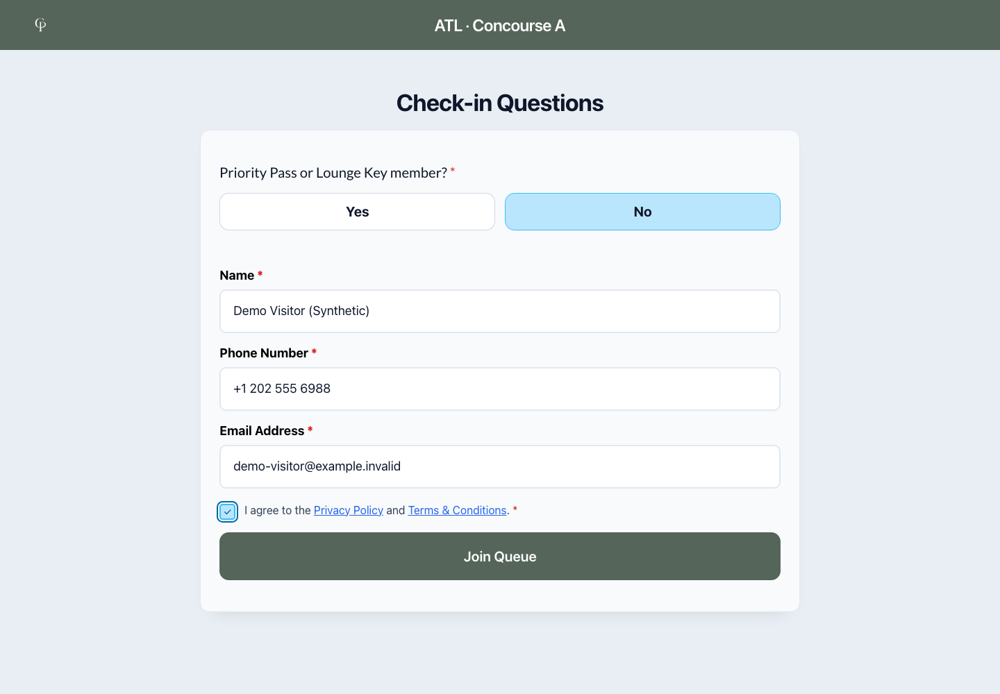
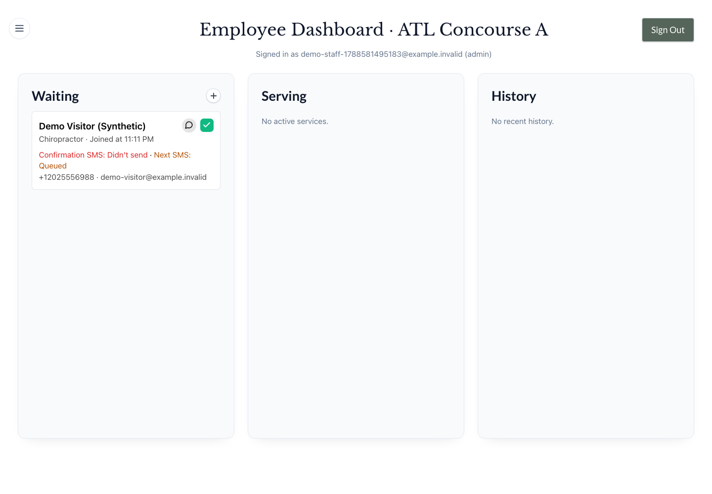

# Chiroport

Chiroport manages walk-in chiropractic and bodywork visits at airport locations. Travelers choose a service, provide contact details and consent, and join a location's queue. Staff see the line, start and complete visits, handle messages, and review operational analytics.

The engineering problem is keeping that shared queue understandable and correct when staff act concurrently, browsers reconnect, and SMS delivery fails independently of the database.

## Product walkthrough

These are real application captures from an isolated local environment. **All people, visits, messages, and analytics shown are synthetic.** No SMS was delivered to a phone.





1. Choose a service and submit contact details and consent through public intake.
2. Sign in as staff and see the new visit in the location queue.
3. Start service, then complete the visit through the staff controls.
4. Inspect [completed history](docs/images/synthetic-history.png) and [synthetic analytics](docs/images/synthetic-analytics.png).

[Watch the automated browser recording](docs/images/synthetic-walkthrough.webm) · [Run the same regression](tests/e2e/product-journey.spec.ts)

## My contribution

I’m Zack Sikkink. My work spans the public intake, staff workflows, SQL queue commands, messaging integration, analytics, and their tests. Inspectable examples in Git are the idempotent join (`2ffa4e8`), admin analytics endpoint/UI (`dcad8e1`), and queue/analytics hardening (`91775f4`). These establish implementation contributions, not sole ownership of product decisions or the managed infrastructure.

Supabase supplies Postgres, Auth, Realtime and Edge hosting; Twilio supplies SMS transport; Next.js/React supply the web framework. The application-specific contribution is how those boundaries enforce and communicate the product's rules.

## Three engineering highlights

### Queue correctness

Competing staff commands must not duplicate transitions or notifications. A database command locks the visit and commits its state, event, and outbox work together. The UI uses authoritative ordering and isolates each selected location's asynchronous work.

The tradeoff is intentional database ownership of business rules, with focused browser reconciliation rather than a second client-side queue model. [A coordinated two-writer test](tests/queue_concurrency.test.ts) observes both writers blocked in Postgres before releasing them: one serving transition succeeds, the other is rejected, and one serving event and notification row remain. [Location-switch regressions](tests/e2e/location-context.spec.ts) exercise delayed actions and Realtime responses.

### Durable messaging, honest failures

SMS work is committed before delivery. Claims are leased; persistence checks the current attempt and affected row. Claims expired before provider I/O are rejected; superseded attempts and deleted rows cannot be reported as successfully persisted. Signed STOP/START callbacks reconcile the latest durably recorded preference, so an older retry cannot undo newer recorded intent.

The tradeoff: provider acceptance and database persistence cannot be one transaction. A timeout or lost persistence acknowledgement can remain ambiguous; this is **not exactly-once delivery**. [Real-adapter experiments](tests/sms_outbox_adapter.test.ts) use local Postgres and a fake provider to verify ownership and accepted-but-not-persisted outcomes. [Preference ordering tests](tests/sms_preference_ordering.test.ts) exercise the actual signed handler and database resolver. Neither proves live carrier delivery.

### Trustworthy history and recovery

Consent/contact snapshots survive operational visit cleanup. Rollups need numerical evidence, not just a successful job status: a two-day fixture conserves **10 arrivals, 8 served visits, and 6 completions** across the monthly-rollup function, replay, and rebuild. It also exposed a monthly rate calculation error: **−3.75 became the correct 0.375** for three over-threshold waits among eight served visits.

The tradeoff is retaining historical records and explicit unknowns instead of manufacturing values after source data expires. [The SQL fixture](tests/fixtures/rollup-conservation.sql) runs both normally and inside [a synthetic restore drill](scripts/test-local-recovery.cjs), which also checks restored authentication, queue operations, legal snapshots, and permissions. This is local recovery evidence, not proof of production disaster recovery or an agreed recovery SLA.

These numerical results are scoped to synthetic local verification on September 4, 2026 (America/Chicago), not traffic, business impact, throughput, or uptime claims. [Engineering walkthrough and evidence](docs/engineering-walkthrough.md) · [Authoritative system rules](docs/system-architecture.md)

## Safe local quick start

Prerequisites: Node **22.x** (verified 22.22.0), npm (10.9.4), Deno **2.7.7**, Supabase CLI **2.67.1**, running local Docker, and PostgreSQL client tools (`psql`, `pg_dump`, `pg_restore`; verified **18.2** against the local **17.6** database). The recipe uses macOS/Linux Unix process and Docker socket behavior; native Windows needs separate validation. Internet access is needed to download locked packages, Chromium, and Docker images. Ports 3000 and 54321–54324 must be free. Do not stop another project's services to free them without checking ownership.

Select Node 22 in each terminal (`nvm use` from the checkout if using nvm), then verify without a production environment file:

```bash
node scripts/local-verify.cjs
```

The runner copies source into a private temporary directory, installs locked dependencies and Chromium, rehearses the recorded migration upgrade, then creates a fresh database and runs the full checks. Required database/browser cases must pass without skips. It starts the actual Next/Edge application with local credentials and no provider configuration, then removes only its disposable volumes. Your checkout and existing database volumes are not reset. Retain the printed private evidence path.

For an editable, persistent synthetic workspace:

```bash
node scripts/local-dev.cjs create
cd "<the printed Editable source path>"
node scripts/local-dev.cjs start
```

From that printed workspace, use two terminals with Node 22 selected:

```bash
node scripts/local-dev.cjs edge
node scripts/local-dev.cjs web
```

Open [the local app](http://127.0.0.1:3000). Employee login: `demo-staff@example.invalid` / `Synthetic-Only-2468!`. Use synthetic contacts only. Source edits in the printed workspace hot reload. `create` excludes private configuration and Git state; `start` installs locked dependencies, creates only its unique local Supabase project, disables its cron jobs and seeds this synthetic admin once. Generated environment files and service logs are private; no production or Twilio credentials are needed.

Ctrl-C in both service terminals, then run `node scripts/local-dev.cjs stop` in the workspace. Ordinary `start` resumes its saved synthetic database and does not repeat the seed. For fresh data, stop this workspace and run `create` from the original checkout to get another unique workspace. Never use `db:reset` or `--no-backup` for an ordinary restart. Review and port only intended source edits back to your working checkout; keep generated environment files, the local project ID and ownership manifest private. [Development commands and safety boundaries](docs/system-architecture.md#verification-and-local-development) explain the recipe and checks.

`node scripts/local-verify.cjs --demo` remains the disposable **production-build demonstration**; Ctrl-C removes its owned volumes. It does not hot reload. `--capture-demo` deliberately updates repository images/recording and is not an onboarding command. Neither an agent's rehearsal nor a green runner establishes the successor's clean-machine independence.

## Operational handoff

[Current handoff plan and acceptance gates](docs/handoff/HANDOFF_PLAN.md) records current preparation, access, owner actions and readiness. Read [system rules](docs/system-architecture.md), then [operations and maintenance](docs/operations-runbook.md) for incidents, ownership, release sequencing, backups and recovery. The [October 13 audit](docs/handoff/HANDOFF_AUDIT.md) and [October 9 hardening report](docs/audits/chiroport-production-hardening-2026-10-09.md) are dated evidence. Repository safeguards do not establish hosted monitoring, backups or deployment readiness.

## Scope and limitations

This repository uses Next.js, React, TypeScript, Tailwind, Supabase and Twilio. Configured location counts do not establish an active business footprint. Employee access is currently chain-wide, not tenant isolation.

Local checks do not establish which web/Edge artifacts, grants, monitoring, or backups are active in production. The health endpoint is liveness/configuration only. Real Twilio configuration/delivery, historical aggregate correction where daily inputs have expired, notification-age policy, cross-visit contact semantics, and production recovery objectives require separate decisions or evidence. Relative analytics presets currently use the browser calendar, which can omit a newer location-local day across timezones; the browser regression explicitly selects the visit’s location-local day. Existing September screenshots precede the current analytics controls.

The project releases directly to `main`; it does not require PRs. A push or deployment is a separate checkpoint: reconcile deployed artifacts and migration history, select the intended source changes, confirm compatible release/recovery artifacts, and review publication exposure first. No hosted publication, credential rotation, or deployment is performed by the local demo.
