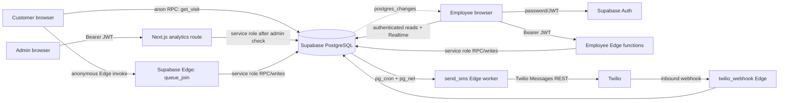
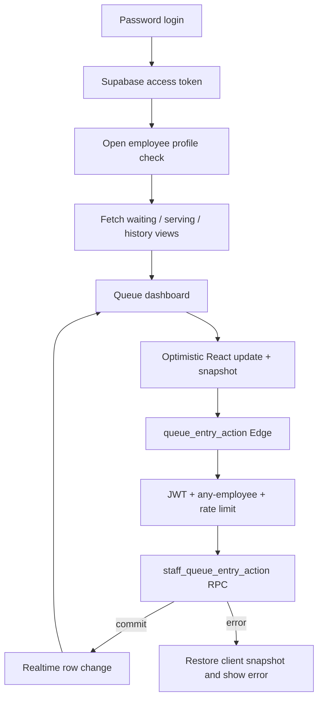
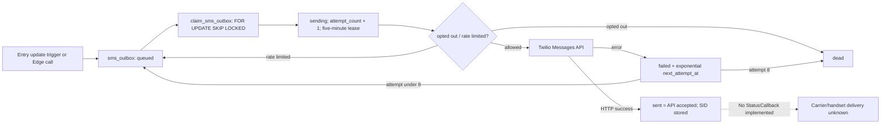
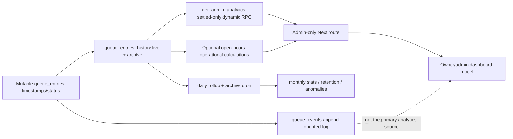
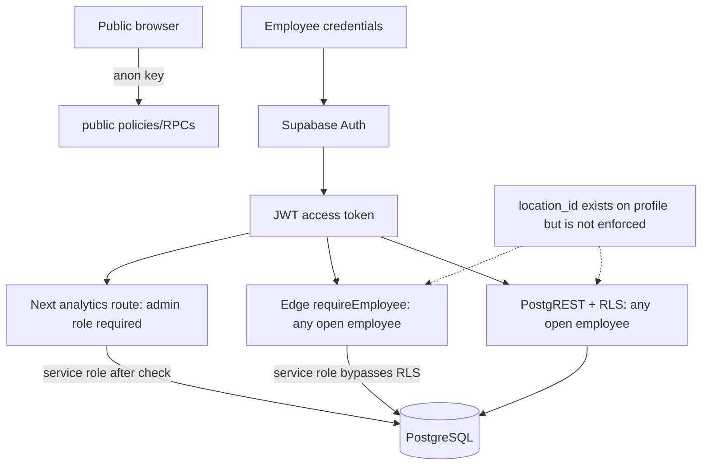
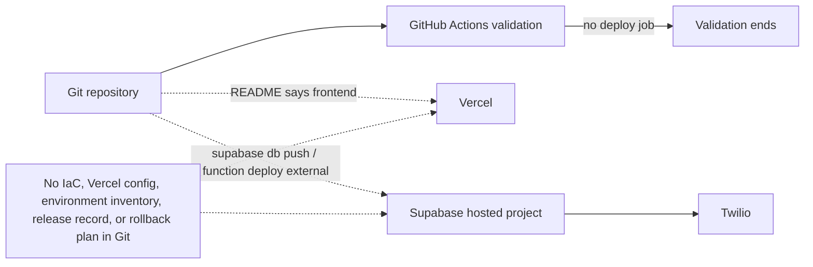
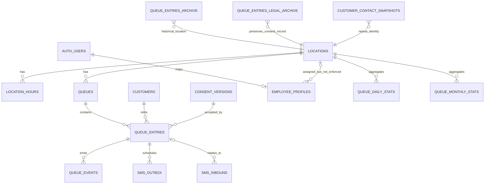

# The Chiroport — interview source of truth

> Evidence-first technical and operational audit. Generated 2026-07-31. This document describes the repository at one immutable Git revision; it does not certify production state or business facts that live outside Git.

## Audit identity and verification record

| Item | Recorded value |
|---|---|
| Repository | `chiroport` |
| Branch | `main` |
| Commit | `0eb86393c1768ac53b19c80b3b4f28e9b60dd803` (`Update MSP massage lounge locations`) |
| Commit date | 2026-05-06 15:02:10 -0400 |
| Generation date | 2026-07-31 16:32:21 CDT (-0500) |
| Working tree before audit | `## main...origin/main`; pre-existing untracked `chiroport-project-context-source.md` only |
| Runtime | Node.js `v22.22.0`; npm `10.9.4`; pnpm `10.14.0`; Yarn `1.22.22`; Git `2.50.1 (Apple Git-155)`; Supabase CLI `2.67.1` |
| Package manager | npm, established by `package-lock.json` and CI's `npm ci` |
| Application versions | Next.js `16.1.6`, React `19`, TypeScript `5`, Supabase JS `2.89`, Jest `29.7`, Playwright `1.55` |

No environment-file values, customer rows, production logs, invoices, hosting dashboards, or live usage data were read. No Twilio request, paid API call, production mutation, database smoke test, or destructive queue command was executed.

### Verification commands and results

| Command | Result | Interpretation |
|---|---|---|
| `npm run type-check` | PASS | `tsc --noEmit` completed with exit 0. |
| `npm run lint` | PASS | `eslint .` completed with exit 0. |
| Explicit six-file Jest run | PASS | 6 suites, 24 tests, 0 snapshots. Database-gated suites were deliberately excluded. |
| `npm run build` with inert shell-provided placeholders | PASS | Next 16.1.6 production build compiled, type-checked, and generated 21 pages, including nine location paths. It made no live service call. |
| `npm run check:env` with inert placeholders | PASS | Required variable names are internally consistent when all are supplied. |
| `npm run queue:clear:smoke` | PASS | Guards reject `--all` without confirmation and production-wide clearing without `--force-prod`. No rows were touched. |
| `npx playwright test --list` | PASS | Found one API-level `queue-smoke` test; it was not run because its configured target was not proven local. |
| `supabase status` | BLOCKED | Local Docker daemon was unavailable, so migrations/RLS were not executed against a local PostgreSQL instance. CI is configured to run `supabase start` and `supabase db reset`. |
| `npm audit --audit-level=moderate` | FAIL | 15 findings: 2 low, 2 moderate, 11 high. No automated fix was applied. |
| `npm audit --omit=dev --audit-level=moderate` | FAIL | 7 production-tree findings: 1 moderate, 6 high, including reports against Axios, Next, PostCSS, Sharp, `follow-redirects`, `form-data`, and `ws`. |
| Tracked secret-assignment scan | PASS with scope caveat | No populated assignment for the named Supabase/Twilio secrets was found in tracked text. This is not a full secret-scanner attestation. |
| Git history inspection | PASS | 288 commits reachable from HEAD, dated 2025-05-20 through 2026-05-06, all under Zack Sikkink's name using two addresses. |

The repository's CI does **not** run Jest, Playwright, `next build`, `npm audit`, Deno type checks, or a production deploy. It installs dependencies, starts local Supabase, resets migrations, runs environment/type/lint checks, and stops Supabase (`.github/workflows/ci.yml:1-25`).

## Evidence-label legend

These exact labels are used throughout:

- **Production-deployed and repository-supported** — both production operation and the implementation are evidenced. No résumé claim reaches this label from this repository alone; a README assertion is not deployment telemetry.
- **Implemented and tested** — implementation exists and a relevant local or repository test was identified/passed; this does not prove deployment.
- **Implemented but deployment not established by repository** — code/migrations exist, but no deployment record or live observation establishes rollout.
- **External operational fact not independently verifiable from repository** — requires invoices, production data, stakeholder evidence, or hosting records.
- **Partially implemented** — only a narrower version exists, or a material correctness/coverage gap remains.
- **Legacy or disabled path** — retained code/history is not the active client path.
- **Designed only** — documentation/schema intent exists without an established executable path.
- **Not found in repository** — the audit found no supporting implementation or record.
- **Contradicted by repository evidence** — repository behavior conflicts with the claim as normally understood.

## Executive answer: what can safely be claimed?

The repository strongly supports that I built a custom Next.js/Supabase operations application with public self-service intake, employee queue tooling, database-enforced staff actions, Supabase Realtime subscriptions, a PostgreSQL/Twilio outbox, and an admin analytics model. Configuration and migrations contain **nine location records across five airport codes**, and the build produces nine public routes. That is **Implemented and tested**, but actual deployment at all nine locations is **External operational fact not independently verifiable from repository**.

The strongest concurrency statement is: **queue ordering uses transaction-scoped PostgreSQL advisory locks, while employee state changes use a row lock inside one PL/pgSQL RPC transaction; trigger-generated transition SMS jobs and queue events share that transition transaction.** It would be inaccurate to say all queue/SMS work is one atomic workflow. Check-in's confirmation job and `joined` event are separate writes after `join_queue`; inbound cancellation uses multiple REST writes; customer edits are also multi-write.

The code sends confirmation, “next,” “serving,” cancellation acknowledgement, and manual SMS. It stores an outbox, claims rows with `FOR UPDATE SKIP LOCKED`, retries with capped exponential backoff, and has a terminal `dead` state. “Sent” means the Twilio Messages API returned success, not handset delivery: no outbound `StatusCallback` is supplied and no delivery-status callback handler exists. The UI reports queue position/people ahead—not a calculated duration—so “automated SMS wait-time estimates” is **Contradicted by repository evidence** if “wait time” means minutes; “queue-position and readiness updates” is defensible.

The repository does not contain production data establishing 20,000 visits, a 113-visit median day, the prior $550 monthly price, operating cost, requirements sessions, training, rollout, or production incident records. Those are external facts. Appendix C supplies reproducible SQL and forces the definitions/date range to be stated.

## Evidence index

Use these anchors as the shared “Repository evidence” behind concise answers.

| ID | Evidence and conclusion |
|---|---|
| E1 — public intake | `src/app/locations/[location]/[concourse]/page.tsx:20-33,99-128` statically validates/configures routes. `src/features/location-details/LocationDetails.tsx:104-427` runs the wizard, validates, invokes `queue_join`, verifies via `get_visit`, and stores the result in React state. `src/schemas/intake.ts:4-34` validates name/phone/email/consent. |
| E2 — queue join | `supabase/functions/queue_join/index.ts:27-351` performs runtime validation, E.164 normalization, DB-backed rate limits, consent lookup, RPC invocation, confirmation enqueue/send, and a separate event insert. `supabase/migrations/20260205000002_join_queue_idempotent.sql:3-197` resolves open location/queue, locks, upserts customer by phone, deduplicates an active entry, inserts, and returns position. |
| E3 — state machine | `supabase/functions/queue_entry_action/index.ts:13-184` authenticates an employee, rate-limits, and calls the service-role RPC. `supabase/migrations/20260104000044_staff_queue_entry_move_dedupe.sql:3-211` row-locks an entry and implements `serving`, `complete`, `cancel`, `return`, `move`, and hard `delete` plus events. `src/app/employee/[location]/hooks/useEntryActions.ts:100-363` applies optimistic UI changes and restores snapshots on failure. |
| E4 — locks/order | `20260205000002_join_queue_idempotent.sql:80-105` locks the queue row, then calls `pg_advisory_xact_lock(hashtext(queue_id || ':' || customer_type))` before `max(sort_key)+1`. `20260104000038_next_sort_key_rpc.sql:3-36` uses the same transaction lock for moves/edits. `20260104000006_queue_ordering_and_employee_views.sql` encodes paying-before-priority ordering. |
| E5 — SMS | `supabase/migrations/20260104000043_enqueue_queue_messages_definer.sql:3-95` transactionally enqueues `next` and `serving` jobs from entry updates. `20260104000045_confirm_first_outbox_guard.sql:3-67` claims due/expired work with `FOR UPDATE SKIP LOCKED` and gates follow-ups on a sent confirmation. `supabase/functions/_shared/outbox.ts:16-245` implements eight attempts, exponential delay, opt-out/rate-limit checks, Twilio send, and result persistence. `supabase/functions/_shared/twilio.ts` implements Twilio REST and HMAC helpers. |
| E6 — inbound SMS | `supabase/functions/twilio_webhook/index.ts:1-341` validates the Twilio signature, records inbound form data with provider-ID conflict handling, processes STOP/START/CANCEL, conditionally cancels an entry, writes an event, and enqueues acknowledgement in separate calls. No outbound status callback handler exists. |
| E7 — schema/history | `supabase/migrations/20260104000000_create_queue_schema.sql:1-294` defines core enums/tables/constraints/indexes. Migrations `00002`–`00045` add RLS, consent, ordering, messaging, rate limits, and RPCs. `00030`–`00060` add daily/monthly rollups, archives, retention, and anomaly checks. `20260208000003_legal_visit_archive.sql` and `00005_legal_archive_indexes.sql` preserve consent/repeat-analysis records. |
| E8 — analytics | `supabase/migrations/20260208000007_story_driven_analytics_payload.sql:3-314` returns settled-only KPIs, daily/hourly series, comparisons, waits, time-in-system, and repeat metrics from `queue_entries_history`. `src/app/api/analytics/route.ts` validates an admin bearer token, calls that RPC, and optionally computes open-hours queue length/utilization. `tests/analytics_dashboard_model.test.ts` covers dashboard transformations. |
| E9 — locations | `data/locationData.json:2-184` has ATL(1), DFW(1), HOU(1), LAS(2), MSP(4): nine routes/five codes. `20260104000001_seed_default_queue.sql:3-71` seeds eight; `20260428000000_add_msp_massage_lounge_on_c.sql:3-36` adds the ninth; `20260506000000_rename_msp_concourse_f_massage_lounge.sql` renames MSP F. |
| E10 — auth/RLS/realtime | Supabase password auth is used in `src/app/employee/page.tsx` and browser clients. `supabase/functions/_shared/employeeAuth.ts` validates the bearer and an open employee profile. `20260104000002_security_and_rpc.sql:134-606` enables RLS and policies; `20260104000042_employee_profiles_policy_fix.sql` is the later profile fix. `src/app/employee/[location]/hooks/useRealtimeSubscriptions.ts:173-389` subscribes to queue changes filtered by queue ID and unfiltered authenticated SMS changes. |
| E11 — deploy/ops | `README.md:65-69,108-111` names Vercel/Supabase/Twilio and environment handling, but there is no Vercel project file, IaC, deploy workflow, or release evidence. `.github/workflows/ci.yml:1-25` is validation-only. `src/app/api/health/route.ts:4-90` returns process/config health, not downstream probes. `src/server/config.ts:98-132` logs locally and leaves error/security aggregation as TODO. |
| E12 — tests | `package.json:8-35,50-68`, `jest.config.js`, `playwright.config.ts`, and `tests/`. Six Jest files are local unit/component tests; `join_queue.test.ts`, `rls.test.ts`, and `sms_outbox.test.ts` are real-DB gated; `tests/e2e/queue-smoke.spec.ts` is an API/database smoke test. No Twilio network test was run. |
| E13 — Git history | 288 HEAD-reachable commits, one named author, 2025-05-20 through 2026-05-06. `5864ce4` replaces legacy Waitwhile routes/client/config with Supabase; `fa21427`, `6220cff`, `569d149`, `2ffa4e8` harden ordering/actions/idempotency; `fd5bf8e` adds confirm-first SMS; the rollup-fix series documents repeated SQL corrections. History supports sustained implementation, not stakeholder/rollout claims. |
| E14 — security gaps | The Edge join rate limits IP 30/minute and phone 5/hour, 10/day, fail-closed; however `join_queue` execute remains granted to `anon, authenticated` (`20260205000002...:195-197`), so direct RPC callers bypass Edge validation/rate limiting. Employee RLS and service-role authorization test “any employee,” not `employee_profiles.location_id`, so location-level isolation is absent. `middleware.ts` rate limiting is process-local and `/api`-only. |

## Core diagrams

### Overall architecture



### Customer check-in journey

```mermaid
sequenceDiagram
  participant B as Customer browser
  participant J as queue_join Edge
  participant D as PostgreSQL
  participant O as SMS outbox/worker
  B->>B: Validate wizard with Zod
  B->>J: location, identity, service, consent
  J->>J: Server Zod, E.164, rate limits
  J->>D: join_queue RPC
  D->>D: queue row lock + advisory xact lock
  D->>D: upsert customer; find/insert active entry
  D-->>J: entry, public token, position
  J->>O: upsert confirmation and attempt send
  J->>D: insert joined event (separate write)
  J-->>B: public token + position
  B->>D: get_visit(public token)
  D-->>B: current visit view
  Note over J,D: Entry commit does not atomically include confirm/event.
```

### Employee queue workflow



### Queue state machine

```mermaid
stateDiagram-v2
  [*] --> waiting: join / create
  waiting --> serving: staff serving
  waiting --> completed: staff complete (skip allowed)
  waiting --> cancelled: staff, public-token RPC, or SMS CANCEL
  serving --> completed: staff complete
  serving --> cancelled: staff or SMS CANCEL
  serving --> waiting: staff return or move
  completed --> waiting: staff return or move
  cancelled --> waiting: staff return or move
  no_show --> waiting: staff return or move
  waiting --> waiting: move to another queue in same airport
  note right of no_show: Enum/history/UI recognize it; active staff action never sets it.
  note left of waiting: Hard delete is available from any state and cascades history/outbox.
```



### Advisory lock and staff transaction sequence

```mermaid
sequenceDiagram
  participant R1 as Request A
  participant R2 as Request B
  participant P as PostgreSQL
  R1->>P: BEGIN implicit RPC transaction
  R1->>P: SELECT queue ... FOR UPDATE
  R1->>P: pg_advisory_xact_lock(hashtext(queue:type))
  R2->>P: same lock key (waits)
  R1->>P: MAX sort_key FOR UPDATE; insert entry
  R1->>P: COMMIT; xact lock auto-releases
  P-->>R2: lock granted
  Note over R1,P: Join confirmation/event happen after this transaction.
  Note over P: Staff action instead locks entry FOR UPDATE; update + event + trigger outbox share its RPC transaction.
```

### SMS outbox and status flow



### Event-to-analytics flow



### Authentication and authorization



### Deployment architecture (repository intent, not deployment proof)



## A. Product, users, ownership, and rollout

### Q1. What operational problem did The Chiroport need to solve?

**Interview-ready answer.** I built a location-specific check-in and queue-operations application for airport chiropractic/massage sites. Customers can join without an account; employees see waiting, serving, and history columns and communicate by SMS; admins analyze throughput and wait behavior. The repository establishes the software problem and workflow, but it does not contain discovery notes proving the original business pain.

**Deep technical explanation.** The operational unit is a location's default queue. A visit progresses through `queue_entries`; PostgreSQL is authoritative, Realtime distributes changes, and SMS is asynchronous. **Repository evidence.** E1, E3, E5, E8, README `:3-10`. **Tradeoffs and alternatives.** A compact shared platform reduces vendor/workflow mismatch; buying avoids ownership burden. **Failure modes and edge cases.** Airport connectivity, stale Realtime, Supabase/Twilio outages, and cross-location authorization gaps remain. **Safe interview claim.** I built software for self-check-in, live queue work, messaging, and analytics — **Implemented and tested**.

### Q2. What did the previous SaaS do?

**Interview-ready answer.** Git history shows the application previously integrated Waitwhile: it had Waitwhile API routes, a client, and provider-specific location/data-field configuration. That supports saying the former SaaS supplied queue/visit and location-form capabilities. The repository does not establish its complete feature set, contract, or price.

**Deep technical explanation.** Commit `5864ce4` removed the legacy Waitwhile client/routes and introduced the Supabase queue stack. Earlier commit `d50b7e4` fixed Waitwhile data-field IDs across airports. **Repository evidence.** E13 and Git show/diff for those commits. **Tradeoffs and alternatives.** SaaS accelerates rollout but constrains workflow/data; replacement assumes operating responsibility. **Failure modes and edge cases.** Historical code is not evidence of how every live site used Waitwhile. **Safe interview claim.** The prior code integrated Waitwhile for queue/intake functions — **Legacy or disabled path**; `$550/month` is external.

### Q3. Why was a custom platform built?

**Interview-ready answer.** The defensible technical rationale is workflow control: the custom stack encodes paying-priority ordering, service variants, same-airport moves, staff transitions, SMS sequencing, consent, and owner analytics directly in the data model. I would present cost and stakeholder motivation only with external corroboration.

**Deep technical explanation.** These policies span PL/pgSQL, Edge validation, location config, and UI—not merely styling a generic queue. **Repository evidence.** E2–E9; especially ordering in E4 and transition SQL in E3. **Tradeoffs and alternatives.** Custom software gives exact workflows and data ownership but adds security, migrations, on-call, compliance, and vendor-integration costs. **Failure modes and edge cases.** Gaps such as no delivery callbacks and weak location isolation illustrate that burden. **Safe interview claim.** I replaced a generic integration with a purpose-built operations workflow — **Implemented but deployment not established by repository**.

### Q4. Who are the users?

**Interview-ready answer.** I can identify three software personas: anonymous customers, authenticated employees/clinicians, and authenticated admins/owners. Customers submit intake and receive a token; employees manage queues and messages; admins can access analytics and broader management policies.

**Deep technical explanation.** Supabase Auth backs employee/admin identities; `employee_profiles.role` is `employee|admin`. There is no customer account model. **Repository evidence.** E1, E8, E10 and base schema `employee_role`. **Tradeoffs and alternatives.** Anonymous intake minimizes friction; accounts would strengthen identity and self-service history. **Failure modes and edge cases.** A shared phone conflates people; employee access is global rather than location-scoped. **Safe interview claim.** The product serves public visitors, staff, and admins — **Implemented and tested**.

### Q5. What can customers do?

**Interview-ready answer.** Customers choose the configured location/service path, provide name, phone, required email and consent, join the queue, see their position when applicable, and receive operational texts. A public-token RPC also supports retrieving and cancelling a visit, although the current UI only calls retrieval after join.

**Deep technical explanation.** The browser invokes `queue_join`, then `get_visit(public_token)`. `cancel_visit` exists in SQL but has no current customer UI invocation; SMS `CANCEL` is active. **Repository evidence.** E1, E2, E6. **Tradeoffs and alternatives.** Capability tokens avoid accounts but depend on secrecy. **Failure modes and edge cases.** Token leakage grants visit access; there is no durable browser session or estimated-minutes display. **Safe interview claim.** I delivered anonymous self-service intake and queue confirmation — **Implemented and tested**; browser cancellation is **Partially implemented**.

### Q6. What can clinicians or employees do?

**Interview-ready answer.** Authenticated employees can view all open location queues, move entries among waiting/serving/history, complete, cancel, return, move within an airport, hard-delete, edit customer/visit details, create manual entries, and exchange/manual-send SMS. Realtime keeps open dashboards synchronized.

**Deep technical explanation.** Critical actions use `queue_entry_action` and a row-locked RPC; editing uses several independent service calls. **Repository evidence.** E3, E5, E10; employee components/hooks under `src/app/employee/[location]`. **Tradeoffs and alternatives.** Rich operational controls reduce workarounds; hard delete and global access increase risk. **Failure modes and edge cases.** Stale UIs, partial edits, cross-location access, and deletes that cascade event/outbox evidence. **Safe interview claim.** I built a live employee queue console with operational messaging — **Implemented and tested**.

### Q7. What can managers or administrators do?

**Interview-ready answer.** Admins can open the owner analytics dashboard and the server-protected analytics/Metabase endpoints; database policies also give admins management rights over several records. The repository does not show a complete admin CRUD console, staffing scheduler, or production Metabase configuration.

**Deep technical explanation.** The analytics route validates the Supabase user and requires an open admin profile before service-role queries. **Repository evidence.** E8, E10; `src/app/api/analytics/metabase/route.ts`; RLS policies in migrations `00003` and later fixes. **Tradeoffs and alternatives.** Coarse roles are simple; granular permissions would reduce blast radius. **Failure modes and edge cases.** A misclassified admin has broad scope; embedded analytics depends on external settings. **Safe interview claim.** I implemented admin-gated analytics — **Implemented and tested**; broader management tooling is **Partially implemented**.

### Q8. What did I personally build?

**Interview-ready answer.** Git attributes all 288 commits reachable from this revision to my name, across the Next.js UI, Supabase migrations/functions, Twilio integration, analytics, tests, and operational scripts. That is unusually strong repository evidence of implementation ownership. I would still distinguish coding ownership from sole product ownership, rollout, and every stakeholder decision.

**Deep technical explanation.** History spans May 2025–May 2026 and includes the Waitwhile-to-Supabase transition plus later hardening. **Repository evidence.** E13 and Git author summary. **Tradeoffs and alternatives.** Commit authorship establishes changes, not who designed/reviewed/requested them. **Failure modes and edge cases.** Squash imports or shared credentials could distort attribution, though none are evidenced. **Safe interview claim.** I was the repository's primary implementation owner at this revision — **Implemented but deployment not established by repository**.

### Q9. What evidence supports individual ownership?

**Interview-ready answer.** The strongest evidence is continuous, single-name Git authorship over 288 commits and cross-layer changes: UI, schema, lock design, atomic staff RPCs, outbox sequencing, analytics, and test/CI work. Commit messages and diffs show iterative problem solving, not one bulk code drop.

**Deep technical explanation.** Representative commits are `5864ce4`, `fa21427`, `6220cff`, `fd5bf8e`, `2ffa4e8`, and `110b58e`. **Repository evidence.** E13. **Tradeoffs and alternatives.** Interviews can cite design decisions and diffs; third-party testimony is stronger for leadership/rollout. **Failure modes and edge cases.** Authorship cannot prove time allocation or independent conception. **Safe interview claim.** I can defend hands-on end-to-end implementation ownership; delivery/rollout ownership remains an external fact — mixed **Implemented** and **External operational fact**.

### Q10. What role did owners and clinicians play?

**Interview-ready answer.** The software names an owner/admin analytics experience and models clinician/employee workflow, so it was clearly designed for those personas. The repository contains no interviews, meeting notes, approvals, tickets, or attributed requirements proving how owners and clinicians participated.

**Deep technical explanation.** Persona-oriented names are implementation intent, not stakeholder evidence. **Repository evidence.** `src/app/employee/analytics`, commits `110b58e`/`c8205de`, E3/E8. **Tradeoffs and alternatives.** Product evidence should be linked to tickets/ADRs; this repository is code-centric. **Failure modes and edge cases.** Inventing a collaboration narrative would be unverifiable. **Safe interview claim.** “I built for owner/admin and clinician workflows”; “I partnered with them” requires external corroboration — **External operational fact not independently verifiable from repository**.

### Q11. How were requirements gathered?

**Interview-ready answer.** I cannot reconstruct a defensible requirements-gathering process from Git. The commit sequence shows iterative refinement, but not whether needs came from interviews, observation, support messages, or my own assumptions. In an interview I would supply contemporaneous tickets/messages or explicitly frame my recollection as external context.

**Deep technical explanation.** Feature evolution is not a requirements transcript. **Repository evidence.** No discovery/requirements artifact found; E13 only shows implementation history. **Tradeoffs and alternatives.** ADRs and acceptance criteria would improve traceability. **Failure modes and edge cases.** Post-hoc storytelling can overstate stakeholder partnership. **Safe interview claim.** Requirements method is **Not found in repository**.

### Q12. How were workflows observed or documented?

**Interview-ready answer.** Current workflows are documented implicitly by UI states, SQL functions, tests, and README, not by observational research artifacts. Git establishes how the workflow was encoded and changed, not how it was observed in airport operations.

**Deep technical explanation.** The state machine and data flows are executable documentation; no journey study, shadowing notes, runbook, or process map predates implementation. **Repository evidence.** E1–E6; no qualifying artifact in `docs/`. **Tradeoffs and alternatives.** Executable tests reduce drift; operational process maps capture human exceptions code misses. **Failure modes and edge cases.** Manual fallback and training behavior are absent. **Safe interview claim.** Repository-documented software workflow — **Implemented**; real-world observation process — **Not found in repository**.

### Q13. Which locations and airport configurations exist in code?

**Interview-ready answer.** The code contains nine public location configurations across five airports: ATL A; DFW A; HOU West; LAS B and C; MSP C, Massage Lounge on C, Massage Lounge on F, and G. Each maps to an airport/location code, display data, hours copy, service category, and often UI overrides.

**Deep technical explanation.** JSON drives static routes while SQL seeds authoritative location/queue/timezone rows. **Repository evidence.** E9, build output. **Tradeoffs and alternatives.** JSON makes routing simple but duplicates database configuration. **Failure modes and edge cases.** Static copy can drift from DB hours; four referenced image files are absent (`atl-a`, `dfw-a`, `hou-w`, `las-b`). **Safe interview claim.** Nine configured routes in five airports — **Implemented and tested**.

### Q14. What evidence supports deployment across 9 locations and 5 airports?

**Interview-ready answer.** Repository evidence supports configuration and buildability, not deployment. The JSON and migrations encode nine locations/five airport codes, and the local production build generated all nine routes. There is no release manifest, environment inventory, URL probe, hosting dashboard export, or production database snapshot proving all nine operated.

**Deep technical explanation.** Code presence is capability; deployment is external state. **Repository evidence.** E9, E11 and verification table. **Tradeoffs and alternatives.** Deployment evidence could be an automated smoke matrix and immutable release record. **Failure modes and edge cases.** A route may build while its DB row, Edge functions, secrets, or image are absent. **Safe interview claim.** “Configured for nine locations in five airports” — **Implemented and tested**; “deployed across” — **External operational fact not independently verifiable from repository**.

### Q15. What evidence must come from outside the repository?

**Interview-ready answer.** Actual rollout, active locations, dates, production traffic, 20,000 visits, median 113/day, the prior $550 fee, current operating cost, stakeholder partnership, requirements ownership, training, support load, incidents, backups, delivery rates, and staffing outcomes all need external evidence.

**Deep technical explanation.** Source code can establish definitions and query procedures but not the values of absent production records. **Repository evidence.** E11 and Appendices C/E. **Tradeoffs and alternatives.** Redacted invoices, query outputs with timestamp/range, deploy records, and stakeholder references would close gaps. **Failure modes and edge cases.** Unsourced numbers can change by date and definition. **Safe interview claim.** Treat these as **External operational fact not independently verifiable from repository**.

### Q16. How was rollout performed?

**Interview-ready answer.** The repository does not say. There are location additions and iterative commits, but code chronology cannot establish the production rollout sequence, responsible people, migration window, training, or customer cutover.

**Deep technical explanation.** Later location migrations prove schema evolution, not deployment events. **Repository evidence.** E9/E13; no deploy workflow/runbook. **Tradeoffs and alternatives.** A phased rollout with feature flags and location smoke tests would reduce risk; a simultaneous cutover is faster but riskier. **Failure modes and edge cases.** Frontend/database/function versions may drift. **Safe interview claim.** Rollout method is **Not found in repository**.

### Q17. Was rollout gradual or simultaneous?

**Interview-ready answer.** I cannot establish that from Git. MSP additions in April/May 2026 show configuration was extended over time, but they do not reveal whether earlier airports went live together or whether code landed before/after operational activation.

**Deep technical explanation.** Commit time is not release time. **Repository evidence.** E9/E13. **Tradeoffs and alternatives.** Versioned deployment records should associate commit, environment, and activated locations. **Failure modes and edge cases.** Inferring rollout from migrations creates false chronology. **Safe interview claim.** **External operational fact not independently verifiable from repository**.

### Q18. How were employees trained?

**Interview-ready answer.** No training guide, attendance record, tutorial, onboarding checklist, or support artifact is present. The UI is operationally oriented, but usability is not training evidence.

**Deep technical explanation.** README covers developer setup, not staff operation. **Repository evidence.** README and `docs/` inventory; no training document found. **Tradeoffs and alternatives.** Embedded guided workflows and versioned SOPs reduce tribal knowledge. **Failure modes and edge cases.** Untrained users may misuse hard delete, moves, manual SMS, or stale screens. **Safe interview claim.** Training is **Not found in repository** and must be supplied externally.

### Q19. What support and maintenance were required?

**Interview-ready answer.** Git shows sustained maintenance—UI refinements, security changes, SQL fixes, queue guardrails, and analytics revisions—but not production support hours, on-call process, ticket volume, or incident response.

**Deep technical explanation.** The rollup repair series and operational scripts demonstrate engineering maintenance. **Repository evidence.** E11/E13; migrations `00047`–`00060`. **Tradeoffs and alternatives.** Custom ownership enables rapid fixes but creates permanent operational responsibility. **Failure modes and edge cases.** There is no alerting/error aggregation or documented runbook. **Safe interview claim.** I maintained and hardened the codebase — **Implemented but deployment not established by repository**; operational support level is external.

### Q20. Which features remain incomplete or legacy?

**Interview-ready answer.** Major limitations are no outbound delivery callbacks, no numeric wait estimate, no location-scoped employee authorization, no bot protection, no Realtime staleness detector, multi-write edits/webhook cancellation, incomplete observability/rollback/backups, missing images, and gated rather than CI-run tests. Legacy Edge paths include `advance_queue` and `set_serving`; public browser cancellation exists only as an unused RPC.

**Deep technical explanation.** These are implementation boundaries, not polish items. **Repository evidence.** E3, E5, E6, E10–E14. **Tradeoffs and alternatives.** Some simplicity fits current scale; authorization/delivery semantics should not be deferred. **Failure modes and edge cases.** See security/operations sections. **Safe interview claim.** Those paths are **Partially implemented**, **Legacy or disabled path**, or **Not found in repository** as stated.

### Q21. What is the strongest accurate project summary?

**Interview-ready answer.** I built and iteratively hardened a custom airport-service operations platform in Next.js, React, TypeScript, Supabase/PostgreSQL, and Twilio. It supports anonymous check-in, database-backed queue ordering and staff transitions, Realtime employee dashboards, asynchronous operational SMS, and timestamp-based owner analytics. The repository configures nine locations across five airports; production rollout and usage metrics require separate evidence.

**Deep technical explanation.** PostgreSQL owns state/invariants; Edge functions own trusted orchestration; Twilio is an at-least-once external side effect. **Repository evidence.** E1–E13. **Tradeoffs and alternatives.** It optimizes workflow fit and simplicity over strict tenancy and distributed infrastructure. **Failure modes and edge cases.** See Q20. **Safe interview claim.** The summary above is **Implemented and tested**, with the explicit deployment caveat.

### Q22. What would be an exaggerated description?

**Interview-ready answer.** It would be exaggerated to call this a proven, fully multi-tenant, exactly-once, end-to-end atomic, delivery-tracked platform operating at 20,000 visits with 113/day solely from Git. It would also be wrong to claim advisory locks protect SMS delivery, or that customers receive wait-time estimates in minutes.

**Deep technical explanation.** Locations share global employee policies; external sends have a crash window; join follow-ups are outside the join transaction; no status callbacks or production data exist. **Repository evidence.** E2–E6, E9, E11, E14. **Tradeoffs and alternatives.** Precise narrower claims are more credible. **Failure modes and edge cases.** Overclaiming invites simple counterexamples. **Safe interview claim.** Those descriptions are **Contradicted by repository evidence** or **External operational fact not independently verifiable from repository**.

## B. Complete architecture

### Q23. What is the complete architecture?

**Interview-ready answer.** I used a Next.js App Router/React frontend, Supabase Auth, PostgREST, Realtime, PostgreSQL, and Deno Edge Functions, with Twilio for SMS. Public and employee browsers connect to Supabase; trusted Edge/Next code uses the service role only after validation. PostgreSQL is the queue and job source of truth, while cron/pg_net invoke the SMS worker.

**Deep technical explanation.** See the architecture diagram: anonymous join goes through Edge; employee actions go through authenticated Edge RPCs; analytics goes through a Next admin route; database changes fan out through Realtime. **Repository evidence.** E1–E11. **Tradeoffs and alternatives.** Managed primitives reduce backend code but couple the system to Supabase conventions. **Failure modes and edge cases.** Shared-service outages and service-role bugs have broad impact. **Safe interview claim.** **Implemented but deployment not established by repository**.

### Q24. Which responsibilities belong to the browser?

**Interview-ready answer.** The browser renders routes and wizard/dashboard state, performs immediate Zod validation, invokes Supabase, holds the public result or employee JWT, applies optimistic staff updates, and subscribes to Realtime. It is not authoritative for queue order or transitions.

**Deep technical explanation.** Public location props are derived from checked static config; employee hooks fetch views and reconcile row events. **Repository evidence.** E1, E3, E10. **Tradeoffs and alternatives.** Browser-direct Supabase reduces server hops; a backend-for-frontend could centralize policy. **Failure modes and edge cases.** React state can be stale or lost on close; browser validation is bypassable. **Safe interview claim.** Client UX/orchestration is **Implemented and tested**; correctness remains database-side.

### Q25. Which belong to Next.js or the application server?

**Interview-ready answer.** Next.js owns page generation, middleware security headers and short-burst `/api` limiting, health/config routes, and admin analytics/Metabase endpoints. Core public join and employee mutations do not pass through Next—they invoke Supabase Edge directly.

**Deep technical explanation.** Analytics extracts a bearer token, validates the user/admin profile, then uses a server-only service client. **Repository evidence.** E8, E11, `middleware.ts`, `src/lib/supabase/server.ts`. **Tradeoffs and alternatives.** Splitting Next and Edge fits hosting boundaries but creates two trusted runtimes. **Failure modes and edge cases.** Middleware limiting is per-process; a service-route mistake could bypass RLS. **Safe interview claim.** **Implemented and tested**, deployment unestablished.

### Q26. Which belong to Supabase or PostgreSQL?

**Interview-ready answer.** Supabase provides hosted-platform interfaces for Auth, PostgREST/RPC, Realtime, Edge Functions, Vault, pg_net, and scheduling. PostgreSQL owns durable customers, queues, visits, state timestamps/events, outbox/inbound SMS, rate buckets, authorization policies, history, archives, and analytics SQL.

**Deep technical explanation.** Correctness-critical actions are PL/pgSQL functions/triggers; RLS guards browser reads/writes, while service-role functions bypass it. **Repository evidence.** E2–E10. **Tradeoffs and alternatives.** Database-centric invariants are shared by clients but increase SQL migration complexity. **Failure modes and edge cases.** A bad migration or Supabase outage affects every site. **Safe interview claim.** **Implemented but deployment not established by repository**.

### Q27. Which belong to Twilio?

**Interview-ready answer.** Twilio accepts outbound Messages REST requests and posts inbound SMS webhooks. The app—not Twilio—owns queue semantics, job retries, deduplication keys, opt-out records, and the employee message view. No outbound delivery-status integration is implemented.

**Deep technical explanation.** Basic auth uses API key SID/secret; either Messaging Service SID or a From number identifies the sender. **Repository evidence.** E5/E6, `env.template`. **Tradeoffs and alternatives.** Twilio supplies carrier connectivity; abstraction or another provider would reduce lock-in. **Failure modes and edge cases.** API acceptance can still become carrier failure; provider outage accumulates jobs. **Safe interview claim.** Twilio REST/inbound integration is **Implemented but deployment not established by repository**.

### Q28. Are edge functions or background workers used?

**Interview-ready answer.** Yes. Deno Edge Functions implement public join, staff actions/edits/manual messages, outbound worker, and Twilio inbound webhook. `send_sms` behaves as a database-backed worker invoked immediately and by a minute cron through pg_net; it is not a separate always-running process.

**Deep technical explanation.** Claim leases and statuses coordinate invocations. **Repository evidence.** `supabase/functions/`, E2/E3/E5/E6, migration `00019`. **Tradeoffs and alternatives.** Scheduled Edge invocation is operationally small; a durable broker/worker provides richer observability and backpressure. **Failure modes and edge cases.** Cron, Vault, pg_net, or function deployment drift can stop retries silently. **Safe interview claim.** **Implemented but deployment not established by repository**.

### Q29. Is Realtime used?

**Interview-ready answer.** Yes—Supabase `postgres_changes`, not polling, updates open employee dashboards for `queue_entries` filtered to a queue ID and for authenticated SMS inbox/outbox channels. Initial page loads still fetch snapshots.

**Deep technical explanation.** Hooks patch/remove entries and refetch related views after change events. No subscription-health state or periodic reconciliation exists. **Repository evidence.** E10; migrations `00013` and `00024`. **Tradeoffs and alternatives.** Realtime lowers latency/read traffic; polling is simpler to heal after missed events. **Failure modes and edge cases.** Disconnects or authorization/publication mistakes may leave the UI stale until another fetch. **Safe interview claim.** Live updates via Supabase Realtime are **Implemented**, with staleness monitoring **Not found in repository**.

### Q30. What are the trust boundaries?

**Interview-ready answer.** Boundaries are: untrusted public browser; authenticated but potentially malicious employee browser; Next server; service-role Edge functions; PostgreSQL/RLS; Supabase platform services; and external Twilio/webhook traffic. Any client-supplied location, entry ID, state action, token, or phone must be treated as hostile.

**Deep technical explanation.** JWT/profile checks cross employee boundaries; HMAC crosses Twilio; RLS/RPC grants cross database boundaries. **Repository evidence.** auth and architecture diagrams, E6/E10/E14. **Tradeoffs and alternatives.** Direct browser-to-Supabase makes RLS/RPC grants security-critical. **Failure modes and edge cases.** Current direct anon RPC and global employee scope weaken those boundaries. **Safe interview claim.** Threat boundaries are repository-supported; complete hardening is **Partially implemented**.

### Q31. What information is public?

**Interview-ready answer.** Location/route marketing configuration, open locations/queues/hours, active consent versions, and capability-token visit data are public through scoped policies/RPCs. The anon key is intentionally browser-visible. Customer tables and employee queue views are not generally public.

**Deep technical explanation.** `get_visit` gates by a random UUID public token, not an authenticated customer. `join_queue` itself is executable by anon. **Repository evidence.** E1/E2/E10/E14, migrations `00002`–`00005`. **Tradeoffs and alternatives.** Public check-in minimizes friction; an account or signed short-lived token gives stronger identity. **Failure modes and edge cases.** Leaked public tokens expose a visit; direct RPC grant bypasses Edge protections. **Safe interview claim.** Public surface is **Implemented**, with a **Partially implemented** abuse boundary.

### Q32. What information requires employee authentication?

**Interview-ready answer.** Queue/customer views, staff actions, employee SMS inbox/outbox, and dashboard operations require an authenticated open employee profile; analytics additionally requires `admin`. The implementation does not restrict an employee to their assigned `location_id`.

**Deep technical explanation.** RLS and Edge `requireEmployee` test membership/role, then service-role code performs mutations. **Repository evidence.** E3/E8/E10/E14. **Tradeoffs and alternatives.** Coarse authorization is easy to operate; location claims/policy joins provide least privilege. **Failure modes and edge cases.** Any employee can access other locations if they select/submit their IDs. **Safe interview claim.** Authentication and role checks are **Implemented**; object/location authorization is **Partially implemented**.

### Q33. What are the major data flows?

**Interview-ready answer.** The major flows are check-in → join RPC → confirmation/event; employee action → locked state transition → event/trigger outbox; database change → Realtime UI; outbox → claim → Twilio; inbound Twilio → verified webhook → inbound/cancel/ack; history → analytics RPC/API → admin dashboard.

**Deep technical explanation.** Each arrow has a different consistency boundary; only work inside one PostgreSQL RPC/trigger transaction is atomic. **Repository evidence.** core diagrams and E1–E10. **Tradeoffs and alternatives.** Separating side effects keeps queue operation available during Twilio failure. **Failure modes and edge cases.** Partial writes occur at HTTP boundaries. **Safe interview claim.** These flows are **Implemented but deployment not established by repository**.

### Q34. What is synchronous?

**Interview-ready answer.** Client validation, Edge authentication/rate checks, `join_queue`, staff-action RPCs, analytics queries, and immediate outbox claim/send attempts are request-coupled. A successful staff RPC means its state/event/trigger outbox transaction committed; a successful join RPC does not mean confirmation/event completed.

**Deep technical explanation.** “Immediate send” still uses an outbox row but waits for Twilio in that Edge request. **Repository evidence.** E2/E3/E5/E8. **Tradeoffs and alternatives.** Immediate attempts reduce latency; pure async responses reduce user-facing dependency. **Failure modes and edge cases.** Slow locks/Twilio extend request latency; client timeout may follow a commit. **Safe interview claim.** Synchronous boundaries are as stated — **Implemented**.

### Q35. What is asynchronous?

**Interview-ready answer.** Realtime fan-out, cron-based SMS retries, pg_net invocations, external Twilio delivery, inbound replies, and scheduled analytics rollups/retention are asynchronous. They are eventually consistent with queue state.

**Deep technical explanation.** Outbox lease/state supplies retry coordination; Realtime is notification, not durable consumer acknowledgement. **Repository evidence.** E5–E8/E10. **Tradeoffs and alternatives.** Async isolates external failure; it requires idempotency, monitoring, and reconciliation. **Failure modes and edge cases.** Delays, duplicates, missed notifications, and dead jobs are possible. **Safe interview claim.** **Implemented but deployment not established by repository**.

### Q36. What is the source of truth for queue state?

**Interview-ready answer.** PostgreSQL `queue_entries`, not React state or events, is authoritative. The active status and lifecycle timestamps are mutable columns; employee views and Realtime project them into the UI.

**Deep technical explanation.** `queue_events` is an audit/analytics companion and cannot reliably reconstruct all state. **Repository evidence.** E3/E7. **Tradeoffs and alternatives.** Current-state rows make operational reads easy; event sourcing would improve replay/audit at substantial complexity. **Failure modes and edge cases.** Direct policy-allowed edits can bypass the canonical RPC; hard delete removes dependent history. **Safe interview claim.** PostgreSQL current state is the source of truth — **Implemented**.

### Q37. What is the source of truth for SMS state?

**Interview-ready answer.** `sms_outbox` is the application's job/attempt source of truth and `sms_inbound` stores incoming messages. A stored `sent` row proves only a successful Twilio API response, not carrier/handset delivery.

**Deep technical explanation.** `provider_message_id`, `attempt_count`, `next_attempt_at`, lease fields, and statuses capture application processing. **Repository evidence.** E5–E7. **Tradeoffs and alternatives.** Provider callbacks would enrich authoritative delivery state. **Failure modes and edge cases.** Crash after provider acceptance but before row update makes DB state lag reality. **Safe interview claim.** Outbox processing state is **Implemented**; delivery source of truth is **Not found in repository**.

### Q38. What is the source of truth for analytics?

**Interview-ready answer.** Operational analytics primarily read `queue_entries_history`, which combines live/archive visit rows and their timestamps. `queue_events` exists but is not the primary analytical source. Daily/monthly aggregate tables preserve longer-term summaries.

**Deep technical explanation.** The current admin RPC filters settled statuses and computes KPIs dynamically; optional Next calculations use history and configured hours. **Repository evidence.** E7/E8. **Tradeoffs and alternatives.** Timestamped current/history rows are simple; immutable fact tables or a warehouse scale and audit better. **Failure modes and edge cases.** Missing/mutated timestamps and ambiguous “arrival” definitions bias results. **Safe interview claim.** Timestamp-based analytics model is **Implemented and tested**.

### Q39. What are the primary scalability bottlenecks?

**Interview-ready answer.** Likely bottlenecks are a shared Supabase/Postgres project, queue-row serialization during joins, Realtime fan-out, repeated history scans and client-side operational calculations, one-minute sequential SMS batches/rate caps, and service-role Edge calls. No load evidence identifies an observed first bottleneck.

**Deep technical explanation.** Admin flows can issue paginated history reads; join locks the queue row before the per-type advisory lock. **Repository evidence.** E2/E4/E5/E8. **Tradeoffs and alternatives.** These are reasonable at modest scale; counters, precomputed facts, partitioning, and dedicated jobs are later steps. **Failure modes and edge cases.** Contention and backlog raise latency. **Safe interview claim.** Bottlenecks are repository-based inference, not measured production facts — **Designed only** as capacity analysis.

### Q40. What would fail first under substantially higher traffic?

**Interview-ready answer.** My first hypotheses are analytics latency/history pagination and SMS backlog/rate limits; a single hot location's queue-row lock could then serialize joins. I would validate with DB wait metrics, query plans, outbox age, Edge latency, and Realtime channel telemetry before claiming certainty.

**Deep technical explanation.** Each location has a unique queue, so hot-location contention is localized, while shared database/resource exhaustion is global. **Repository evidence.** E4/E5/E8. **Tradeoffs and alternatives.** Pre-aggregation and a broker help at higher throughput but add operational systems. **Failure modes and edge cases.** Twilio/location rate cap 200/day can be reached independent of compute. **Safe interview claim.** Predictive answer only — **Designed only**, not observed.

### Q41. What parts are airport-specific versus shared?

**Interview-ready answer.** Location codes, displays, gates, hours, IANA time zones, service/intake variants, and same-airport move boundaries vary. The frontend deployment, schemas, queues, staff logic, SMS worker, authentication, and analytics are shared.

**Deep technical explanation.** Location is a foreign key/config record, not a tenant deployment. `move` compares airport codes. **Repository evidence.** E3/E7/E9. **Tradeoffs and alternatives.** Shared code reduces drift; stricter tenant boundaries or per-airport deploys improve isolation. **Failure modes and edge cases.** JSON/DB duplication can drift and global employee policy crosses airports. **Safe interview claim.** Shared configurable multi-location design — **Implemented and tested**, not fully multi-tenant.

## C. Customer check-in flow

### Q42. Trace a customer from opening the check-in page through completed service.

**Interview-ready answer.** A static location page runs a service-specific wizard, validates contact/consent, calls the `queue_join` Edge function, and verifies the returned public token with `get_visit`. PostgreSQL creates or returns the active entry. Employees later mark it serving and completed through a row-locked RPC; Realtime updates dashboards and transition triggers enqueue texts.

**Deep technical explanation.** Customer closes browser without affecting state; completion is staff-driven. **Repository evidence.** customer/employee sequence diagrams, E1–E5. **Tradeoffs and alternatives.** Anonymous intake is fast but identity is phone-based. **Failure modes and edge cases.** Entry can commit without confirmation/join event; UI may fail its verification despite successful join. **Safe interview claim.** End-to-end repository flow is **Implemented and tested** except production delivery.

### Q43. What information is entered?

**Interview-ready answer.** Required contact fields are full name, phone, email, and consent. The wizard also derives customer type and a service label from location-specific membership/category, adjustment, massage, and treatment selections.

**Deep technical explanation.** The payload includes airport/location codes, service label, consent key, and paying/priority-pass type. **Repository evidence.** E1; `LocationDetails.tsx:203-360`. **Tradeoffs and alternatives.** Required email increases contact completeness but friction/data footprint. **Failure modes and edge cases.** Free-form name/service/manual content can be low quality; family-shared phone merges identities. **Safe interview claim.** **Implemented and tested**.

### Q44. How is input validated?

**Interview-ready answer.** React uses Zod before submission, and the Edge function independently parses a Zod schema, normalizes/validates phone, checks consent and valid enum/service inputs, resolves an active consent row, and relies on SQL constraints/location lookup. Client validation is UX; server/database validation is security.

**Deep technical explanation.** Email/name/consent are stricter in UI and Edge than the directly granted SQL RPC. **Repository evidence.** E1/E2, phone tests. **Tradeoffs and alternatives.** Shared schemas reduce drift, but browser and Deno use parallel definitions. **Failure modes and edge cases.** Direct anon RPC bypasses Edge schema/rates and accepts weaker fields. **Safe interview claim.** Layered validation is **Partially implemented** because the public RPC bypass exists.

### Q45. Is customer identity authenticated or inferred?

**Interview-ready answer.** It is inferred from normalized phone number; there is no customer authentication. `customers.phone_e164` is globally unique, and a random public token acts as a capability for visit lookup/cancel RPCs.

**Deep technical explanation.** Join upserts the name/email for the phone, then reuses an active queue entry for that customer and queue. **Repository evidence.** E2/E7. **Tradeoffs and alternatives.** This removes account friction but is not identity proof. OTP/account login would be stronger. **Failure modes and edge cases.** Recycled/shared/spoofed phone numbers can merge or overwrite contact identity. **Safe interview claim.** Phone-keyed anonymous identity — **Implemented**; authenticated customer identity — **Not found in repository**.

### Q46. How are repeat visitors handled?

**Interview-ready answer.** A repeat normalized phone upserts the existing customer record and creates a new visit once no active entry remains. Analytics uses contact snapshots/history to classify repeat visits. An active duplicate in the same queue is returned rather than inserted.

**Deep technical explanation.** Customer contact is global; visits are many-to-one. **Repository evidence.** `join_queue...:107-159`, E7/E8. **Tradeoffs and alternatives.** Phone is a practical stable key; a separate verified customer ID avoids household/recycled-number errors. **Failure modes and edge cases.** Latest join overwrites stored name/email, and privacy/contact history retention is broader. **Safe interview claim.** Repeat-phone handling is **Implemented**, with identity caveats.

### Q47. How is phone-number formatting handled?

**Interview-ready answer.** Both browser and Edge use `libphonenumber-js`. Numbers starting `+` are parsed internationally; otherwise non-digits are stripped and US is assumed. The Edge stores canonical E.164 or rejects the request.

**Deep technical explanation.** Client code uses npm package; Deno imports the same library/version family. **Repository evidence.** E1/E2; `src/schemas/intake.ts:4-15`; `_shared/phone.ts:1-15`; phone tests. **Tradeoffs and alternatives.** A country selector avoids US-default ambiguity. **Failure modes and edge cases.** Validity does not establish SMS capability or ownership. **Safe interview claim.** E.164 normalization/validation is **Implemented and tested**.

### Q48. What prevents malformed or abusive check-ins?

**Interview-ready answer.** Zod, phone normalization, consent/location checks, an active-entry uniqueness constraint, and DB-backed Edge rate limits mitigate malformed/repeated input. There is no CAPTCHA/device reputation, and the underlying anon-executable `join_queue` RPC can bypass Edge validation and limits.

**Deep technical explanation.** Default Edge caps are IP 30/minute, phone 5/hour and 10/day, fail-closed. **Repository evidence.** E2/E14. **Tradeoffs and alternatives.** CAPTCHA/Turnstile plus revoke-anon/direct gateway would harden abuse. **Failure modes and edge cases.** Attackers can call RPC with the anon key; shared networks/phones can false-positive. **Safe interview claim.** Abuse prevention is **Partially implemented**.

### Q49. How is the correct location selected?

**Interview-ready answer.** The URL's airport/concourse slug is matched against static JSON; invalid pairs return not found. The page passes fixed airport/location codes to the wizard, and SQL resolves only an open matching location/default queue.

**Deep technical explanation.** The normal form does not let a customer type a location ID. **Repository evidence.** E1/E2/E9. **Tradeoffs and alternatives.** QR codes/deep links are simple; GPS or a location picker could reduce wrong-link use. **Failure modes and edge cases.** A valid link for the wrong site still works; JSON and DB can drift. **Safe interview claim.** Location-specific routing and DB resolution are **Implemented and tested**.

### Q50. Can a user check into the wrong location?

**Interview-ready answer.** Yes, if they open another valid location URL or call the public service with another valid code. The app prevents malformed locations, not physical-presence mistakes.

**Deep technical explanation.** There is no geofence, kiosk binding, signed location link, or employee approval. **Repository evidence.** E1/E2/E9. **Tradeoffs and alternatives.** Physical QR signage and clear copy may be sufficient; signed kiosk tokens/geolocation add friction/privacy. **Failure modes and edge cases.** Misrouted entries require same-airport move or cancellation/rejoin across airports. **Safe interview claim.** Correct-code validation is **Implemented**; physical-location assurance is **Not found in repository**.

### Q51. Can the same person create duplicate queue entries?

**Interview-ready answer.** Not concurrently in the same queue when identified by the same normalized phone: a partial unique index covers active `waiting|serving` rows and `join_queue` returns an existing active row. They can have active visits in different queues, use another phone, or be conflated with another person sharing a phone.

**Deep technical explanation.** `INSERT ... ON CONFLICT ... DO NOTHING` closes the race. **Repository evidence.** E2/E7, `tests/join_queue.test.ts` (gated). **Tradeoffs and alternatives.** Airport-wide uniqueness could prevent cross-location duplicates but frustrate legitimate moves. **Failure modes and edge cases.** Manual/admin pathways and identity ambiguity remain. **Safe interview claim.** Same-queue active deduplication is **Implemented and tested** at repository level; true concurrency is untested.

### Q52. What happens when a request is retried?

**Interview-ready answer.** The DB RPC is idempotent for an active same-phone/same-queue join and returns that row. Confirmation enqueue uses deterministic `(entry,type)` uniqueness, so it should not create a second confirmation. The response does not consistently flag that the normal RPC result was pre-existing.

**Deep technical explanation.** Browser timeouts after commit can safely retry creation, but side effects are separate. **Repository evidence.** E2/E5. **Tradeoffs and alternatives.** A client request-id/result table would give stronger end-to-end idempotency semantics. **Failure modes and edge cases.** After a visit settles, retry creates a new visit; provider crash window can duplicate SMS. **Safe interview claim.** Queue-entry retry dedupe is **Implemented**; end-to-end exactly-once is **Contradicted by repository evidence**.

### Q53. What database records are created?

**Interview-ready answer.** Join upserts one `customers` row, inserts or reuses a `queue_entries` row linked to queue and consent, then separately attempts a confirmation `sms_outbox` row and a `queue_events` `joined` row. Triggers may also mark/enqueue “next” depending on queue state.

**Deep technical explanation.** Customer/entry work is inside `join_queue`; confirmation/event are PostgREST calls after it. **Repository evidence.** E2/E5/E7. **Tradeoffs and alternatives.** One transactional join wrapper could include all durable effects. **Failure modes and edge cases.** Confirmation or event may be missing after a committed entry. **Safe interview claim.** Records/partial boundaries are **Implemented** as described.

### Q54. What events are emitted?

**Interview-ready answer.** Join attempts a `joined` event; staff actions record `serving_by_staff`, `completed_by_staff`, `cancelled_by_staff`, `returned_to_queue`, `moved_by_staff`, and possibly `cancelled_by_move`. Messaging triggers add `next_notified`; other paths add edit/cancel-related events.

**Deep technical explanation.** Event type is free text with JSON payload and optional actor. **Repository evidence.** E2/E3/E5/E6/E7. **Tradeoffs and alternatives.** A constrained event enum/schema improves analytics but slows evolution. **Failure modes and edge cases.** Direct writes, hard delete/cascade, and separate HTTP writes create gaps. **Safe interview claim.** Timestamped event logging is **Implemented**, not full event sourcing.

### Q55. What SMS messages are scheduled?

**Interview-ready answer.** Automated types are confirmation, “next in line,” “serving/ready,” and cancellation acknowledgement; staff can send manual messages with `staff_<uuid>` types. Confirmation must be stored as sent before automated follow-ups can be claimed.

**Deep technical explanation.** `next` is paying-only; `serving` trigger covers transitions, with an extra immediate attempt for paying staff actions. **Repository evidence.** E5/E6, `_shared/messages.ts`. **Tradeoffs and alternatives.** Confirm-first prevents confusing ordering but can block urgent readiness indefinitely if confirmation dies. **Failure modes and edge cases.** SMS caps, opt-out, invalid/landline, outage, and duplicate provider sends. **Safe interview claim.** Operational SMS scheduling is **Implemented**, delivery unproven.

### Q56. What happens if the database write succeeds but SMS processing fails?

**Interview-ready answer.** Queue state remains committed and usable. If an outbox row exists, the worker retries it; after eight failed send attempts it becomes `dead`. For join, the confirmation outbox insert itself occurs after the join transaction, so a failure at that boundary can leave no job to retry.

**Deep technical explanation.** Transition-trigger jobs are atomic with the transition; Edge-created jobs are not. **Repository evidence.** E2/E3/E5. **Tradeoffs and alternatives.** A transactional outbox for every source closes missing-job gaps. **Failure modes and edge cases.** No alert guarantees operators notice dead/backlogged jobs. **Safe interview claim.** Queue/SMS failure isolation and retry are **Partially implemented**.

### Q57. What happens if a customer closes the browser?

**Interview-ready answer.** Nothing happens to the durable queue entry. PostgreSQL—not the page—holds status; staff can continue service and SMS can continue. The customer loses the in-memory result/token unless browser state elsewhere preserves it; the current flow does not expose a customer account/history page.

**Deep technical explanation.** No client heartbeat leases a visit. **Repository evidence.** E1/E2. **Tradeoffs and alternatives.** Persisting the public token locally or sending a signed status link improves recovery but increases token exposure. **Failure modes and edge cases.** UI verification can fail after DB success, leaving the customer uncertain. **Safe interview claim.** Browser-independent durable join is **Implemented**.

### Q58. What information is displayed after check-in?

**Interview-ready answer.** The success state confirms joining and, for paying entries, shows queue position/people ahead; it tells the customer to watch for a text. Priority-pass behavior omits the same position payload. It does not show a calculated time in minutes.

**Deep technical explanation.** Response position is a rank over waiting entries with paying before priority-pass. **Repository evidence.** `LocationDetails.tsx:402-427`, associated `steps.tsx`, E2/E4. **Tradeoffs and alternatives.** Position avoids unstable service-time estimates. **Failure modes and edge cases.** Position can change and the screen lacks Realtime subscription. **Safe interview claim.** Position/readiness communication is **Implemented**; wait-minute UI is **Not found in repository**.

### Q59. How is estimated wait time calculated?

**Interview-ready answer.** It is not calculated for customers. The system computes historical average wait for analytics as `served_at - created_at`, but check-in returns an ordinal queue position, not predicted minutes.

**Deep technical explanation.** No staffing/service-duration model feeds public output or SMS. **Repository evidence.** E1/E8; search for wait display/calculation. **Tradeoffs and alternatives.** An estimate could combine ahead count, service-duration distributions, and active capacity, with confidence intervals. **Failure modes and edge cases.** A naive estimate misleads under variable services/no staff. **Safe interview claim.** “Automated wait-time estimates” is **Contradicted by repository evidence**; “queue position and readiness updates” is safe.

### Q60. What edge cases exist for no staff, closed locations, or missing configuration?

**Interview-ready answer.** There is no staff-capacity gate. SQL rejects a closed/missing location or closed/missing default queue, but does not evaluate `location_hours`; the public static page may still render. Missing JSON produces 404; missing DB config fails join. Four configured image paths are absent.

**Deep technical explanation.** Hours exist in DB and display copy but are not a join invariant. **Repository evidence.** E2/E9; image inventory. **Tradeoffs and alternatives.** A location-open service combining schedules/manual overrides would centralize behavior. **Failure modes and edge cases.** Customers can join outside stated hours if `is_open` remains true; no staff leaves a stagnant queue. **Safe interview claim.** Closed/missing queue checks are **Partially implemented**.

## D. Queue state machine

The authoritative diagram appears above; the exhaustive transition table is Appendix B.

### Q61. What are all valid queue states?

**Interview-ready answer.** The PostgreSQL enum is `waiting`, `serving`, `completed`, `cancelled`, and `no_show`. They model one mutable visit, not separate ready/in-service jobs.

**Deep technical explanation.** Status is typed in DB and generated TypeScript. **Repository evidence.** E7, base migration `:11-15`. **Tradeoffs and alternatives.** An enum is clear but adding states requires migration. **Failure modes and edge cases.** `no_show` has no active staff setter. **Safe interview claim.** Five modeled states are **Implemented**; all five active workflows are **Partially implemented**.

### Q62. What does each state mean?

**Interview-ready answer.** `waiting` is active in line; `serving` means staff has called/started the visit; `completed` is finished; `cancelled` exited without completion; `no_show` is modeled abandonment/nonattendance. Timestamp columns record service/completion/cancel/no-show where set.

**Deep technical explanation.** Meaning is inferred from UI/action/analytics usage, not a formal state specification. **Repository evidence.** E3/E7/E8. **Tradeoffs and alternatives.** Separate `ready` and `in_service` would distinguish notification from care start. **Failure modes and edge cases.** `serving` conflates readiness and service start. **Safe interview claim.** Meanings are repository-supported; readiness distinction is **Partially implemented**.

### Q63. What is the initial state?

**Interview-ready answer.** `waiting`; the table default and join insert both rely on it.

**Deep technical explanation.** New entries receive sort order and may immediately become the first paying entry/“next” candidate. **Repository evidence.** E2/E7. **Tradeoffs and alternatives.** A `pending` validation state could isolate incomplete intake. **Failure modes and edge cases.** Trigger timing can enqueue next very soon after join. **Safe interview claim.** **Implemented and tested**.

### Q64. What are all valid transitions?

**Interview-ready answer.** Staff RPC allows waiting→serving/completed/cancelled; serving→completed/cancelled; any non-waiting→waiting via return; any state→waiting at another same-airport queue via move; and hard delete. The public-token RPC allows waiting→cancelled; verified SMS `CANCEL` allows waiting or serving→cancelled. No active action sets `no_show`.

**Deep technical explanation.** Move can cancel an active duplicate at the target in the same transaction. **Repository evidence.** E3/E6 and Appendix B. **Tradeoffs and alternatives.** Explicit transition table/constraint would be clearer. **Failure modes and edge cases.** Direct DB write policies may bypass RPC rules. **Safe interview claim.** Staff transition RPC is **Implemented**; globally enforced state machine is **Partially implemented**.

### Q65. Which transitions are invalid?

**Interview-ready answer.** Serving requires waiting; complete/cancel require waiting or serving; return rejects already-waiting; move requires a different open queue within the same airport. Repeating settled actions is invalid. Direct no-show is unavailable.

**Deep technical explanation.** SQL raises exceptions after row lock. **Repository evidence.** staff action SQL `:46-198`. **Tradeoffs and alternatives.** Idempotent no-op success can simplify retries but hide conflicting intent. **Failure modes and edge cases.** The UI can attempt serving from history through a drag path and receive rejection. **Safe interview claim.** RPC invalid-transition guards are **Implemented**.

### Q66. Who is authorized to perform each transition?

**Interview-ready answer.** Any authenticated open employee can use staff actions; admin is not required and location assignment is not enforced. A public-token holder can cancel the corresponding waiting visit, while verified inbound SMS can cancel waiting or serving. Service-role DB functions execute the mutation.

**Deep technical explanation.** Actor user ID is passed for staff events; webhook/public paths may lack an authenticated actor. **Repository evidence.** E3/E6/E10/E14. **Tradeoffs and alternatives.** Location-scoped RBAC and explicit per-action permissions would reduce risk. **Failure modes and edge cases.** ID tampering enables cross-location staff actions. **Safe interview claim.** Coarse authorization is **Implemented**; object-level enforcement is **Partially implemented**.

### Q67. Is cancellation represented?

**Interview-ready answer.** Yes: `cancelled` plus `cancelled_at`, staff/public/SMS paths, and cancellation events/acknowledgement.

**Deep technical explanation.** The staff RPC updates and event are atomic; webhook update/event/ack are separate. **Repository evidence.** E3/E6/E7. **Tradeoffs and alternatives.** Cancellation reason/source columns would improve analysis. **Failure modes and edge cases.** DB constraints do not require `cancelled_at` whenever status is cancelled. **Safe interview claim.** **Implemented**, with source/atomicity gaps.

### Q68. Is abandonment represented?

**Interview-ready answer.** Only ambiguously. `no_show` can represent abandonment, and analytics groups it with before-service loss, but no current staff action sets it and there is no timeout auto-abandon workflow.

**Deep technical explanation.** Cancellation is active; no-show is schema/history/UI-recognized. **Repository evidence.** E3/E7/E8. **Tradeoffs and alternatives.** A reason enum plus explicit no-show action preserves intent. **Failure modes and edge cases.** Abandonment may be recorded as cancellation or remain waiting. **Safe interview claim.** **Partially implemented**.

### Q69. Is a no-show represented?

**Interview-ready answer.** It exists in the enum, timestamps, views, and analytics, but not in the active action set. Therefore the data model supports it while the main workflow does not create it.

**Deep technical explanation.** `ALLOWED_ACTIONS` omits `no_show`. **Repository evidence.** `queue_entry_action/index.ts:13-20`, E7/E8. **Tradeoffs and alternatives.** Add a guarded staff action or automatic expiry. **Failure modes and edge cases.** Direct DB writes may create inconsistent timestamps. **Safe interview claim.** **Partially implemented**.

### Q70. Is “ready,” “in service,” and “completed” distinguished?

**Interview-ready answer.** Completed is distinct, but “ready” and “in service” are conflated in `serving`. A separate `next_notified_at` records a “next” notification, yet there is no explicit ready state.

**Deep technical explanation.** Serving transition both timestamps service and enqueues the “we're ready” message. **Repository evidence.** E3/E5/E7. **Tradeoffs and alternatives.** Separate `notified|ready|serving` improves operational measurement but creates more actions and stale states. **Failure modes and edge cases.** Wait time may measure notification/start ambiguously. **Safe interview claim.** **Partially implemented**.

### Q71. Can a completed entry return to an earlier state?

**Interview-ready answer.** Yes. `return` permits any non-waiting status—including completed—to become waiting and clears service/settled timestamps; `move` also resets it into waiting at another same-airport queue.

**Deep technical explanation.** Prior events remain unless the entry is deleted. `next_notified_at` is not cleared by return, so next notification will not repeat; move does clear it. **Repository evidence.** staff SQL `:94-110,169-192`. **Tradeoffs and alternatives.** Reopen supports corrections but mutates analytical history. **Failure modes and edge cases.** Cleared timestamps can change past metrics. **Safe interview claim.** **Implemented**, with audit/notification caveats.

### Q72. Can states be skipped?

**Interview-ready answer.** Yes: waiting can go directly to completed, and SQL sets `served_at` to now. There is no required serving dwell. Waiting/serving can go directly to cancelled.

**Deep technical explanation.** This supports quick correction/completion but changes wait/service interpretation. **Repository evidence.** staff SQL `:63-79`. **Tradeoffs and alternatives.** Strict sequence improves analytics; flexible sequence helps real operators recover. **Failure modes and edge cases.** Direct completion yields near-zero service time. **Safe interview claim.** Flexible completion is **Implemented**.

### Q73. Where is the state machine encoded?

**Interview-ready answer.** Primarily in `staff_queue_entry_action` PL/pgSQL, with additional public-cancel/webhook conditions, enum/check constraints, Edge action allowlists, and UI affordances. It is distributed, not one declarative transition table.

**Deep technical explanation.** The database RPC is authoritative only for callers routed through it. **Repository evidence.** E3/E6/E7. **Tradeoffs and alternatives.** One transition function plus revoked table writes would centralize enforcement. **Failure modes and edge cases.** Policy-granted direct updates can diverge. **Safe interview claim.** Multi-layer encoding is **Implemented**; universal enforcement is **Partially implemented**.

### Q74. Is it enforced in application code, SQL, database constraints, or multiple layers?

**Interview-ready answer.** Multiple layers: UI/Edge restrict actions, PL/pgSQL validates current state under a row lock, enum/check/unique constraints enforce shape, and triggers add side effects. There is no database constraint expressing the entire transition graph.

**Deep technical explanation.** Service-role RPC gives the strongest current guard. **Repository evidence.** E3/E7. **Tradeoffs and alternatives.** Trigger-based transition rejection covers all writes but can complicate imports/migrations. **Failure modes and edge cases.** Direct authenticated update policies or older functions may bypass the canonical graph. **Safe interview claim.** **Partially implemented** end-to-end; canonical staff path is guarded.

### Q75. What transition side effects exist?

**Interview-ready answer.** Transitions set/clear timestamps, write typed events, enqueue serving/next outbox rows through a trigger, may notify immediately, auto-select the first paying visitor for “next,” cancel a target duplicate during move, and publish row changes to Realtime.

**Deep technical explanation.** Trigger inserts share the transition transaction; immediate HTTP sends do not. **Repository evidence.** E3/E5/E10. **Tradeoffs and alternatives.** Triggers guarantee durable coupling but hide behavior from application readers. **Failure modes and edge cases.** Hard delete cascades events/outbox; return does not reset next notification. **Safe interview claim.** **Implemented** with explicitly mixed boundaries.

### Q76. Which transitions trigger SMS messages?

**Interview-ready answer.** The first paying waiting entry's `next_notified_at` transition enqueues `next`; any transition into `serving` enqueues `serving`. Join separately creates `confirm`; inbound cancellation separately creates `cancel_ack`. Completion/return/delete do not send automated messages.

**Deep technical explanation.** Uniqueness `(entry,type)` prevents repeat automated job creation. **Repository evidence.** E5/E6. **Tradeoffs and alternatives.** More lifecycle messages improve clarity but cost/opt-out risk grows. **Failure modes and edge cases.** Confirm-first can block follow-ups. **Safe interview claim.** **Implemented but deployment not established by repository**.

### Q77. Which transitions create events?

**Interview-ready answer.** Canonical staff serving/complete/cancel/return/move create events; move may create cancellation events for target duplicates; “next” creates an event when the outbox insert wins. Join and webhook cancellation attempt events separately. Hard delete creates no durable deletion event.

**Deep technical explanation.** Event atomicity depends on origin. **Repository evidence.** E2/E3/E5/E6. **Tradeoffs and alternatives.** Soft delete/tombstone would preserve accountability. **Failure modes and edge cases.** Separate writes and cascading deletes create gaps. **Safe interview claim.** Transition event logging is **Partially implemented**.

### Q78. What happens when a transition is repeated?

**Interview-ready answer.** Row locking serializes concurrent staff calls. The first valid action commits; the next rereads the new state and usually raises an invalid-state error. It does not return idempotent success. Repeated delete returns not found.

**Deep technical explanation.** Outbox uniqueness prevents another automated type even if another pathway attempts it. **Repository evidence.** E3/E5. **Tradeoffs and alternatives.** An operation/request ID could distinguish safe retry from conflicting intent. **Failure modes and edge cases.** A client timeout after commit makes a legitimate retry look like failure. **Safe interview claim.** Duplicate transition prevention is **Implemented**; retry idempotency is **Partially implemented**.

### Q79. Are transitions idempotent?

**Interview-ready answer.** Not semantically. They are concurrency-safe against repeated incompatible changes, but a second identical staff request generally errors rather than returning the original outcome. SMS job creation for automated types is idempotent at the database row level.

**Deep technical explanation.** State preconditions and unique keys serve different purposes. **Repository evidence.** E3/E5. **Tradeoffs and alternatives.** Idempotency-key tables make network retry behavior clearer. **Failure modes and edge cases.** Provider sends remain at-least-once. **Safe interview claim.** State transitions are atomic/guarded, not fully idempotent — **Partially implemented**.

### Q80. How are invalid-transition errors communicated?

**Interview-ready answer.** PL/pgSQL raises a descriptive exception; the Edge function joins message/details/hint and returns HTTP 400 JSON. The employee action hook restores its snapshot and exposes an error message.

**Deep technical explanation.** Auth/rate failures use 401/403/429; state conflicts are not a dedicated 409 code. **Repository evidence.** `queue_entry_action/index.ts:131-154`, E3. **Tradeoffs and alternatives.** Typed error codes/409 make UI and metrics more reliable than parsing text. **Failure modes and edge cases.** Raw database details could reveal implementation and inconsistent UI handling. **Safe interview claim.** **Implemented**.

### Q81. Could an employee’s stale browser act on an outdated state?

**Interview-ready answer.** Yes. Realtime can be delayed/disconnected and there is no version field. The browser may optimistically act on stale data, but the row-locked SQL rechecks the current state and rejects an incompatible action.

**Deep technical explanation.** Stale edits are more dangerous because edit flow is multi-write and lacks an expected version. **Repository evidence.** E3/E10. **Tradeoffs and alternatives.** `version`/`updated_at` conditional updates and periodic refetch improve conflict handling. **Failure modes and edge cases.** Realtime staleness is not surfaced. **Safe interview claim.** Transition conflict protection is **Implemented**; stale-state detection is **Partially implemented**.

### Q82. How does the system resolve that conflict?

**Interview-ready answer.** For canonical actions, PostgreSQL serializes on `SELECT ... FOR UPDATE`; the later call observes the committed status, fails its precondition, rolls back, and the client restores its optimistic snapshot. Realtime then normally supplies the winning row.

**Deep technical explanation.** There is no merge; database state wins. **Repository evidence.** E3/E10. **Tradeoffs and alternatives.** Optimistic version checks avoid blocking but require explicit retry/merge UX. **Failure modes and edge cases.** If Realtime is stale, restoring the old snapshot may temporarily display obsolete data. **Safe interview claim.** **Implemented**, with reconciliation monitoring **Not found in repository**.

## E. PostgreSQL advisory locks

### Q83. Where are advisory locks used?

**Interview-ready answer.** They are used in two PL/pgSQL paths that allocate queue sort keys: `join_queue` and `next_sort_key`. Staff status transitions use a normal entry row lock, and SMS claiming uses row locks with `SKIP LOCKED`; advisory locks do not protect SMS delivery.

**Deep technical explanation.** Both sort functions take a transaction lock before reading maximum waiting sort key. **Repository evidence.** E4. **Tradeoffs and alternatives.** Central counters or atomic sequences avoid scanning max. **Failure modes and edge cases.** Misstating the SMS scope would be inaccurate. **Safe interview claim.** Queue ordering uses advisory transaction locks — **Implemented but true concurrency testing not found**.

### Q84. What shared resource does each lock protect?

**Interview-ready answer.** The logical resource is the next `sort_key` within one `(queue_id, customer_type)` ordering lane. It ensures two transactions do not both read the same maximum and choose the same next number.

**Deep technical explanation.** Paying and priority-pass use separate lock keys, although `join_queue` first locks the shared queue row and therefore serializes same-queue joins more broadly. **Repository evidence.** join SQL `:80-105`; next-sort SQL `:19-31`. **Tradeoffs and alternatives.** A counter row makes the protected resource tangible. **Failure modes and edge cases.** Sort keys are not declared unique, so bypass paths could still duplicate. **Safe interview claim.** **Implemented** for canonical allocation paths.

### Q85. What exact PostgreSQL lock function is called?

**Interview-ready answer.** `pg_advisory_xact_lock(hashtext(...))`—the blocking, transaction-scoped, single-bigint-key overload after `hashtext` produces an integer key.

**Deep technical explanation.** It is not `pg_advisory_lock`, `pg_try_advisory_*`, or a session lock. **Repository evidence.** `20260205000002_join_queue_idempotent.sql:93`; `20260104000038_next_sort_key_rpc.sql:19`. **Tradeoffs and alternatives.** Two-key advisory forms can avoid manual concatenation/hash semantics. **Failure modes and edge cases.** `hashtext` can collide. **Safe interview claim.** Exact function is repository-supported — **Implemented**.

### Q86. Is the lock transaction-scoped or session-scoped?

**Interview-ready answer.** Transaction-scoped. The `_xact_` function releases automatically when the RPC transaction commits or rolls back.

**Deep technical explanation.** Supabase RPC execution supplies the PostgreSQL transaction around the function call. **Repository evidence.** E4 and function name. **Tradeoffs and alternatives.** Session locks would require explicit release and are dangerous with pools. **Failure modes and edge cases.** Long transactions retain the lock, but connection return cannot leak it after transaction end. **Safe interview claim.** **Implemented** and pooling-safe on release semantics.

### Q87. How is the lock key constructed?

**Interview-ready answer.** It concatenates the queue UUID text, a colon, and customer-type text, then hashes that string: `hashtext(queue_id::text || ':' || customer_type::text)`.

**Deep technical explanation.** Both allocation functions use the identical formula, which is essential for mutual exclusion. **Repository evidence.** E4. **Tradeoffs and alternatives.** A dedicated lock-key table or two-key integer form makes collision/domain management clearer. **Failure modes and edge cases.** A future path using different canonicalization would fail to coordinate. **Safe interview claim.** **Implemented**.

### Q88. Could different records generate the same key?

**Interview-ready answer.** Yes in principle. `hashtext` maps a much larger string space into a 32-bit integer, so collisions are possible. A collision causes unnecessary serialization, not simultaneous access to the protected lanes.

**Deep technical explanation.** PostgreSQL advisory locks coordinate solely on the resulting integer. **Repository evidence.** E4. **Tradeoffs and alternatives.** A collision-free counter row or deterministic 64-bit mapping reduces this risk. **Failure modes and edge cases.** Rare collisions can look like unexplained cross-queue latency. **Safe interview claim.** Lock correctness survives collisions, concurrency suffers — repository-based inference.

### Q89. Are location IDs included?

**Interview-ready answer.** Not directly. The lock includes `queue_id`, and each queue belongs to one location, so location identity is indirectly namespaced by a unique queue UUID.

**Deep technical explanation.** Customer type is the second logical dimension. **Repository evidence.** E4/E7 foreign keys. **Tradeoffs and alternatives.** Explicit location is redundant if queue IDs are globally unique. **Failure modes and edge cases.** Data corruption/reused IDs are prevented by UUID primary keys and FK design. **Safe interview claim.** Indirect location isolation is **Implemented**.

### Q90. Can unrelated locations proceed concurrently?

**Interview-ready answer.** Yes, absent a `hashtext` collision or shared database resource saturation. Different queue UUIDs produce independent logical lock keys, and the queue row locks are also distinct.

**Deep technical explanation.** Same-location different customer types have distinct advisory keys, but join's queue `FOR UPDATE` still serializes them. **Repository evidence.** E4. **Tradeoffs and alternatives.** Removing the coarse queue row lock could increase concurrency after proving necessity. **Failure modes and edge cases.** DB connection/CPU limits remain shared. **Safe interview claim.** Per-queue concurrency isolation is repository-supported — **Implemented**.

### Q91. When is the lock acquired?

**Interview-ready answer.** In `join_queue`, after resolving/row-locking the open default queue and before reading the maximum sort key; in `next_sort_key`, after input checks and before the maximum-key query.

**Deep technical explanation.** Work before the lock includes location/consent/queue resolution; work after includes key computation. **Repository evidence.** join SQL `:38-105`; next-sort `:15-31`. **Tradeoffs and alternatives.** Acquire as late as possible to shorten hold time. **Failure modes and edge cases.** Waiting on the earlier queue row may dominate. **Safe interview claim.** **Implemented**.

### Q92. Which operations occur while the lock is held?

**Interview-ready answer.** Join reads max sort key, upserts customer, checks/inserts the active queue entry, computes position, and returns before transaction commit. `next_sort_key` only reads/returns max+1, but its caller's transaction continues and performs the move/edit update.

**Deep technical explanation.** Nested SQL functions run inside the caller's transaction, so the xact lock remains through caller commit. **Repository evidence.** E2/E3/E4. **Tradeoffs and alternatives.** Join could upsert customer before locking to reduce hold time, subject to ordering/race review. **Failure modes and edge cases.** Slow customer/upsert/position work raises contention. **Safe interview claim.** **Implemented**.

### Q93. When is it released?

**Interview-ready answer.** Automatically at the end of the outer PostgreSQL transaction—commit on success or rollback on exception. Returning from the nested function alone does not release it if the caller's transaction continues.

**Deep technical explanation.** This is the core `_xact_` behavior. **Repository evidence.** E4 and PostgreSQL function semantics implied by the selected primitive. **Tradeoffs and alternatives.** Explicit session release is unnecessary. **Failure modes and edge cases.** A long-running RPC retains it until the transaction ends. **Safe interview claim.** **Implemented**.

### Q94. Could a lock leak?

**Interview-ready answer.** Not across a completed transaction. PostgreSQL releases transaction-scoped locks on commit, rollback, connection loss, or backend termination. The practical risk is a transaction remaining open/blocked, not a forgotten unlock in application code.

**Deep technical explanation.** Supabase pooling does not change server transaction lifetime. **Repository evidence.** exact `_xact_` use in E4. **Tradeoffs and alternatives.** Statement/lock timeouts bound hangs. **Failure modes and edge cases.** Repository does not configure a lock timeout for these calls. **Safe interview claim.** Leak-resistant by primitive; timeout hardening **Not found in repository**.

### Q95. Could lock acquisition block indefinitely?

**Interview-ready answer.** It is a blocking call with no repository-defined try-lock or local timeout, so it can wait until the holder ends or an external database/statement timeout intervenes. “Indefinitely” depends on Supabase settings not captured here.

**Deep technical explanation.** PostgreSQL deadlock detection covers cycles, not a simply long holder. **Repository evidence.** E4; no `SET LOCAL lock_timeout` nearby. **Tradeoffs and alternatives.** `lock_timeout`/try-lock can fail fast but adds retry UX. **Failure modes and edge cases.** Request timeouts may occur while DB work later succeeds/fails. **Safe interview claim.** Blocking behavior is **Implemented**; bounded-wait policy **Not found**.

### Q96. Is try-lock behavior used?

**Interview-ready answer.** No. Neither `pg_try_advisory_xact_lock` nor equivalent fallback appears in these paths.

**Deep technical explanation.** Calls queue behind the holder. **Repository evidence.** E4 and repository search. **Tradeoffs and alternatives.** Try-lock is useful when fast rejection/requeue beats waiting. **Failure modes and edge cases.** Under a hot queue, tail latency grows. **Safe interview claim.** Try-lock is **Not found in repository**.

### Q97. What happens when lock acquisition fails?

**Interview-ready answer.** Normal contention waits rather than returning failure. A deadlock, timeout, cancellation, or connection failure raises a database error, aborting/rolling back the RPC; the Edge/client surfaces a failure. There is no lock-specific retry policy.

**Deep technical explanation.** Advisory lock calls themselves do not return a Boolean. **Repository evidence.** E2–E4. **Tradeoffs and alternatives.** Retry transient SQLSTATEs with jitter and an idempotency key; do not blindly retry validation errors. **Failure modes and edge cases.** A client retry after uncertain commit needs dedupe. **Safe interview claim.** Transaction rollback is **Implemented**; lock-aware retry is **Not found**.

### Q98. What contention is expected?

**Interview-ready answer.** Same-queue joins contend on the queue row and then the per-type advisory lane; moves/edits allocating within the same queue/type contend on the advisory lane. Different queues normally do not.

**Deep technical explanation.** The coarse queue row means paying and priority-pass joins serialize before their distinct advisory keys. **Repository evidence.** E4. **Tradeoffs and alternatives.** A per-lane counter row can narrow contention. **Failure modes and edge cases.** Burst check-in at one airport site increases join latency. **Safe interview claim.** Expected contention is a static design inference, not measured production evidence.

### Q99. Could lock ordering create deadlocks?

**Interview-ready answer.** A single join takes queue row then one advisory lock. A move takes entry row, then may update a duplicate, then calls `next_sort_key`; concurrent cross-entry moves could create more complex row-lock order. I found no formal lock-order proof or concurrency test, so deadlock risk is low-looking, not disproven.

**Deep technical explanation.** PostgreSQL would abort one transaction on a detected cycle. **Repository evidence.** E3/E4. **Tradeoffs and alternatives.** Sort/acquire all involved row IDs consistently. **Failure modes and edge cases.** Cross-moves/duplicate cancellation are candidates. **Safe interview claim.** Deadlock prevention is **Partially implemented**; testing **Not found**.

### Q100. How are lock-related failures logged?

**Interview-ready answer.** Only generically. Edge handlers log the thrown join/action error; there is no lock key, wait duration, SQLSTATE classification, `pg_locks` telemetry, or dedicated metric.

**Deep technical explanation.** Production Next console removal does not affect Deno logs, but aggregation is absent. **Repository evidence.** E2/E3/E11. **Tradeoffs and alternatives.** Structured SQLSTATE/request/queue IDs and DB wait dashboards improve diagnosis without PII. **Failure modes and edge cases.** Generic errors hide contention versus validation. **Safe interview claim.** Generic logging is **Implemented**; lock observability is **Not found**.

### Q101. How are concurrent actions tested?

**Interview-ready answer.** They are not truly tested concurrently. DB-gated tests exercise idempotent join/RLS/outbox behavior sequentially, and the API smoke is one sequential flow. No barrier-controlled parallel requests or lock-timeout assertions exist.

**Deep technical explanation.** Static SQL reasoning supports design, not runtime concurrency proof. **Repository evidence.** E12 and test search. **Tradeoffs and alternatives.** Add local-Supabase tests with two independent connections and deterministic barriers. **Failure modes and edge cases.** Race bugs can pass all current tests. **Safe interview claim.** Concurrent testing is **Not found in repository**.

### Q102. Why were advisory locks chosen?

**Interview-ready answer.** The likely design goal was to serialize a logical resource—next position per queue/type—that is not one pre-existing row. Advisory locks let both join and reorder paths share the same mutex without introducing a counter table.

**Deep technical explanation.** Git commit `fa21427` explicitly introduced atomic sort-key allocation. **Repository evidence.** E4/E13. **Tradeoffs and alternatives.** It is a small migration but relies on key discipline and blocking behavior. **Failure modes and edge cases.** Hash collision, hidden contention, and missing callers. **Safe interview claim.** Rationale is a strong implementation inference; stakeholder rationale is **Not found**.

### Q103. Why was a normal row lock not sufficient or not preferred?

**Interview-ready answer.** Locking the current maximum row fails when a lane is empty and can let different transactions select different candidates as data changes. A dedicated counter row would work; the advisory lock supplies a stable logical lock even with no entries. In join, however, a queue row is already locked, so the advisory lock is partly redundant there.

**Deep technical explanation.** `FOR UPDATE` on max complements but does not create an empty-lane lock. **Repository evidence.** E4. **Tradeoffs and alternatives.** Counter rows are explicit and observable. **Failure modes and edge cases.** Redundant locking reduces concurrency. **Safe interview claim.** Advisory lock closes empty/max allocation races — repository-supported design analysis.

### Q104. Could a conditional atomic update have replaced the lock?

**Interview-ready answer.** Yes, if the schema stored a next-position counter per queue/type: `UPDATE ... SET next=next+1 RETURNING next`. The current schema derives max from entries, so there is no row/column for that atomic increment.

**Deep technical explanation.** Conditional updates are ideal for state transitions but cannot atomically allocate `max+1` without a stable counter record. **Repository evidence.** E4/E7. **Tradeoffs and alternatives.** Counters add rows/reset/gap semantics but remove scans/hash locks. **Failure modes and edge cases.** Counter rollback/gaps must be defined. **Safe interview claim.** Alternative is **Designed only**, current advisory path **Implemented**.

### Q105. What are the operational risks of advisory locks with connection pooling?

**Interview-ready answer.** Session locks can return to a pool still held and later be released by the wrong borrower. This code avoids that class by using transaction-scoped locks. Remaining risks are pool/statement timeout interactions, long transactions, opaque contention, and clients retrying after uncertain outcomes.

**Deep technical explanation.** Locks live in PostgreSQL, not the JS connection abstraction. **Repository evidence.** E4. **Tradeoffs and alternatives.** Row/counter locks are easier to inspect as data. **Failure modes and edge cases.** An RPC spanning nested functions holds the lock until outer completion. **Safe interview claim.** Correct `_xact_` primitive is **Implemented**.

### Q106. Are the locks safe under the actual database client and hosting model?

**Interview-ready answer.** The release behavior is safe with Supabase/PostgREST pooling because each RPC executes transactionally and `_xact_` locks end with that transaction. I cannot certify production pooler mode, timeouts, or contention without hosted configuration/telemetry.

**Deep technical explanation.** Safety here means no session-lock leakage—not proof of latency or deadlock freedom. **Repository evidence.** E2/E4/E11. **Tradeoffs and alternatives.** A counter row further reduces platform-specific advisory assumptions. **Failure modes and edge cases.** External timeouts can make results uncertain to callers. **Safe interview claim.** Repository design is pooling-compatible — **Implemented but deployment not established by repository**.

## F. Atomic state transitions and transactions

### Q107. What does “atomic state transition” mean in this implementation?

**Interview-ready answer.** For canonical staff actions, PostgreSQL locks the entry and performs status/timestamp change plus staff event inside one `staff_queue_entry_action` RPC transaction; database-triggered `next/serving` outbox inserts also share that transaction. It does not mean join, every event, Twilio delivery, webhook cancel, or edit is in one transaction.

**Deep technical explanation.** A PL/pgSQL exception rolls back the RPC's writes/triggers. **Repository evidence.** E3/E5. **Tradeoffs and alternatives.** Consolidate other multi-write Edge flows into RPCs. **Failure modes and edge cases.** External provider effects can never share a PostgreSQL transaction. **Safe interview claim.** Staff transitions are atomic — **Implemented**; end-to-end workflow atomicity is **Contradicted**.

### Q108. Is the current state included in the update condition?

**Interview-ready answer.** It is validated after `SELECT ... FOR UPDATE`, then the update targets the locked ID without repeating status in its `WHERE`. That is concurrency-safe in the RPC because the row lock serializes and the local `v_entry.status` is read while locked.

**Deep technical explanation.** Webhook cancellation instead uses a conditional status filter on its PATCH. **Repository evidence.** staff SQL `:34-88`; E6. **Tradeoffs and alternatives.** `UPDATE ... WHERE id=? AND status=? RETURNING` is more compact optimistic concurrency. **Failure modes and edge cases.** Safety relies on callers using the RPC. **Safe interview claim.** Equivalent locked precondition is **Implemented**.

### Q109. Is affected-row count checked?

**Interview-ready answer.** The staff RPC first requires the row to exist under lock, so its ID update is expected to affect one, but it does not explicitly `GET DIAGNOSTICS` after each update. Edge verifies the RPC returned an entry ID. Conditional webhook updates inspect returned data to decide follow-up work.

**Deep technical explanation.** Trigger code does check row count for whether `next` outbox insertion won. **Repository evidence.** E3/E5/E6. **Tradeoffs and alternatives.** Explicit `UPDATE ... RETURNING`/count makes invariants self-documenting. **Failure modes and edge cases.** A future trigger/RLS change could violate the assumption. **Safe interview claim.** Result validation is **Partially implemented**.

### Q110. Are the state change and event insertion in one transaction?

**Interview-ready answer.** Yes for canonical staff actions and trigger-created `next_notified`; no for public join's `joined` event and Twilio webhook cancellation event, which are separate network writes after state commit.

**Deep technical explanation.** Transaction boundary is the PL/pgSQL RPC/trigger invocation. **Repository evidence.** E2/E3/E5/E6. **Tradeoffs and alternatives.** Move webhook/join event creation into security-definer RPCs. **Failure modes and edge cases.** Missing events bias audit/analytics. **Safe interview claim.** Staff path **Implemented** atomically; system-wide event atomicity **Partially implemented**.

### Q111. Are the state change and SMS outbox insertion in one transaction?

**Interview-ready answer.** For `serving` and DB-triggered `next`, yes: the trigger inserts outbox work inside the update transaction. Confirmation after join and cancellation acknowledgement after webhook cancellation are separate. Manual texts are separate user actions.

**Deep technical explanation.** The immediate send after a staff RPC is also outside the transaction, but the durable serving row already exists from the trigger. **Repository evidence.** E2/E3/E5/E6. **Tradeoffs and alternatives.** Universal transactional outbox creation would close missing-job gaps. **Failure modes and edge cases.** Trigger disabled/missing in a deployed DB breaks coupling. **Safe interview claim.** Transition outbox atomicity is **Partially implemented** by message type.

### Q112. What happens if one write fails?

**Interview-ready answer.** Inside a staff RPC/trigger transaction, an uncaught error rolls back all its writes. Across separate Edge/PostgREST calls, earlier successful writes remain; handlers usually log/catch and return or continue. Twilio success cannot be rolled back.

**Deep technical explanation.** This is why queue entry may exist without join event/confirmation and webhook cancel without ack/event. **Repository evidence.** E2/E3/E5/E6. **Tradeoffs and alternatives.** RPC consolidation or compensating/reconciliation jobs. **Failure modes and edge cases.** Silent partial success produces user uncertainty. **Safe interview claim.** Transactional rollback is **Implemented** only within named boundaries.

### Q113. Can the system commit a transition without its corresponding event?

**Interview-ready answer.** Canonical staff RPC cannot if its event insert raises—the transaction rolls back. Public join and webhook cancellation can, because event insertion follows the committed state operation. Direct table updates and hard delete also undermine a complete event history.

**Deep technical explanation.** Events cascade on queue-entry deletion. **Repository evidence.** E2/E3/E6/E7. **Tradeoffs and alternatives.** Trigger all transition events or revoke direct mutations. **Failure modes and edge cases.** Analytics mainly uses timestamps/history, but audit reconstruction suffers. **Safe interview claim.** Staff event coupling **Implemented**; universal guarantee **Contradicted by repository evidence**.

### Q114. Can it commit a transition without the corresponding SMS job?

**Interview-ready answer.** Staff `serving` and trigger-driven `next` should roll back if trigger outbox insert fails; duplicate conflicts intentionally no-op because the job exists. Join can commit with no confirmation job, and webhook cancel can commit with no acknowledgement job.

**Deep technical explanation.** Completion/cancellation do not necessarily require an automated SMS job by design. **Repository evidence.** E2/E5/E6. **Tradeoffs and alternatives.** One DB command per business operation. **Failure modes and edge cases.** Deployed trigger drift is not detected at runtime. **Safe interview claim.** Transition-specific guarantee is **Partially implemented**.

### Q115. What prevents lost updates?

**Interview-ready answer.** Staff status changes use a row lock and current-state validation; queue order allocation uses locks; active-entry uniqueness closes duplicate races. Realtime does not prevent lost updates. The separate customer/entry edit flow has no row version and can partially overwrite or lose concurrent edits.

**Deep technical explanation.** PostgreSQL's default likely READ COMMITTED plus explicit locks supplies path-level serialization. **Repository evidence.** E2–E4. **Tradeoffs and alternatives.** Add `version` and conditional updates for edits. **Failure modes and edge cases.** Last-write-wins contact changes. **Safe interview claim.** Status/order lost-update protection **Implemented**; general edit protection **Partially implemented**.

### Q116. What prevents duplicate transitions?

**Interview-ready answer.** Entry row locking and state preconditions serialize staff transitions; only the first compatible change succeeds. Automated outbox uniqueness prevents repeated transition message jobs. There is no request-level idempotency record returning the first result.

**Deep technical explanation.** A duplicate is rejected, not coalesced. **Repository evidence.** E3/E5. **Tradeoffs and alternatives.** Request IDs allow exact retry semantics. **Failure modes and edge cases.** Alternate/direct mutation paths may bypass the RPC. **Safe interview claim.** Duplicate incompatible commits are prevented on the canonical path — **Implemented**.

### Q117. What isolation level does PostgreSQL provide here?

**Interview-ready answer.** No migration sets a different isolation level, so the defensible assumption is PostgreSQL's default `READ COMMITTED`, subject to hosted configuration not in Git. Explicit row/advisory locks strengthen particular invariants; they do not turn all operations into serializable transactions.

**Deep technical explanation.** Each statement sees a current committed snapshot; a waiting `FOR UPDATE` rechecks the row. **Repository evidence.** no `SET TRANSACTION` found; E3/E4. **Tradeoffs and alternatives.** SERIALIZABLE can catch wider anomalies but requires retry logic. **Failure modes and edge cases.** Multi-statement unlocked Edge flows remain exposed. **Safe interview claim.** Default isolation is a repository-based inference — deployment setting unestablished.

### Q118. Which concurrency anomalies are relevant?

**Interview-ready answer.** Duplicate `max+1`, duplicate active joins, double staff claims, stale actions, lost edit updates, duplicate outbox work, worker double claims, and provider-side duplicate sends are relevant. Locks/unique constraints address many DB races; multi-write HTTP and Twilio crash windows remain.

**Deep technical explanation.** Non-repeatable reads are less important than check-then-act and external side effects here. **Repository evidence.** E2–E6. **Tradeoffs and alternatives.** Use counters, conditional versions, transactional outbox, and provider callbacks/reconciliation. **Failure modes and edge cases.** True parallel tests are absent. **Safe interview claim.** Mitigation is **Partially implemented**.

### Q119. Could two employees claim the same customer?

**Interview-ready answer.** They can both click, but only one waiting→serving staff RPC commits. The second waits for the row lock, sees `serving`, and fails. The model does not assign a clinician/owner to the visit, so it prevents double state claim but not human ownership ambiguity.

**Deep technical explanation.** `actor_user_id` is logged in the winning event. **Repository evidence.** E3. **Tradeoffs and alternatives.** Add `assigned_employee_id` with conditional claim if assignment matters. **Failure modes and edge cases.** No true concurrency test. **Safe interview claim.** Database-level double-transition prevention is **Implemented**.

### Q120. Could two employees mark a customer ready?

**Interview-ready answer.** Only one can commit waiting→serving through the canonical RPC. The trigger's unique `(entry,'serving')` outbox row also prevents two application jobs. “Ready” is not separate from serving.

**Deep technical explanation.** A second action errors after lock. **Repository evidence.** E3/E5. **Tradeoffs and alternatives.** Separate ready state plus idempotent command if workflow needs it. **Failure modes and edge cases.** Provider crash/retry can still deliver duplicate SMS even from one job. **Safe interview claim.** One ready/serving transition/job row — **Implemented**; one handset message not guaranteed.

### Q121. Could a customer receive duplicate readiness messages?

**Interview-ready answer.** Yes, despite one outbox row. If Twilio accepts a send and the worker crashes before storing `sent`, the five-minute lease expires and the same job can be sent again. Database idempotency prevents duplicate jobs, not duplicate provider effects.

**Deep technical explanation.** Twilio request does not include an application idempotency key with an exactly-once provider guarantee. **Repository evidence.** E5. **Tradeoffs and alternatives.** Provider reconciliation/status fetch or a provider idempotency facility could reduce duplicates. **Failure modes and edge cases.** At-least-once is deliberate. **Safe interview claim.** Duplicate job prevention **Implemented**; exactly-once delivery **Contradicted**.

### Q122. What does rollback do?

**Interview-ready answer.** A PostgreSQL error inside an RPC/trigger transaction restores the row, timestamps, event, and trigger outbox to their pre-call state and releases xact locks. It cannot undo a prior independent HTTP call or an SMS Twilio already accepted.

**Deep technical explanation.** Client optimistic state is separately restored by React; that is UI rollback, not DB rollback. **Repository evidence.** E3/E5. **Tradeoffs and alternatives.** Sagas/compensation cover cross-system work but are more complex. **Failure modes and edge cases.** Client can restore stale data. **Safe interview claim.** Database and UI rollback mechanisms are **Implemented** within their boundaries.

### Q123. How are transaction errors retried?

**Interview-ready answer.** Staff transitions are not automatically retried by the Edge handler; the user may retry. SMS jobs retry their own send failures according to outbox policy. Join can be retried by the client and is active-entry-idempotent, but there is no SQLSTATE-aware retry loop.

**Deep technical explanation.** Deadlock/serialization/connection errors are not classified. **Repository evidence.** E2/E3/E5. **Tradeoffs and alternatives.** Retry only transient SQLSTATEs with jitter and request idempotency. **Failure modes and edge cases.** Blind retry of validation or ambiguous provider success is harmful. **Safe interview claim.** General transaction retry is **Not found in repository**.

### Q124. Which errors should not be retried?

**Interview-ready answer.** Invalid state/action/location/consent/input, unauthorized/forbidden, permanent phone/opt-out, and cross-airport move errors should not be blindly retried. Deadlocks, lock/statement timeouts, 429s after `Retry-After`, and transient service/network errors may be retried with bounded backoff and idempotency.

**Deep technical explanation.** Current code only makes that distinction comprehensively in SMS status handling, not staff DB errors. **Repository evidence.** E2/E3/E5. **Tradeoffs and alternatives.** Typed error codes improve policy. **Failure modes and edge cases.** Twilio acceptance timeout is ambiguous. **Safe interview claim.** Recommended policy is **Designed only** beyond current SMS handling.

### Q125. What invariants are enforced at the database layer?

**Interview-ready answer.** Types/FKs, globally unique customer phone and public token, one active customer per queue, queue/location relationships, consent references/timing, timestamp ordering checks, staff transition preconditions under lock, same-airport moves, unique automated outbox jobs/idempotency keys, claim leases, and sort allocation locks are database-enforced.

**Deep technical explanation.** Some are constraints, others security-definer functions/triggers. **Repository evidence.** E2–E7 and Appendix B. **Tradeoffs and alternatives.** DB enforcement covers every trusted caller that uses the function. **Failure modes and edge cases.** No full transition trigger; direct writes bypass function invariants. **Safe interview claim.** Core invariants are **Implemented**, not exhaustive.

### Q126. Which remain application-level?

**Interview-ready answer.** Rich intake validation/service logic, Edge abuse limits, employee action allowlist, end-to-end join side effects, edit sequencing, CORS, customer/location UX, manual message sensitivity, Realtime reconciliation, error display, and admin-route scope remain application-level. Physical presence, staffing, and deployment operations are external.

**Deep technical explanation.** Direct RPC grants make application-only public protections bypassable. **Repository evidence.** E1–E3/E8/E10/E14. **Tradeoffs and alternatives.** Move security-critical rules into one DB/API boundary. **Failure modes and edge cases.** Drift between browser, Edge, SQL, and static JSON. **Safe interview claim.** **Partially implemented** defense in depth.

### Q127. Show representative SQL or pseudocode from the real implementation.

**Interview-ready answer.** The essential staff pattern is: `SELECT entry FOR UPDATE; validate old status; UPDATE status/timestamps; INSERT queue_event;` and let an `AFTER UPDATE` trigger insert the unique outbox row—all in the RPC transaction. Ordering uses `pg_advisory_xact_lock(hashtext(queue_id||':'||type)); SELECT max(sort_key) ... FOR UPDATE; INSERT ... max+1`.

**Deep technical explanation.** See real, not invented, functions below. **Repository evidence.** E3/E4/E5. **Tradeoffs and alternatives.** Conditional update/counter row are credible alternatives. **Failure modes and edge cases.** External sends remain outside SQL. **Safe interview claim.** **Implemented**.

```sql
-- Condensed from staff_queue_entry_action; see migration 20260104000044.
select id, status into v_entry
from public.queue_entries where id = p_entry_id for update;
if p_action = 'serving' and v_entry.status <> 'waiting' then
  raise exception 'Queue entry is not in waiting status';
end if;
update public.queue_entries
set status = 'serving', served_at = now()
where id = p_entry_id;
insert into public.queue_events(queue_entry_id, actor_user_id, event_type, payload)
values (p_entry_id, p_actor_user_id, 'serving_by_staff', '{"source":"staff_queue_entry_action"}');

-- Condensed from join_queue / next_sort_key.
perform pg_advisory_xact_lock(
  hashtext(v_queue_id::text || ':' || p_customer_type::text)
);
select sort_key into v_max_sort_key
from public.queue_entries
where queue_id = v_queue_id and customer_type = p_customer_type and status = 'waiting'
order by sort_key desc, created_at desc limit 1 for update;
v_next_sort_key := coalesce(v_max_sort_key, 0) + 1;
```

## G. SMS and Twilio reliability

### Q128. What events cause an SMS to be sent?

**Interview-ready answer.** A successful join schedules confirmation; becoming first paying visitor schedules “next”; entering `serving` schedules readiness; inbound `CANCEL` schedules acknowledgement; and an employee can send a manual message. State/event and job atomicity depends on the source.

**Deep technical explanation.** Triggers own `next/serving`; Edge owns confirm/manual/ack. **Repository evidence.** E2/E3/E5/E6. **Tradeoffs and alternatives.** Centralizing all enqueue decisions in DB reduces drift. **Failure modes and edge cases.** Confirm-first can block follow-ups; manual texts can duplicate on retry. **Safe interview claim.** **Implemented but deployment not established by repository**.

### Q129. What message types exist?

**Interview-ready answer.** `confirm`, `next`, `serving`, `cancel_ack`, and dynamically generated `staff_<UUID>` manual types. The outbox schema stores type as text rather than an enum.

**Deep technical explanation.** Automated `(entry,type)` uniqueness makes each type at most one job per visit. **Repository evidence.** E5/E6, `_shared/messages.ts`, manual SMS Edge function. **Tradeoffs and alternatives.** Enum/check improves consistency; text supports manual identifiers. **Failure modes and edge cases.** Unexpected type may bypass confirm-first because only named follow-ups are gated. **Safe interview claim.** **Implemented**.

### Q130. Is sending synchronous or asynchronous?

**Interview-ready answer.** Both operationally: enqueue is durable asynchronous work, while some Edge requests immediately claim and await a Twilio attempt. A minute cron retries due jobs independently. Actual carrier delivery is always asynchronous and untracked.

**Deep technical explanation.** The request can finish after an immediate API attempt, but durability comes from the outbox. **Repository evidence.** E5, migration `00019`. **Tradeoffs and alternatives.** Pure async reduces latency; immediate-first lowers notification delay. **Failure modes and edge cases.** Twilio latency extends join/action requests. **Safe interview claim.** Asynchronous outbox with immediate attempts — **Implemented**.

### Q131. Is an outbox used?

**Interview-ready answer.** Yes. `sms_outbox` stores a durable message/job before or around send, and workers claim/retry it. It is a PostgreSQL outbox, not a broker.

**Deep technical explanation.** It includes body/recipient/type, status, provider ID, attempts, timestamps, lock lease, next attempt, error, and idempotency key. **Repository evidence.** E5/E7. **Tradeoffs and alternatives.** DB outbox is simple/transaction-friendly; queues offer stronger scheduling/backpressure. **Failure modes and edge cases.** Polling/cron failure silently grows backlog. **Safe interview claim.** **Implemented**.

### Q132. What tables or job records represent SMS work?

**Interview-ready answer.** `sms_outbox` is outbound work; `sms_inbound` stores received messages; `sms_opt_outs` suppresses recipients; `api_rate_limits` backs per-phone/location caps. Queue events link some notifications to visit history.

**Deep technical explanation.** Employee views expose message status/chat without making Twilio authoritative. **Repository evidence.** E5–E7. **Tradeoffs and alternatives.** Normalized delivery-attempt table would preserve every attempt rather than overwrite last error/state. **Failure modes and edge cases.** One row cannot fully reconstruct per-attempt chronology. **Safe interview claim.** **Implemented**.

### Q133. Is the outbox record created in the same transaction as the triggering state change?

**Interview-ready answer.** For DB-triggered `next` and `serving`, yes. For join confirmation and inbound cancellation acknowledgement, no. Manual messages have no queue state transition to share.

**Deep technical explanation.** Trigger insert failure aborts the entry update; post-RPC Edge failure does not. **Repository evidence.** E2/E5/E6. **Tradeoffs and alternatives.** Move all enqueue work into operation RPCs. **Failure modes and edge cases.** Missing confirm/ack job after committed state. **Safe interview claim.** **Partially implemented** transactional outbox.

### Q134. How does a worker claim pending messages?

**Interview-ready answer.** `claim_sms_outbox` selects due queued/failed rows or expired `sending` leases, applies confirm-first eligibility, locks candidates `FOR UPDATE SKIP LOCKED`, then updates status to `sending`, sets `locked_at`, and increments attempts before returning rows.

**Deep technical explanation.** Default lease is five minutes; worker limit is bounded. **Repository evidence.** E5, migration `00045:3-67`. **Tradeoffs and alternatives.** SKIP LOCKED scales concurrent workers without blocking; a broker supplies leasing natively. **Failure modes and edge cases.** Long sends beyond lease can overlap; clock/database job configuration matters. **Safe interview claim.** **Implemented**.

### Q135. How are duplicate sends prevented?

**Interview-ready answer.** Unique idempotency keys and unique `(queue_entry_id,message_type)` prevent duplicate automated job rows; `SKIP LOCKED` and leases prevent normal concurrent claims; a stored provider ID excludes completed work. They do not prevent duplicates across the Twilio acceptance/DB-update crash window.

**Deep technical explanation.** Prevention is job-level, not exactly-once external side effect. **Repository evidence.** E5/E7. **Tradeoffs and alternatives.** Provider reconciliation or idempotent send API would narrow the gap. **Failure modes and edge cases.** Lease expiry after slow send. **Safe interview claim.** Job dedupe **Implemented**; duplicate delivery remains possible.

### Q136. Are idempotency keys used?

**Interview-ready answer.** Yes: deterministic `confirm|next|serving|cancel_ack:<entry UUID>` keys and random manual keys. The database enforces uniqueness.

**Deep technical explanation.** `enqueueAndSendOutboxMessage` upserts on `(entry,type)` and fetches by idempotency key. **Repository evidence.** E2/E3/E5/E6. **Tradeoffs and alternatives.** Accept a client operation ID for manual retry stability. **Failure modes and edge cases.** New random manual key on retry creates another message. **Safe interview claim.** Automated idempotency **Implemented**; manual request idempotency **Partially implemented**.

### Q137. What happens if the worker crashes after Twilio accepts a message but before the database is updated?

**Interview-ready answer.** The row remains `sending` without a provider ID. After the five-minute lease, another worker may claim and send again, so the customer can receive a duplicate. This is at-least-once processing.

**Deep technical explanation.** No distributed transaction exists between PostgreSQL and Twilio. **Repository evidence.** `_shared/outbox.ts:149-170`, E5. **Tradeoffs and alternatives.** Reconcile by a stable provider idempotency key/provider query where supported. **Failure modes and edge cases.** Exactly-once is impossible with current contract. **Safe interview claim.** At-least-once with a known duplicate window — **Implemented**.

### Q138. What retry policy exists?

**Interview-ready answer.** Failed sends store the error and a future attempt; cron checks every minute. Delay begins at 60 seconds, doubles by attempt, caps at one hour, and the job becomes terminal on the eighth failed send attempt.

**Deep technical explanation.** Rate-limited jobs return to queued with a `Retry-After`-derived time; claim already incremented attempts. **Repository evidence.** `_shared/outbox.ts:16-68`, E5. **Tradeoffs and alternatives.** Add jitter, error classification, and alert thresholds. **Failure modes and edge cases.** Permanent errors are retried unnecessarily; capped cadence can lag. **Safe interview claim.** **Implemented**, not evidence of delivery reliability.

### Q139. Is exponential backoff used?

**Interview-ready answer.** Yes: `min(60 * 2^(attempt-1), 3600)` seconds—approximately 60, 120, 240, 480, 960, 1920, then 3600 seconds.

**Deep technical explanation.** It has no random jitter. **Repository evidence.** `_shared/outbox.ts:16-23`. **Tradeoffs and alternatives.** Jitter prevents synchronized retry storms. **Failure modes and edge cases.** Many jobs claimed together can retry together. **Safe interview claim.** **Implemented**.

### Q140. What is the maximum retry count?

**Interview-ready answer.** `MAX_ATTEMPTS = 8`; `attempt_count` increments on claim, and failure at count eight marks the job dead.

**Deep technical explanation.** A repeatedly rate-limited job is requeued and the max check occurs only in send-failure handling, a subtle policy gap. **Repository evidence.** `_shared/outbox.ts:16,31-39,54-68`; claim SQL. **Tradeoffs and alternatives.** Separate claim/send/rate-limit counters. **Failure modes and edge cases.** Rate-limited jobs can exceed the intuitive attempt cap. **Safe interview claim.** Eight failed-send attempts — **Implemented**, with rate-limit nuance.

### Q141. How are permanently failed messages represented?

**Interview-ready answer.** Status `dead`, with `last_error`; opted-out messages also become dead with `opted_out`. There is no separate dead-letter table.

**Deep technical explanation.** Dead rows stay in the outbox for inspection. **Repository evidence.** E5/E7. **Tradeoffs and alternatives.** Separate DLQ plus replay/ack workflow improves operations. **Failure modes and edge cases.** No repository alert or admin replay process ensures they are handled. **Safe interview claim.** Terminal failure state **Implemented**; operational DLQ workflow **Partially implemented**.

### Q142. Is there a dead-letter state?

**Interview-ready answer.** Yes, a `dead` status acts as a lightweight dead-letter state, but there is no dedicated queue, alert, ownership, replay policy, or runbook.

**Deep technical explanation.** It is terminal because claim eligibility excludes it. **Repository evidence.** E5. **Tradeoffs and alternatives.** A DLQ table preserves immutable attempts and explicit replay. **Failure modes and edge cases.** Dead messages can accumulate unnoticed. **Safe interview claim.** State **Implemented**; dead-letter operations **Partially implemented**.

### Q143. How are invalid phone numbers handled?

**Interview-ready answer.** Intake rejects numbers that `libphonenumber-js` cannot validate/normalize. Manual/legacy/database values that pass through can still cause Twilio errors, which are retried and eventually dead.

**Deep technical explanation.** Valid numbering-plan syntax is not delivery capability. **Repository evidence.** E1/E2/E5. **Tradeoffs and alternatives.** Provider lookup can classify reachability but adds cost/latency. **Failure modes and edge cases.** Recycled/international/short-code restrictions. **Safe interview claim.** Format validation **Implemented and tested**; deliverability validation **Not found**.

### Q144. How are landlines handled?

**Interview-ready answer.** They are not detected in advance. A landline can be syntactically valid; Twilio/provider response determines failure, after which the generic retry/dead policy applies.

**Deep technical explanation.** No Twilio Lookup or line-type field exists. **Repository evidence.** E1/E2/E5 and dependency/API search. **Tradeoffs and alternatives.** Lookup reduces futile sends but costs money and can misclassify ported numbers. **Failure modes and edge cases.** Repeated attempts waste delay/cost. **Safe interview claim.** Landline-specific handling is **Not found in repository**.

### Q145. How are opt-outs handled?

**Interview-ready answer.** Verified inbound STOP-like handling upserts `sms_opt_outs`; START removes it. The worker checks this table before send and marks the job dead when opted out.

**Deep technical explanation.** If the opt-out lookup errors, the helper returns false—fail-open—and may send. Twilio may independently enforce carrier opt-outs. **Repository evidence.** E5/E6, migration `00032`. **Tradeoffs and alternatives.** Fail-closed protects consent but can suppress urgent operational texts during DB errors. **Failure modes and edge cases.** Race between STOP and a claimed send; raw keyword variations depend on handler. **Safe interview claim.** **Partially implemented** due fail-open lookup.

### Q146. How are Twilio status callbacks received?

**Interview-ready answer.** They are not. The outbound request does not set `StatusCallback`, and the only Twilio webhook processes inbound messages. Therefore carrier states such as delivered/undelivered are not persisted.

**Deep technical explanation.** Provider SID is stored after API success, but never reconciled. **Repository evidence.** E5/E6 and `sendTwilioSms`. **Tradeoffs and alternatives.** Add a signed status webhook keyed by SID. **Failure modes and edge cases.** Employees may interpret `sent` too strongly. **Safe interview claim.** Outbound status callbacks are **Not found in repository**.

### Q147. How is webhook authenticity verified?

**Interview-ready answer.** The inbound function reads `X-Twilio-Signature`, reconstructs the configured/candidate webhook URL plus sorted form parameters, computes HMAC-SHA1 with the Twilio auth token, and compares in constant-time style; it also supports a raw-body candidate.

**Deep technical explanation.** Missing/invalid signatures receive 403 before writes. **Repository evidence.** E6; `_shared/twilio.ts:11-60`; webhook `:174-190`. **Tradeoffs and alternatives.** Twilio's official helper reduces canonicalization drift, but is not used in Deno. **Failure modes and edge cases.** Proxy URL mismatch/config error rejects legitimate traffic. **Safe interview claim.** Signature validation **Implemented**, tests **Not found**.

### Q148. Is HMAC validation used?

**Interview-ready answer.** Yes, HMAC-SHA1 as required by the implemented Twilio signature scheme, encoded Base64 and compared without an early mismatch exit.

**Deep technical explanation.** Web Crypto imports the auth token as the HMAC key. **Repository evidence.** `_shared/twilio.ts:11-27`. **Tradeoffs and alternatives.** Delegate to maintained provider SDK if runtime compatible. **Failure modes and edge cases.** Secret rotation and URL canonicalization are operational dependencies. **Safe interview claim.** **Implemented but untested locally**.

### Q149. Is the raw request body required for verification?

**Interview-ready answer.** For standard Twilio form validation the function preserves the raw form text, parses it, and tries the URL plus sorted key/value formula; it also tries URL plus raw body as a fallback. So raw content is retained in memory and participates in fallback validation, but the primary form algorithm uses parsed parameters.

**Deep technical explanation.** Parsing before preserving exact bytes would break raw verification; this code reads text first. **Repository evidence.** E6. **Tradeoffs and alternatives.** Use exact provider library/test vectors. **Failure modes and edge cases.** Duplicate form keys/canonicalization can be tricky. **Safe interview claim.** Raw-aware validation **Implemented**; correctness test coverage **Not found**.

### Q150. How are replayed or duplicate webhooks handled?

**Interview-ready answer.** `sms_inbound.provider_message_id` is unique and insert uses conflict handling, so the same MessageSid is deduplicated. STOP/START are idempotent, and CANCEL conditionally patches only active statuses. If MessageSid is absent, durable replay dedupe weakens.

**Deep technical explanation.** Event/ack writes follow the conditional cancellation. **Repository evidence.** E6/E7. **Tradeoffs and alternatives.** Store a hash/timestamp nonce for SID-less cases. **Failure modes and edge cases.** Partial first processing can make replay fill or duplicate secondary effects depending on returned row handling. **Safe interview claim.** Provider-ID replay defense **Implemented**.

### Q151. What is the difference between “accepted,” “sent,” “delivered,” and “failed”?

**Interview-ready answer.** Accepted means Twilio's API accepted the request and returned a SID; “sent” in this app means that same event. Provider “sent” would mean handed toward the carrier, “delivered” means a delivery receipt, and “failed/undelivered” are later provider outcomes. The latter three provider lifecycle states are not ingested here.

**Deep technical explanation.** Database naming overstates semantics. **Repository evidence.** `_shared/outbox.ts:149-170`, no status handler. **Tradeoffs and alternatives.** Rename to `provider_accepted` or implement callbacks. **Failure modes and edge cases.** Metrics/UI can overstate success. **Safe interview claim.** API acceptance tracking **Implemented**; delivery tracking **Not found**.

### Q152. What status is shown to employees?

**Interview-ready answer.** Employee views expose queued/sending/sent/failed/dead concepts; some card UI simplifies automated statuses to “Sent” or “Didn't send.” Again, “Sent” is API acceptance.

**Deep technical explanation.** Realtime SMS channels refresh status across authenticated employees. **Repository evidence.** employee SMS views/components, E5/E10. **Tradeoffs and alternatives.** Show precise `queued / provider accepted / delivered / failed` with timestamps. **Failure modes and edge cases.** Simplification can prompt false reassurance. **Safe interview claim.** Processing status UI **Implemented**, delivery status **Contradicted if implied**.

### Q153. How are rate limits handled?

**Interview-ready answer.** Before sending, DB-backed multi-bucket limits default to five SMS per phone per day and 200 per location per day. A blocked job returns to queued with a future attempt. Rate-limit checks fail closed.

**Deep technical explanation.** Buckets are stored in `api_rate_limits`; location is resolved from the entry. **Repository evidence.** `_shared/outbox.ts:110-139`, E5. **Tradeoffs and alternatives.** Limits control cost/abuse but should distinguish message priority and be monitored. **Failure modes and edge cases.** Operational texts can be suppressed, and attempt counts increase on claims. **Safe interview claim.** **Implemented**.

### Q154. How is SMS cost controlled?

**Interview-ready answer.** Per-phone/location limits, automated job uniqueness, opt-outs, and bounded retries limit volume. There is no repository-defined spend budget, price model, carrier-segment estimator, alert, or monthly cost dashboard.

**Deep technical explanation.** Long messages may use multiple segments, which the system does not calculate. **Repository evidence.** E5/E11. **Tradeoffs and alternatives.** Segment-aware accounting and provider usage alerts give real cost control. **Failure modes and edge cases.** Manual messages and retries still incur cost. **Safe interview claim.** Volume controls **Implemented**; financial cost control **Partially implemented**.

### Q155. How are message contents kept free of sensitive information?

**Interview-ready answer.** Automated templates use first-order operational content—brand/location, queue position, readiness, cancellation instructions—without diagnosis or treatment detail. However names/location/phone are personal data, and manual staff text is unrestricted, so the repository cannot guarantee no sensitive content.

**Deep technical explanation.** Outbox/inbound bodies persist in PostgreSQL. **Repository evidence.** `_shared/messages.ts`, E5–E7. **Tradeoffs and alternatives.** Template-only messaging and content policy reduce risk. **Failure modes and edge cases.** Staff can type health information; logs/raw inbound may contain message bodies. **Safe interview claim.** Automated templates minimize health detail — **Partially implemented** privacy control.

### Q156. What happens during a Twilio outage?

**Interview-ready answer.** Queue state and employee operations continue because Twilio is outside the database transaction. Outbox sends fail, back off, and eventually die; customers may miss notifications. No repository alert or alternate channel automatically activates.

**Deep technical explanation.** Immediate failures are caught; durable rows retry on cron if they exist. **Repository evidence.** E3/E5/E11. **Tradeoffs and alternatives.** On-screen status, email, paging, or provider failover improve continuity. **Failure modes and edge cases.** Confirm-first blocks later automated messages even after recovery if confirmation is dead. **Safe interview claim.** Queue/SMS decoupling **Implemented**; outage operations **Partially implemented**.

### Q157. Can queue operation continue without SMS?

**Interview-ready answer.** Technically yes: PostgreSQL queue state and employee UI do not require a successful send. Operationally, staff must compensate because no documented fallback/runbook or customer live-status page is established.

**Deep technical explanation.** State transaction commits before/independently of Twilio acceptance. **Repository evidence.** E3/E5/E11. **Tradeoffs and alternatives.** Visible kiosk/manual calling can be a human fallback. **Failure modes and edge cases.** Customers who leave the site may not know to return. **Safe interview claim.** Technical continuity **Implemented**; manual continuity **Not found in repository**.

## H. Database and event model

### Q158. What are the major tables?

**Interview-ready answer.** Core tables are locations, hours, queues, customers, queue entries/events, employee profiles, SMS outbox/inbound, consent versions, rate limits, and opt-outs. Analytics/retention adds daily/monthly stats, entry/archive/legal-archive, contact snapshots, rollup settings, and anomalies.

**Deep technical explanation.** Current and archive/history are separated to keep the live queue small. **Repository evidence.** E7. **Tradeoffs and alternatives.** More tables preserve concerns but increase migration/query complexity. **Failure modes and edge cases.** Generated TypeScript types lag later tables. **Safe interview claim.** **Implemented but local migration execution blocked**.

### Q159. Provide an ER diagram.

**Interview-ready answer.** The main cardinality is location→queue→entries; customer→entries; entry→events/outbox/inbound association; Auth user→employee profile; consent version→entries; settled entries→archive/snapshots/stats.

**Deep technical explanation.** SMS inbound associates by phone/entry when resolvable. **Repository evidence.** E7. **Tradeoffs and alternatives.** Phone normalization supports joins but is PII. **Failure modes and edge cases.** Hard delete cascades dependent operational records. **Safe interview claim.** Diagram reflects repository schema — **Implemented**.



### Q160. What represents customers, visits, queue entries, locations, employees, messages, and events?

**Interview-ready answer.** `customers` represents phone-keyed people; each visit is a `queue_entries` row; `locations`/`queues` represent sites/lines; Supabase `auth.users` plus `employee_profiles` represent staff; `sms_outbox`/`sms_inbound` represent messages; `queue_events` records timestamped activity.

**Deep technical explanation.** “Visit” and “queue entry” are the same operational record. **Repository evidence.** E7/E10. **Tradeoffs and alternatives.** Separate appointment/service encounter entities would support richer clinical workflows. **Failure modes and edge cases.** Customer identity and visit history are mutable/cascade-prone. **Safe interview claim.** **Implemented**.

### Q161. What are the primary and foreign keys?

**Interview-ready answer.** Most primary keys are UUIDs generated by `gen_random_uuid()`. Queues reference locations; entries reference queue/customer/consent; events/outbox reference entries; profiles reference Auth user and optionally location; stats/archive rows retain location/visit relationships.

**Deep technical explanation.** Delete behavior includes cascades for operational children and archives with their own retention semantics. **Repository evidence.** base and archive migrations in E7. **Tradeoffs and alternatives.** UUIDs support distributed creation and opaque URLs but are wider than integers. **Failure modes and edge cases.** Cascade from hard-delete destroys operational audit rows. **Safe interview claim.** **Implemented**.

### Q162. What unique constraints exist?

**Interview-ready answer.** Important uniqueness includes location airport/code, queue location/code, customer E.164 phone, entry public token, active `(queue,customer)` partial uniqueness, outbox idempotency key and `(entry,type)`, inbound provider message ID, hours per location/day, employee user, and daily/monthly period keys.

**Deep technical explanation.** Active uniqueness applies only to waiting/serving, enabling repeat visits after settlement. **Repository evidence.** E2/E5/E7. **Tradeoffs and alternatives.** Airport-wide active uniqueness changes move/rejoin behavior. **Failure modes and edge cases.** Nullable provider IDs do not dedupe SID-less inbound. **Safe interview claim.** **Implemented**.

### Q163. What check constraints exist?

**Interview-ready answer.** They validate enum-shaped values, day/time ranges, timestamp ordering, positive/valid attempts/rates, and consent timestamp relationships. They do not encode the full state graph or require every status-specific timestamp, such as `cancelled_at` whenever cancelled.

**Deep technical explanation.** Function guards carry much of semantic correctness. **Repository evidence.** base/analytics migrations in E7. **Tradeoffs and alternatives.** More constraints improve data quality but must support correction/import paths. **Failure modes and edge cases.** Direct writes can create semantically incomplete rows. **Safe interview claim.** Shape constraints **Implemented**; semantic completeness **Partially implemented**.

### Q164. What indexes exist?

**Interview-ready answer.** Indexes cover queue status/order/reordering, serving/history timestamps, event entry/time, outbox due/lease/provider/idempotency, inbound phone/time/provider, rate buckets, archive location/date, BRIN time fields, contact phone, rollup periods, and anomaly checks.

**Deep technical explanation.** Later migrations tune both live operations and retention scans. **Repository evidence.** E7; migrations `00000`, `00018`, `00030-31`, `20260208000005`. **Tradeoffs and alternatives.** Indexes accelerate reads but cost write/storage/maintenance. **Failure modes and edge cases.** Query plans on production distribution are unavailable. **Safe interview claim.** Index definitions **Implemented**, performance outcomes external.

### Q165. Which indexes support the live queue?

**Interview-ready answer.** The main composite index begins with queue/status/customer type/sort key/created time; partial active uniqueness prevents duplicates; additional waiting reorder and serving indexes support dashboard views and state changes.

**Deep technical explanation.** Ordering aligns with paying-before-priority plus sort/time. **Repository evidence.** base and ordering migrations E4/E7. **Tradeoffs and alternatives.** Covering indexes could reduce heap reads at the cost of bloat. **Failure modes and edge cases.** Expression/order mismatch can force sorts; verify with `EXPLAIN ANALYZE` on real scale. **Safe interview claim.** **Implemented**.

### Q166. Which support analytics?

**Interview-ready answer.** History/archive location/date/status and timestamp indexes, contact snapshot phone indexes, daily/monthly unique period indexes, legal-archive/BRIN indexes, and anomaly indexes support analysis/retention.

**Deep technical explanation.** BRIN is suited to large append-correlated timestamps; B-tree handles filters/joins. **Repository evidence.** E7/E8. **Tradeoffs and alternatives.** Partitioning/materialized facts become valuable at higher volume. **Failure modes and edge cases.** Dynamic repeat-history scans may still be expensive. **Safe interview claim.** **Implemented**, production query performance unverified.

### Q167. What is mutable current state?

**Interview-ready answer.** `queue_entries.status`, order, service label, queue/customer references, notification marker, and lifecycle timestamps form mutable visit state; `customers` contact fields are overwritten on repeat joins/edits.

**Deep technical explanation.** Employee actions can clear prior timestamps on return/move. **Repository evidence.** E2/E3/E7. **Tradeoffs and alternatives.** Mutable state is fast for operations; immutable facts preserve audit. **Failure modes and edge cases.** Corrections change historical metrics unless archive/facts preserve earlier values. **Safe interview claim.** **Implemented**.

### Q168. What is append-oriented history?

**Interview-ready answer.** `queue_events`, settled-entry archives/legal archive, contact snapshots, and daily/monthly aggregates are append-oriented. They are not uniformly immutable: admins can manage events and hard delete cascades them, while legal archive has stronger mutation guards.

**Deep technical explanation.** “Append-oriented” is safer than “append-only.” **Repository evidence.** E7 and legal archive trigger. **Tradeoffs and alternatives.** WORM/audit store improves assurance but complicates privacy deletion. **Failure modes and edge cases.** Admin/service role can often bypass normal policy. **Safe interview claim.** Append-oriented history **Implemented**; immutable event log **Contradicted**.

### Q169. Why are timestamped events stored?

**Interview-ready answer.** They preserve who/what/when context for queue actions and messaging, aiding debugging and operational interpretation beyond the current row. Analytics primarily uses lifecycle timestamps/history, so events supplement rather than solely power every KPI.

**Deep technical explanation.** `event_type`, JSON payload, actor, and database `created_at` capture a flexible audit trail. **Repository evidence.** E3/E5/E7/E8. **Tradeoffs and alternatives.** Typed immutable events enable replay but require schema/version discipline. **Failure modes and edge cases.** Missing/separate events and hard deletes limit audit completeness. **Safe interview claim.** Timestamped event logging **Implemented**; “events alone power analytics” would be exaggerated.

### Q170. What fields are recorded in each event?

**Interview-ready answer.** The core row records UUID, `queue_entry_id`, nullable `actor_user_id`, free-text `event_type`, JSONB `payload`, and database timestamp. Payload varies by source—for example source, message type, and move location IDs.

**Deep technical explanation.** There is no enforced payload schema/version. **Repository evidence.** E3/E5/E7. **Tradeoffs and alternatives.** Per-type schema validation or typed columns improve reliable analytics. **Failure modes and edge cases.** Event consumers must tolerate missing/different payloads. **Safe interview claim.** **Implemented**.

### Q171. Is actor identity recorded?

**Interview-ready answer.** It is nullable and recorded for canonical staff actions via the authenticated user ID. Automated trigger/public/webhook events can have null or context-dependent actor.

**Deep technical explanation.** `auth.uid()` inside a service-role trigger may be null, while staff RPC passes `p_actor_user_id`. **Repository evidence.** E3/E5/E7. **Tradeoffs and alternatives.** Explicit actor type/id (`user|customer|system|provider`) is clearer. **Failure modes and edge cases.** Null actors hinder accountability. **Safe interview claim.** Staff actor tracking **Implemented**; universal provenance **Partially implemented**.

### Q172. Is previous and next state recorded?

**Interview-ready answer.** Not as consistent explicit event columns. Event names imply the new action and the mutable entry carries current state, but previous/next status is not always stored in payload.

**Deep technical explanation.** A move payload has locations, not a uniform state envelope. **Repository evidence.** E3/E7. **Tradeoffs and alternatives.** Store `from_status`, `to_status`, version, and correlation ID on every transition. **Failure modes and edge cases.** Later mutation/delete prevents exact reconstruction. **Safe interview claim.** **Not found in repository** as a uniform feature.

### Q173. Are timestamps generated by the server or client?

**Interview-ready answer.** Lifecycle/event timestamps are predominantly database `now()`/defaults; worker send/next-attempt timestamps are generated in Deno and stored as ISO strings. Client time does not determine queue state.

**Deep technical explanation.** DB time is authoritative for transitions and local-date derivation. **Repository evidence.** E3/E5/E7. **Tradeoffs and alternatives.** Database time avoids client skew; mixing Edge time matters for leases/retries. **Failure modes and edge cases.** Platform clock skew can affect next-attempt timing, though DB claim compares stored time to DB `now()`. **Safe interview claim.** Server-generated timing **Implemented**.

### Q174. How are time zones handled across airports?

**Interview-ready answer.** Each location stores an IANA timezone—New York, Chicago, or Los Angeles as applicable. Timestamps are `timestamptz`; analytics derives `local_date`/hour with `AT TIME ZONE` or `Intl.DateTimeFormat` using that location timezone.

**Deep technical explanation.** Cross-location aggregate rows may use UTC semantics. **Repository evidence.** E7–E9. **Tradeoffs and alternatives.** Store UTC instants plus IANA zone, never fixed offsets. **Failure modes and edge cases.** Static displayed hours may drift from DB. **Safe interview claim.** **Implemented**.

### Q175. How is daylight-saving time handled?

**Interview-ready answer.** IANA timezone conversions in PostgreSQL/JavaScript apply the runtime timezone database's DST rules. No hand-coded offset is used for analytics instants.

**Deep technical explanation.** Ambiguous/repeated local hours can still make hour-bucket interpretation subtle. **Repository evidence.** E8/E9. **Tradeoffs and alternatives.** Preserve UTC instant and label local zone/offset in exports. **Failure modes and edge cases.** tzdata version differs between Postgres and Node; overnight hours are not modeled by the operational helper (`end <= start` ignored). **Safe interview claim.** DST-aware conversion **Implemented**, DST edge tests **Not found**.

### Q176. Can events be edited or deleted?

**Interview-ready answer.** Yes under admin policies/service role, and they cascade when a queue entry is hard-deleted. Therefore `queue_events` is not an immutable audit ledger.

**Deep technical explanation.** RLS restricts ordinary access but does not establish cryptographic/WORM immutability. **Repository evidence.** admin policies in migration `00003`, E3/E7. **Tradeoffs and alternatives.** Deny updates/deletes and create tombstones, balanced against privacy obligations. **Failure modes and edge cases.** Privileged cleanup erases evidence. **Safe interview claim.** Mutable event log — **Contradicted** if called immutable.

### Q177. Are duplicate events possible?

**Interview-ready answer.** Yes. Most event rows lack a unique operation/idempotency key. Row locks prevent duplicate canonical transitions, and next-event creation only follows a winning outbox insert, but separate retry paths can still create duplicates or omissions.

**Deep technical explanation.** Event IDs are unique; semantic events are not. **Repository evidence.** E2/E3/E5/E6/E7. **Tradeoffs and alternatives.** Unique `(entry,event_type,transition_version)` or command IDs. **Failure modes and edge cases.** Consumers must dedupe/interpret cautiously. **Safe interview claim.** Semantic event idempotency **Partially implemented**.

### Q178. How are anomalous or incomplete visits handled?

**Interview-ready answer.** Dynamic analytics filters to settled statuses and only calculates durations when timestamps exist; operational interval code ignores invalid/nonpositive intervals. Rollup sanity checks flag count/rate inconsistencies. There is no general quarantine/correction workflow.

**Deep technical explanation.** DB checks prevent some impossible ordering, but not every missing status timestamp. **Repository evidence.** E7/E8; migration `00059`. **Tradeoffs and alternatives.** Data-quality flags and immutable corrections improve transparency. **Failure modes and edge cases.** Bad rows are silently excluded or bias averages. **Safe interview claim.** **Partially implemented**.

### Q179. Can current state be reconstructed from events?

**Interview-ready answer.** Not reliably. Join/event gaps, missing explicit old/new state, direct edits, returns clearing timestamps, hard-delete cascades, and mutable/admin-manageable events mean event replay is incomplete. Read `queue_entries` for current state.

**Deep technical explanation.** Events are supplementary logs. **Repository evidence.** E2/E3/E7. **Tradeoffs and alternatives.** Full event sourcing requires every command event to be complete/immutable and projections reproducible. **Failure modes and edge cases.** Replay would invent assumptions. **Safe interview claim.** Reconstruction is **Contradicted by repository evidence**.

### Q180. Is event sourcing being used, or merely event logging?

**Interview-ready answer.** Event logging. Mutable `queue_entries` is authoritative; events do not drive the live projection or provide a complete immutable stream.

**Deep technical explanation.** Analytics also queries visit history/timestamps rather than replaying events. **Repository evidence.** E7/E8. **Tradeoffs and alternatives.** Event sourcing adds temporal audit/replay but complexity in schema versions, projections, deletion, and operator corrections. **Failure modes and edge cases.** Calling it event sourced would be wrong. **Safe interview claim.** Timestamped event logging — **Implemented**.

### Q181. What are the tradeoffs between storing only current state, storing current state plus events, and full event sourcing?

**Interview-ready answer.** Current-only is simplest/fastest but loses why/how. Current plus events—the chosen design—keeps easy queue reads and useful context, at the cost of dual consistency and incomplete replay. Full event sourcing maximizes replay/audit but makes projections, schema evolution, privacy deletion, and operational corrections much harder.

**Deep technical explanation.** Chiroport chooses current state plus append-oriented logs/archives. **Repository evidence.** E3/E7/E8. **Tradeoffs and alternatives.** At this scale the choice is reasonable if event guarantees are described honestly. **Failure modes and edge cases.** Partial writes/cascades weaken audit. **Safe interview claim.** Chosen hybrid is **Implemented**.

## I. Staffing and performance analytics

### Q182. What analytics are computed?

**Interview-ready answer.** The admin payload includes settled arrivals by customer type, served/completed/cancelled/no-show counts, before-service loss, completion/drop-off/repeat rates, average wait and time-in-system, daily/hourly series, and previous-period comparison. Optional API logic adds average queue length, location-level occupied-time utilization, and adjusted completions. Rollups add percentiles, variation, throughput, SLA, and service-label groups.

**Deep technical explanation.** Current dashboard dynamically reads history; daily/monthly stats exist for retention/precomputation. **Repository evidence.** E8, rollup migrations. **Tradeoffs and alternatives.** Broad KPIs aid decisions but require precise definitions. **Failure modes and edge cases.** “Arrivals” excludes active visits; “utilization” is not staff utilization. **Safe interview claim.** **Implemented and analytics-model tested**.

### Q183. How is wait time calculated?

**Interview-ready answer.** Historical wait is the interval from `queue_entries.created_at` to `served_at`, generally expressed in minutes and only when served time exists. It measures time until staff set serving, which conflates being called/ready with actual service start.

**Deep technical explanation.** Dynamic RPC averages; rollups calculate mean/stddev/percentiles. **Repository evidence.** E8; daily rollup `:168-186`. **Tradeoffs and alternatives.** A separate ready and actual-start timestamp would disambiguate. **Failure modes and edge cases.** Direct completion sets served and completed together, creating an artificial wait/service profile. **Safe interview claim.** Timestamp-derived wait analytics **Implemented**.

### Q184. How is service time calculated?

**Interview-ready answer.** Rollups calculate `completed_at - served_at` for completed visits with both timestamps. The dynamic story RPC foregrounds time-in-system (`completed_at - created_at`) rather than a complete staffing service-duration measure.

**Deep technical explanation.** Service time is only as accurate as employee action timing. **Repository evidence.** E7/E8 and rollup SQL. **Tradeoffs and alternatives.** Automatic timers/device events reduce manual timestamp error. **Failure modes and edge cases.** Late clicks, direct completion, returns, and concurrent customers distort it. **Safe interview claim.** Service-duration derivation **Implemented**, operational accuracy external.

### Q185. How is a completed visit defined?

**Interview-ready answer.** `status='completed'` with `completed_at` set by staff action; completion can occur from waiting or serving, and direct completion synthesizes `served_at` at the same time.

**Deep technical explanation.** Analytics counts completed among settled rows. **Repository evidence.** E3/E8. **Tradeoffs and alternatives.** Require serving first for clean metrics, or keep flexible correction plus a completion-path flag. **Failure modes and edge cases.** Status may be changed through direct policies or later returned. **Safe interview claim.** **Implemented**.

### Q186. How are cancellations and abandoned visits treated?

**Interview-ready answer.** Cancelled and no-show are settled non-completions; before-service loss counts those without `served_at`, while after-service cancellation can be separated by that timestamp. “Abandoned” is not a distinct active action/reason and may be no-show or cancellation.

**Deep technical explanation.** Story analytics filters all three settled statuses. **Repository evidence.** E8. **Tradeoffs and alternatives.** Reason/source taxonomy improves intervention analysis. **Failure modes and edge cases.** Inconsistent staff classification biases drop-off. **Safe interview claim.** Cancellation analytics **Implemented**; abandonment semantics **Partially implemented**.

### Q187. How are staffing levels represented?

**Interview-ready answer.** They are not represented as shifts, headcount, clinician capacity, or assignments. `employee_profiles` identifies authorized users, not when or how many were working. “Utilization” merges active service intervals at a location, so it is an occupancy proxy, not staff utilization.

**Deep technical explanation.** Multiple concurrent serving visits collapse into the union of intervals. **Repository evidence.** E7/E8/E10. **Tradeoffs and alternatives.** Add shift/capacity facts and assignment IDs. **Failure modes and edge cases.** Staffing recommendations are correlational and can misattribute capacity. **Safe interview claim.** Staff-level analytics are **Not found in repository**.

### Q188. How are events grouped by location?

**Interview-ready answer.** A visit joins queue→location; history/archive retains `location_id`, timezone, and local date. Analytics filters by optional location and otherwise aggregates open locations.

**Deep technical explanation.** Events inherit location through the queue entry rather than storing a direct location column. **Repository evidence.** E7/E8. **Tradeoffs and alternatives.** Denormalized location on immutable facts protects history if queues move/delete. **Failure modes and edge cases.** Hard-deleted entries remove event linkage. **Safe interview claim.** **Implemented**.

### Q189. How are airport and local time zones handled?

**Interview-ready answer.** Per-location IANA timezones convert UTC instants into local day/hour. Airport is an attribute/code on location; the main analytics filter is location, not a separate airport entity/table.

**Deep technical explanation.** ATL uses New York, central sites Chicago, LAS Los Angeles. **Repository evidence.** E8/E9. **Tradeoffs and alternatives.** A normalized airports table avoids repeated metadata but is unnecessary for five codes. **Failure modes and edge cases.** Cross-location “day” spans different UTC windows. **Safe interview claim.** **Implemented**.

### Q190. Which analytics are calculated dynamically?

**Interview-ready answer.** `get_admin_analytics` dynamically scans history for requested dates/types and builds KPI, series, comparisons, waits, and repeat classification. The Next route dynamically computes open-hour queue length, occupied-time utilization, and weighted completions when requested.

**Deep technical explanation.** The API may page history in batches; it does not cache/store the response. **Repository evidence.** E8. **Tradeoffs and alternatives.** Dynamic queries give freshness/filter flexibility; precomputed facts improve latency. **Failure modes and edge cases.** Large ranges and repeat-history scans become expensive. **Safe interview claim.** **Implemented and model-tested**.

### Q191. Which are precomputed?

**Interview-ready answer.** `queue_daily_stats` and `queue_monthly_stats` precompute arrivals, completions, rates, wait/time/service distributions, hourly profiles, service groups, and related aggregates; scheduled jobs roll up/archive/retain and a sanity job records anomalies.

**Deep technical explanation.** The current custom admin RPC does not simply read these stats; they support separate long-term/reporting needs. **Repository evidence.** E7/E8, migrations `00030-00060`. **Tradeoffs and alternatives.** Precompute high-cost stable grains; retain raw facts for flexible analysis. **Failure modes and edge cases.** Long fix series and null monthly distribution fields show aggregation complexity. **Safe interview claim.** Schema/functions **Implemented**, scheduled production execution unestablished.

### Q192. Are materialized views or aggregation tables used?

**Interview-ready answer.** Aggregation tables are used; no PostgreSQL materialized view is central. Normal views expose employee/history data, while cron functions populate daily/monthly tables.

**Deep technical explanation.** Table upserts and retention allow incremental persistence. **Repository evidence.** E7/E8. **Tradeoffs and alternatives.** Materialized views simplify refresh but may lock/refresh broadly; tables support custom incremental jobs. **Failure modes and edge cases.** Job failure/drift can stale aggregates without an alert. **Safe interview claim.** Aggregation tables **Implemented**; materialized views **Not found**.

### Q193. How are outliers treated?

**Interview-ready answer.** There is no explicit winsorization, cap, percentile-based exclusion, or “invalid duration” flag. Missing timestamps are excluded from corresponding calculations; nonpositive intervals are ignored by optional operational code, while valid extreme values affect averages/percentiles.

**Deep technical explanation.** DB ordering constraints prevent some negative intervals but not every bad clock/action sequence. **Repository evidence.** E7/E8. **Tradeoffs and alternatives.** Report median/p90 and quality counts instead of silently discarding extremes. **Failure modes and edge cases.** Airport disruptions can be real outliers and should not automatically be removed. **Safe interview claim.** Explicit outlier handling is **Not found in repository**.

### Q194. How are incomplete event sequences treated?

**Interview-ready answer.** Analytics does not replay event sequences; it reads entry timestamps/status. Active waiting/serving rows are excluded from settled “arrivals,” and duration KPIs skip null timestamps. There is no completeness score.

**Deep technical explanation.** A completed row has served/completed timestamps through the canonical RPC, but direct writes can differ. **Repository evidence.** E3/E8. **Tradeoffs and alternatives.** Data-quality columns and denominator reporting make exclusions visible. **Failure modes and edge cases.** “Arrivals” can undercount the current day until visits settle. **Safe interview claim.** Null/status filtering **Implemented**; explicit quality accounting **Not found**.

### Q195. How can the data inform staffing decisions?

**Interview-ready answer.** It can reveal local arrival peaks, wait distributions, throughput, before-service loss, service mix, and occupied-time patterns by location/day/hour. I would use those as signals for scheduling experiments, not proof of optimal staffing, because shifts/headcount are absent.

**Deep technical explanation.** Compare similar weekdays/service mixes and validate interventions prospectively. **Repository evidence.** E8. **Tradeoffs and alternatives.** A causal staffing model needs staff/capacity/weather/flight context. **Failure modes and edge cases.** Confounding and manual timestamps. **Safe interview claim.** Analytics can inform staffing — **Implemented**; measured staffing impact is external.

### Q196. What assumptions could make the analytics misleading?

**Interview-ready answer.** That staff click transitions promptly; phone equals person; settled rows equal arrivals; `serving` equals service start; configured hours equal actual hours; unioned service time equals capacity utilization; cancellations/no-shows are consistently classified; open locations/date ranges are comparable; and archived history is complete.

**Deep technical explanation.** Metric definition is part of correctness. **Repository evidence.** E2/E3/E7/E8. **Tradeoffs and alternatives.** Publish definitions/denominators/data-quality counts. **Failure modes and edge cases.** The résumé 113/day can vary materially with zero/partial days and status inclusion. **Safe interview claim.** Caveats are mandatory; outcomes are **External operational facts**.

### Q197. How are analytics queries tested?

**Interview-ready answer.** Jest tests cover dashboard-model transformation/ranking/story calculations with fixtures. CI migration reset would at least compile/apply SQL when Docker runs. I found no local fixture test that executes `get_admin_analytics` against seeded rows and asserts every SQL metric.

**Deep technical explanation.** Six model test files passed; DB suites were not safely run. **Repository evidence.** E12 and verification table. **Tradeoffs and alternatives.** Golden SQL integration fixtures around timezones/statuses are essential. **Failure modes and edge cases.** UI tests can pass while RPC math is wrong—the rollup fix history demonstrates that. **Safe interview claim.** Model testing **Implemented and tested**; SQL metric testing **Partially implemented**.

### Q198. What would change at much larger data volume?

**Interview-ready answer.** I would introduce immutable visit facts, partition history by time/location, move repeat classification/precomputed KPI queries to incremental aggregates or a warehouse, cache common dashboard windows, cap interactive ranges, and monitor plans/lag. I would keep the live queue small and separate operational from analytical workloads.

**Deep technical explanation.** Current history pagination/dynamic scans share the primary DB. **Repository evidence.** E7/E8. **Tradeoffs and alternatives.** A warehouse adds ETL/eventual consistency. **Failure modes and edge cases.** Aggregate correction/backfill becomes operationally complex. **Safe interview claim.** Scaling redesign is **Designed only**.

## J. Multi-location and airport design

### Q199. How are 9 locations represented?

**Interview-ready answer.** As nine JSON concourse/location configs for public routes and nine SQL `locations` plus default `queues` after migrations. They are rows/config records within one system, not nine codebases.

**Deep technical explanation.** Build generated nine paths; migration sequence seeds eight then adds MSP Massage Lounge on C. **Repository evidence.** E9. **Tradeoffs and alternatives.** Single config layer would prevent JSON/DB drift. **Failure modes and edge cases.** Buildable route may lack deployed DB record. **Safe interview claim.** Nine configured locations — **Implemented and tested**.

### Q200. How are 5 airports represented?

**Interview-ready answer.** Five distinct airport codes in location config/rows: ATL, DFW, HOU, LAS, and MSP. There is no separate airports table; code and timezone/display metadata live on/group locations.

**Deep technical explanation.** Same-airport moves compare `locations.airport_code`. **Repository evidence.** E3/E9. **Tradeoffs and alternatives.** Airport table centralizes shared timezone/name but adds a join. **Failure modes and edge cases.** Repeated airport metadata can drift. **Safe interview claim.** Five configured airports — **Implemented and tested**.

### Q201. Are locations separate tenants or configuration records?

**Interview-ready answer.** Configuration/data-scope records in a shared database/application. They do not have tenant-specific identities, policies, schemas, encryption keys, or deployments, so I would not call the system fully multi-tenant.

**Deep technical explanation.** Rows carry location IDs but employee policies are global. **Repository evidence.** E7/E9/E10/E14. **Tradeoffs and alternatives.** Shared schema is simplest; true tenancy improves isolation/compliance. **Failure modes and edge cases.** One service-role bug or DB outage crosses all sites. **Safe interview claim.** Multi-location shared platform **Implemented**; “multi-tenant” **Contradicted if implying isolation**.

### Q202. Are employees associated with one or multiple locations?

**Interview-ready answer.** `employee_profiles` has one nullable `location_id`, suggesting a home assignment, but runtime authentication/authorization does not enforce it and the dashboard loads all open locations. There is no many-to-many employee-location table.

**Deep technical explanation.** Profile association is descriptive, not an access boundary. **Repository evidence.** E10/E14. **Tradeoffs and alternatives.** Mapping table supports float staff/multiple airports with explicit roles. **Failure modes and edge cases.** Current single field can misrepresent multi-site employees. **Safe interview claim.** Association **Partially implemented**.

### Q203. Can employees see data from other locations?

**Interview-ready answer.** Yes. Any open employee can read employee views/data across locations under current RLS and choose other location dashboards; SMS Realtime subscriptions are also unfiltered by location.

**Deep technical explanation.** Security checks do not compare requested entry/queue location to profile location. **Repository evidence.** E10/E14. **Tradeoffs and alternatives.** That supports float operations but violates least privilege. **Failure modes and edge cases.** Cross-location PII exposure/manipulation. **Safe interview claim.** Global staff visibility is **Implemented**; location isolation **Not found**.

### Q204. How is location-level authorization enforced?

**Interview-ready answer.** It is not enforced for employee access. Location IDs scope queries and rate buckets, and move enforces same airport, but those are workflow/data filters—not authorization against the employee profile.

**Deep technical explanation.** `requireEmployee` only checks an open profile; service role bypasses RLS. **Repository evidence.** E3/E10/E14. **Tradeoffs and alternatives.** RLS joins through an employee-location membership table and Edge rechecks object scope. **Failure modes and edge cases.** ID tampering succeeds for another location. **Safe interview claim.** **Not found in repository** as an authorization control.

### Q205. Are public check-in URLs location-specific?

**Interview-ready answer.** Yes, `/locations/[airport-slug]/[concourse-slug]`, statically generated from JSON and validated with alias support. Each page supplies its authoritative configured codes to the form.

**Deep technical explanation.** Nine paths are built at this revision. **Repository evidence.** E1/E9 and build output. **Tradeoffs and alternatives.** One picker route is easier to discover; deep links/QRs reduce steps. **Failure modes and edge cases.** Another valid URL is still a wrong-site check-in. **Safe interview claim.** **Implemented and tested**.

### Q206. How is configuration loaded?

**Interview-ready answer.** Next imports static `data/locationData.json` for route/page presentation; PostgreSQL migrations seed authoritative location/queue/hour records queried at runtime. Environment config is read through typed Zod server variables and Supabase Edge secrets.

**Deep technical explanation.** This is a dual source for location facts. **Repository evidence.** E1/E9/E11. **Tradeoffs and alternatives.** Admin-managed DB config plus build-time cache or generated JSON removes duplication. **Failure modes and edge cases.** Static hours/display can disagree with DB state. **Safe interview claim.** **Implemented**, with drift risk.

### Q207. Which settings vary by location?

**Interview-ready answer.** Airport/location code, display name, gate/landmark/copy/image, public hours text, timezone, open state, database hours, queue open state, intake category, and some service labels/UI overrides vary.

**Deep technical explanation.** Queue ordering/rate defaults and authentication are shared. **Repository evidence.** E7/E9. **Tradeoffs and alternatives.** Typed config schema and admin UI improve safe changes. **Failure modes and edge cases.** Four image references have no file. **Safe interview claim.** **Implemented and partly tested**.

### Q208. Are hours, messages, queue behavior, or staffing rules configurable?

**Interview-ready answer.** Hours and open flags are database-configurable, display hours are JSON, and intake/service copy has limited JSON overrides. Automated SMS templates, paying-priority behavior, rate defaults, and transition rules are code/SQL-wide. Staffing rules are absent.

**Deep technical explanation.** The join RPC checks open flags but not the hours table. **Repository evidence.** E2/E5/E7/E9. **Tradeoffs and alternatives.** DB policy tables offer flexibility but need validation/versioning. **Failure modes and edge cases.** Operators may expect hours to close intake automatically when they do not. **Safe interview claim.** **Partially implemented** configurability.

### Q209. Can one deployment support every location?

**Interview-ready answer.** Architecturally yes: one Next build and one shared Supabase schema are location-keyed, and the build generated all nine public routes. Actual environment capacity/configuration and live deployment are not established.

**Deep technical explanation.** Unique queue IDs localize ordering locks, while shared services remain common. **Repository evidence.** E9/E11. **Tradeoffs and alternatives.** One deployment minimizes drift; per-airport deployment improves blast radius/data isolation. **Failure modes and edge cases.** A bad frontend/database migration affects all. **Safe interview claim.** Capability **Implemented and tested**; production fact external.

### Q210. What happens if configuration is missing?

**Interview-ready answer.** Missing static config yields a 404/no generated path; missing/closed DB location or default queue makes `join_queue` raise; missing hours can break/omit operational denominators but does not necessarily close intake; missing secrets breaks relevant server/Edge behavior.

**Deep technical explanation.** There is no startup cross-check comparing JSON to DB. **Repository evidence.** E1/E2/E8/E9/E11. **Tradeoffs and alternatives.** Configuration validation/smoke matrix at deploy. **Failure modes and edge cases.** Route can render and then fail submit. **Safe interview claim.** Failures are handled **Partially**; cross-layer validation **Not found**.

### Q211. Can one location fail without affecting the others?

**Interview-ready answer.** Bad location-specific data or a hot location lock can be localized, and queues have distinct IDs. Shared Next, Supabase DB/Auth/Realtime/Edge, cron, and Twilio dependencies create common failure domains, so strong isolation does not exist.

**Deep technical explanation.** Rate limits include location buckets, but shared resource exhaustion remains. **Repository evidence.** E4/E5/E9/E11. **Tradeoffs and alternatives.** Per-airport projects improve isolation at operational cost. **Failure modes and edge cases.** Bad global migration/function affects all sites. **Safe interview claim.** Logical isolation **Partially implemented**, infrastructure isolation **Not found**.

### Q212. Are database records partitioned or merely keyed by location?

**Interview-ready answer.** Merely keyed/joined by location, with archives and indexes; no PostgreSQL table partitioning by location or time was found.

**Deep technical explanation.** Queue entries reach location via queue, while history/archive denormalizes location. **Repository evidence.** E7. **Tradeoffs and alternatives.** Partitioning aids very large retention/pruning but complicates uniqueness/FKs. **Failure modes and edge cases.** Shared-table bloat/query contention at scale. **Safe interview claim.** Location-keyed shared schema **Implemented**; partitioning **Not found**.

### Q213. What are the tradeoffs between one shared application, one deployment per airport, and a fully multi-tenant architecture?

**Interview-ready answer.** The chosen shared app/database minimizes cost, deploy drift, and duplicated logic, fitting nine configurations. Per-airport deployments improve blast radius and custom release cadence but multiply operations. True multi-tenancy adds tenant identity, scoped authorization, quotas, audit, and isolation within shared infrastructure; this code has location keys without those guarantees.

**Deep technical explanation.** Scaling unit today is the shared Supabase/Next deployment plus per-queue locks. **Repository evidence.** E7/E9/E10/E14. **Tradeoffs and alternatives.** Change when regulatory/isolation/SLA needs exceed operational simplicity. **Failure modes and edge cases.** Current global staff access is the largest tenancy gap. **Safe interview claim.** Shared multi-location design **Implemented**.

## K. Authentication, authorization, and security

### Q214. How do employees authenticate?

**Interview-ready answer.** With email/password through Supabase Auth. The browser obtains a Supabase session/access token, persists and refreshes it, then presents the bearer token to Edge/Next APIs and uses it for authenticated PostgREST/Realtime.

**Deep technical explanation.** Edge calls `auth.getUser(token)` then checks an open `employee_profiles` row. **Repository evidence.** E10, employee login page/browser client. **Tradeoffs and alternatives.** Managed auth reduces password handling; SSO/MFA could strengthen enterprise access. **Failure modes and edge cases.** Credential theft/XSS exposes a broad token. **Safe interview claim.** **Implemented but deployment configuration not established**.

### Q215. Which authentication provider is used?

**Interview-ready answer.** Supabase Auth. No OIDC provider, Auth0, Clerk, Cognito, or custom password store is implemented.

**Deep technical explanation.** Auth user UUID maps to `employee_profiles.user_id`. **Repository evidence.** E10 and dependencies. **Tradeoffs and alternatives.** Supabase integrates with RLS; external IdP improves workforce lifecycle/SSO. **Failure modes and edge cases.** Hosted auth outage affects staff. **Safe interview claim.** Supabase Auth **Implemented**; OIDC **Not found**.

### Q216. Are sessions cookie-based or token-based?

**Interview-ready answer.** Token-based in the Supabase browser session. API callers explicitly send `Authorization: Bearer <access token>`; there is no custom Next server cookie session shown.

**Deep technical explanation.** Supabase client persistence/auto-refresh stores session client-side according to library behavior/config. **Repository evidence.** E10, analytics/action routes. **Tradeoffs and alternatives.** HttpOnly server cookies reduce JS token exposure but require BFF/CSRF design. **Failure modes and edge cases.** XSS can steal browser-accessible token. **Safe interview claim.** **Implemented**.

### Q217. How are tokens validated?

**Interview-ready answer.** Edge and Next server paths call Supabase Auth `getUser` with the bearer, then query the employee profile/role. Direct database requests rely on Supabase's JWT verification and RLS context.

**Deep technical explanation.** This is online/provider validation, not hand-decoding claims. **Repository evidence.** `_shared/employeeAuth.ts`, analytics route, E10. **Tradeoffs and alternatives.** Local JWKS validation reduces auth calls but requires correct issuer/audience/key rotation. **Failure modes and edge cases.** Valid auth user without open profile is denied. **Safe interview claim.** **Implemented**.

### Q218. How are users mapped to application records?

**Interview-ready answer.** `employee_profiles.user_id` references the Supabase Auth user UUID and stores role, open flag, optional location, and profile fields. Customers are not Auth users.

**Deep technical explanation.** Functions require exactly an open profile for employee access. **Repository evidence.** E7/E10. **Tradeoffs and alternatives.** Claims-only roles are faster but harder to update; profile rows support policy joins. **Failure modes and edge cases.** Profile provisioning/deprovisioning process is not documented. **Safe interview claim.** **Implemented**.

### Q219. What roles exist?

**Interview-ready answer.** Two application roles: `employee` and `admin`.

**Deep technical explanation.** Role is a PostgreSQL enum; employee access accepts both, analytics requires admin. **Repository evidence.** base schema/E8/E10. **Tradeoffs and alternatives.** Add manager, analyst, support, or per-capability grants only when needed. **Failure modes and edge cases.** Coarse admin has broad rights. **Safe interview claim.** **Implemented**.

### Q220. What can each role do?

**Interview-ready answer.** Both roles can perform employee queue/message work under current checks. Admin additionally accesses owner analytics/Metabase and admin database policies for managed tables. The exact policy set is broad and not location-scoped.

**Deep technical explanation.** Authorization is role plus open profile, not a full permission matrix. **Repository evidence.** E8/E10/E14. **Tradeoffs and alternatives.** Capability-based permission tables reduce excess privilege. **Failure modes and edge cases.** Employee operations may include destructive hard delete. **Safe interview claim.** Coarse RBAC **Implemented**, least privilege **Partially implemented**.

### Q221. Is authorization enforced server-side?

**Interview-ready answer.** Yes on trusted staff Edge/Next routes and through RLS, not only by hiding UI. The quality varies: admin analytics is role-checked; employee actions require any employee; public direct RPC remains broadly granted.

**Deep technical explanation.** Service-role functions bypass RLS after application checks. **Repository evidence.** E3/E8/E10/E14. **Tradeoffs and alternatives.** Database scope assertions should accompany service-role use. **Failure modes and edge cases.** Any missed check becomes privileged. **Safe interview claim.** Server authorization **Implemented**, object scoping **Partially implemented**.

### Q222. Is object-level authorization enforced?

**Interview-ready answer.** Not by location for employees. Possession of a valid employee token plus a queue-entry/location ID is generally sufficient; functions resolve the object but do not compare it to the profile's location. Public visit access is protected by an unguessable token capability.

**Deep technical explanation.** RLS employee policies test existence of any open profile. **Repository evidence.** E10/E14. **Tradeoffs and alternatives.** Employee-location membership in RLS and Edge. **Failure modes and edge cases.** Horizontal privilege escalation across sites. **Safe interview claim.** Location object authorization is **Not found in repository**.

### Q223. Can one employee manipulate another location by changing request data?

**Interview-ready answer.** Yes. The server verifies employee status but not location membership, and many actions accept/resolve entry or target IDs across the shared DB. Move is restricted to the same airport, but other actions are global.

**Deep technical explanation.** This is an authorization design gap, not merely a UI issue. **Repository evidence.** E3/E10/E14. **Tradeoffs and alternatives.** Global float-staff access could be intentional, but it should be explicit/audited. **Failure modes and edge cases.** Cross-location PII changes/deletes/messages. **Safe interview claim.** **Contradicted by repository evidence** if claiming location isolation.

### Q224. Is Supabase row-level security used?

**Interview-ready answer.** Yes, extensively on core tables and later analytics/security tables. Realtime delivery also depends on authenticated table visibility.

**Deep technical explanation.** Public policies expose open config/consent; employee/admin policies use profile checks; service role bypasses them. **Repository evidence.** E10 and migrations `00002`, `00003`, `00042`, `20260204*`. **Tradeoffs and alternatives.** RLS centralizes direct-client access but is easy to misconfigure. **Failure modes and edge cases.** Security-definer grants and global policies widen scope. **Safe interview claim.** RLS **Implemented**, local runtime validation blocked.

### Q225. If RLS is used, what policies exist?

**Interview-ready answer.** Public reads cover open locations/hours/queues/active consent; employee policies cover operational reads/writes for any open employee/admin; admin policies manage profiles, events, consent, SMS and analytics-related data; specialized views/functions run with explicit grants/security definer.

**Deep technical explanation.** Later migrations repeatedly fix policy recursion/performance/search paths. **Repository evidence.** E10/E14 and security migrations. **Tradeoffs and alternatives.** Deny-by-default with automated policy tests. **Failure modes and edge cases.** A concise policy inventory should be regenerated from a migrated DB; Docker prevented that. **Safe interview claim.** Policy definitions **Implemented**, effective deployed policies unestablished.

### Q226. If RLS is not used, where is authorization enforced?

**Interview-ready answer.** Not applicable globally because RLS is used. For service-role Edge/Next operations that bypass RLS, authorization is enforced in `requireEmployee` or the admin route before privileged queries/RPCs.

**Deep technical explanation.** Database functions themselves often grant only service role, but trust the caller's prior check. **Repository evidence.** E3/E8/E10. **Tradeoffs and alternatives.** Pass actor into a function that revalidates scope in DB. **Failure modes and edge cases.** Caller omissions are high impact. **Safe interview claim.** **Implemented**, defense-in-depth incomplete.

### Q227. How is the Supabase service-role key protected?

**Interview-ready answer.** It is named as a server/Edge secret, loaded from server-only modules or Deno environment, and absent from tracked populated config. Public browser code uses only the anon key.

**Deep technical explanation.** `server-only` guards Next imports; Supabase secrets are documented for Edge. **Repository evidence.** `src/lib/supabase/server.ts`, `src/server/env.ts`, `env.template`, secret scan. **Tradeoffs and alternatives.** Rotate/least-privilege custom keys where platform permits. **Failure modes and edge cases.** Deployment misconfiguration or logging could leak it; Git cannot prove hosted secret hygiene. **Safe interview claim.** Repository separation **Implemented**; operational storage external.

### Q228. Could it enter a browser bundle?

**Interview-ready answer.** The intended code path prevents that: service client modules import `server-only`, and the variable lacks `NEXT_PUBLIC_`. I found no client import/value. Build success is additional static evidence, not a formal bundle secret scan.

**Deep technical explanation.** Next exposes public-prefixed variables to clients. **Repository evidence.** server client/env files, E11. **Tradeoffs and alternatives.** CI scan built assets for secret fingerprints. **Failure modes and edge cases.** A future accidental prop/route response can still expose it. **Safe interview claim.** No repository evidence of browser leakage — **Implemented** guard.

### Q229. How are public check-in endpoints protected from abuse?

**Interview-ready answer.** Edge Zod/phone/consent/location checks, fail-closed DB rate limits, active-entry uniqueness, CORS, and some `/api` middleware controls exist. But direct anon `join_queue` RPC bypasses the Edge controls and CORS is not an authentication boundary.

**Deep technical explanation.** The join Edge limits IP/phone; middleware does not cover Supabase Edge. **Repository evidence.** E2/E14. **Tradeoffs and alternatives.** Revoke anon RPC, expose only Edge, add bot challenge and monitoring. **Failure modes and edge cases.** Automated direct database abuse. **Safe interview claim.** **Partially implemented**.

### Q230. Is rate limiting present?

**Interview-ready answer.** Yes: DB-backed multi-bucket limits on join, employee actions, and SMS, plus a short-burst in-memory limiter for Next `/api`. The authoritative Edge limits fail closed; the Next limiter is process-local.

**Deep technical explanation.** Bucket keys include user/IP/location/phone depending on endpoint. **Repository evidence.** E2/E3/E5/E14, `middleware.ts`. **Tradeoffs and alternatives.** Managed edge/WAF limits provide global IP enforcement. **Failure modes and edge cases.** Direct RPC bypass; phone buckets may appear in logs. **Safe interview claim.** **Partially implemented** across the whole public surface.

### Q231. Is bot protection present?

**Interview-ready answer.** No CAPTCHA, Turnstile, proof-of-work, device reputation, or WAF bot rule is in the repository.

**Deep technical explanation.** Rate limits alone do not prove a human. **Repository evidence.** dependency/source/env search, E14. **Tradeoffs and alternatives.** Challenge only on suspicious volume to preserve kiosk accessibility. **Failure modes and edge cases.** Distributed bot traffic bypasses per-IP caps/direct RPC. **Safe interview claim.** **Not found in repository**.

### Q232. How is SQL injection addressed?

**Interview-ready answer.** Application code uses Supabase query builders/RPC parameters and fixed SQL functions rather than concatenating untrusted SQL. Dynamic identifiers are not constructed from request text in the reviewed paths.

**Deep technical explanation.** SQL migrations set fixed `search_path` on security-definer functions after hardening. **Repository evidence.** E2–E8 and security migrations. **Tradeoffs and alternatives.** Continue parameterization and static SQL review. **Failure modes and edge cases.** JSON/text content can still cause business-logic abuse; injection testing is absent. **Safe interview claim.** Parameterized access **Implemented**; penetration assurance external.

### Q233. How is XSS addressed?

**Interview-ready answer.** React escapes rendered strings by default, input is not inserted with reviewed dangerous HTML, and middleware sets CSP/security headers. The CSP allows `unsafe-inline` for script/style compatibility, so it is not maximally strict.

**Deep technical explanation.** Production config removes console and uses standard React rendering. **Repository evidence.** `middleware.ts`, UI components. **Tradeoffs and alternatives.** Nonce/hash CSP and no `dangerouslySetInnerHTML`. **Failure modes and edge cases.** Dependency vulnerabilities and future unsafe rendering; manual/inbound text is untrusted. **Safe interview claim.** Baseline XSS controls **Implemented**, CSP hardening **Partially implemented**.

### Q234. How is CSRF addressed?

**Interview-ready answer.** Employee mutations use an explicit bearer token rather than an ambient custom cookie, making classic cross-site cookie CSRF less applicable; Edge CORS restricts browser origins when configured. There is no dedicated CSRF-token mechanism, and Git shows one was removed.

**Deep technical explanation.** Public join needs no user authority; CORS does not stop non-browser calls. **Repository evidence.** E3/E10/E13, CORS shared code. **Tradeoffs and alternatives.** If switching to cookies, add SameSite/origin/CSRF tokens. **Failure modes and edge cases.** XSS/token theft remains. **Safe interview claim.** Bearer design mitigates classic CSRF — **Partially implemented**, dedicated token **Not found**.

### Q235. How are insecure direct-object references addressed?

**Interview-ready answer.** Public visits use high-entropy UUID capability tokens, and staff must authenticate, but staff object access is not location-scoped. Thus random public guessing is mitigated while employee horizontal object authorization is incomplete.

**Deep technical explanation.** Entry IDs alone work after any-employee check. **Repository evidence.** E2/E3/E10/E14. **Tradeoffs and alternatives.** Scope checks in both Edge and RLS. **Failure modes and edge cases.** Leaked public token or malicious employee. **Safe interview claim.** Public capability protection **Implemented**; employee IDOR defense **Partially implemented**.

### Q236. What personal customer data is stored?

**Interview-ready answer.** Name, E.164 phone, email, consent version/time, service/customer type/label, location, lifecycle timestamps, SMS recipients/bodies/inbound content/provider IDs, public token, and contact snapshots/legal archive. No diagnosis/medical-record schema was identified.

**Deep technical explanation.** Manual/inbound text may nonetheless contain sensitive content. **Repository evidence.** E2/E5–E7. **Tradeoffs and alternatives.** Data minimization/retention/encryption/access audit should match policy. **Failure modes and edge cases.** Global employee read, logs, archives, hard delete inconsistency. **Safe interview claim.** PII inventory is repository-supported — operational compliance external.

### Q237. What is logged?

**Interview-ready answer.** Edge/Next/browser console logs include endpoint errors, auth/rate/CORS/security events and often user, queue, location, entry/action IDs; Twilio webhook logs validation/processing errors. The DB stores inbound form payload/message and job errors.

**Deep technical explanation.** Logging is inconsistent plain text/object; production Next console is compiler-removed, while Edge logs remain platform-side. **Repository evidence.** E2/E3/E6/E10/E11. **Tradeoffs and alternatives.** Structured centralized logs with correlation IDs and redaction. **Failure modes and edge cases.** Rate bucket keys may include full phone; raw inbound contains PII. **Safe interview claim.** Local/platform logging **Implemented**, centralized observability **Not found**.

### Q238. What is deliberately excluded from logs?

**Interview-ready answer.** Several rate-limit/auth log contexts use IDs rather than names/message bodies, and no secret values are intentionally logged. However I cannot claim PII-free logs: bucket keys can embed a normalized phone and inbound payload storage/log errors can contain customer content.

**Deep technical explanation.** A commit tightened/redacted some contexts, but enforcement is not systematic. **Repository evidence.** `6b9038f`, rate-limit helper/callers, E11/E14. **Tradeoffs and alternatives.** Central redaction/type-safe logger. **Failure modes and edge cases.** Error objects from providers may include recipient data. **Safe interview claim.** PII minimization is **Partially implemented**.

### Q239. How are secrets stored?

**Interview-ready answer.** Locally via ignored `.env.local`; in intended hosting through Vercel environment variables and Supabase Edge secrets; DB cron reads Vault-held secrets. `env.template` lists names only.

**Deep technical explanation.** Repository does not contain hosted secret values or rotation records. **Repository evidence.** E5/E11, README `:65-69`, migrations `00019-20`. **Tradeoffs and alternatives.** Central secret manager/rotation/audit. **Failure modes and edge cases.** Missing/incorrect secret silently breaks cron/webhook/auth. **Safe interview claim.** Secret-loading design **Implemented**; operational management external.

### Q240. What is the project’s threat model?

**Interview-ready answer.** Protect customer PII/queue integrity and SMS spend from anonymous abuse, malicious/stale employee clients, forged/replayed Twilio requests, credential/service-key leakage, injection/XSS, and cross-location access; maintain availability across browser, Next, Supabase, DB, Edge, and Twilio failures.

**Deep technical explanation.** Current controls include validation, JWT/profile checks, RLS, HMAC, locks, unique keys, rate limits, CSP, and outbox. **Repository evidence.** E2–E6/E10/E14. **Tradeoffs and alternatives.** Direct Supabase access raises RLS importance. **Failure modes and edge cases.** Gaps listed next. **Safe interview claim.** This is an evidence-based reconstructed threat model — **Designed only**, not a repository threat-model artifact.

### Q241. What are the top remaining security risks?

**Interview-ready answer.** First, any employee has cross-location data/action access. Second, anonymous callers can bypass Edge join limits/validation via the granted RPC. Then: no bot protection, permissive CORS fallback if allowlist unset, PII in rate/inbound data/logs, powerful service-role paths/hard delete, no aggregated security monitoring, and currently reported dependency vulnerabilities.

**Deep technical explanation.** These are concrete repository gaps, not speculative CVEs alone. **Repository evidence.** E11/E14 and audit results. **Tradeoffs and alternatives.** Fix authorization/RPC surface before scaling features. **Failure modes and edge cases.** One compromised employee/service token has broad impact. **Safe interview claim.** Security is **Partially implemented**, not production-assured.

## L. Supabase and PostgreSQL platform choices

### Q242. Which Supabase products are actually used?

**Interview-ready answer.** Postgres/PostgREST RPC, Auth, Realtime, Edge Functions, Vault integration, and Postgres extensions `pg_cron`/`pg_net`. Supabase Storage is not used for application files.

**Deep technical explanation.** Public/employee clients use Supabase JS; functions use Deno/service role. **Repository evidence.** E2–E11. **Tradeoffs and alternatives.** Integrated products speed delivery but couple operational boundaries. **Failure modes and edge cases.** One project outage affects most services. **Safe interview claim.** **Implemented but deployment not established by repository**.

### Q243. Is Supabase used only for hosted PostgreSQL, or also for Auth, Realtime, Storage, or Edge Functions?

**Interview-ready answer.** Also Auth, Realtime, and Edge Functions; Storage is not found. PostgreSQL extensions support scheduling/network calls.

**Deep technical explanation.** Images live under Next `public/`, not Supabase Storage. **Repository evidence.** E9/E10 and file inventory. **Tradeoffs and alternatives.** Storage could centralize media but adds another permission surface. **Failure modes and edge cases.** Missing static images already show asset/config drift. **Safe interview claim.** Auth/Realtime/Edge **Implemented**; Storage **Not found**.

### Q244. Where is each feature used?

**Interview-ready answer.** Postgres stores/validates all operations; Auth signs employees; Realtime updates employee queue/SMS hooks; Edge handles join, actions, messaging, webhook and workers; Vault/cron/net schedule authenticated sends; PostgREST exposes tables/RPCs.

**Deep technical explanation.** See overall architecture. **Repository evidence.** E2–E10. **Tradeoffs and alternatives.** Clear ownership matters because each has different consistency/observability. **Failure modes and edge cases.** Deployed version drift among DB/functions/frontend. **Safe interview claim.** **Implemented**.

### Q245. Is the client connected directly to Supabase?

**Interview-ready answer.** Yes. Browser clients directly invoke Edge functions/RPCs, query authenticated views, authenticate, and subscribe to Realtime. Admin analytics additionally uses a Next backend route.

**Deep technical explanation.** The anon key is public by design; RLS/grants are the security boundary. **Repository evidence.** E1/E3/E8/E10. **Tradeoffs and alternatives.** Direct access reduces BFF code/latency but widens public database surface. **Failure modes and edge cases.** Direct anon RPC bypass and policy mistakes. **Safe interview claim.** **Implemented**.

### Q246. Which operations go through trusted server code?

**Interview-ready answer.** Public join, staff state/edit/manual-message actions, outbound worker, and Twilio webhook go through Edge; admin analytics/Metabase/health go through Next. Public `get_visit` and authenticated reads/Realtime go directly through RLS/RPC.

**Deep technical explanation.** Trusted code uses service role only after validation except internal scheduled worker secrets. **Repository evidence.** E1–E11. **Tradeoffs and alternatives.** One API layer simplifies policy; split runtimes align Supabase scheduling. **Failure modes and edge cases.** Inconsistent validation/correlation across runtimes. **Safe interview claim.** **Implemented**.

### Q247. Are Realtime subscriptions used for the live queue?

**Interview-ready answer.** Yes, `postgres_changes` on `queue_entries` filtered by queue ID, plus SMS changes. The client processes insert/update/delete and adjusts its waiting/serving/history arrays.

**Deep technical explanation.** Realtime supplements an initial fetch and optimistic actions. **Repository evidence.** E10. **Tradeoffs and alternatives.** Polling gives simpler recovery; Realtime gives low latency. **Failure modes and edge cases.** Missed disconnect changes can leave stale state. **Safe interview claim.** **Implemented**.

### Q248. If so, how are subscriptions authorized?

**Interview-ready answer.** Employee browser sessions supply the Supabase JWT, and Realtime respects table RLS/publication. Queue channel adds `queue_id=eq.<id>`; SMS channels are authenticated but not location-filtered.

**Deep technical explanation.** Migration adds tables to Realtime publication. **Repository evidence.** E10, migrations `00013/00024`. **Tradeoffs and alternatives.** Server fan-out can enforce bespoke scopes. **Failure modes and edge cases.** Global employee RLS means global SMS visibility. **Safe interview claim.** Authenticated subscriptions **Implemented**, location authorization **Partially implemented**.

### Q249. If not, how is live queue state refreshed?

**Interview-ready answer.** Not applicable because Realtime is used. Initial and some event-triggered fetches provide snapshots; there is no regular polling fallback.

**Deep technical explanation.** Optimistic changes cover local actions between events. **Repository evidence.** E3/E10. **Tradeoffs and alternatives.** Add slow reconciliation poll/visibility reconnect fetch. **Failure modes and edge cases.** Silent channel failure. **Safe interview claim.** Polling fallback **Not found in repository**.

### Q250. Are edge functions used?

**Interview-ready answer.** Yes, extensively for trusted orchestration: join, queue actions/edit/create, manual/send worker, Twilio inbound, and legacy action paths.

**Deep technical explanation.** They run Deno and call Supabase/Twilio over HTTP. **Repository evidence.** `supabase/functions/`, E2/E3/E5/E6. **Tradeoffs and alternatives.** Next routes or a dedicated backend consolidate runtime. **Failure modes and edge cases.** Deno imports/type checking are absent from CI. **Safe interview claim.** **Implemented**, deployment unestablished.

### Q251. What credentials do they receive?

**Interview-ready answer.** Public join receives anon context but constructs a service-role client; employee functions receive user bearer tokens then use service role; scheduled send accepts service role/internal `SEND_SMS_SECRET`; Twilio webhook uses auth token for signature verification and service role for DB.

**Deep technical explanation.** Twilio outbound uses account/API-key credentials and sender SID/number. **Repository evidence.** function/env code, E2/E3/E5/E6/E11. **Tradeoffs and alternatives.** Separate least-privilege service credentials per function. **Failure modes and edge cases.** Service role has database-wide power. **Safe interview claim.** Credential flow **Implemented**, hosted protection external.

### Q252. How are database connections managed?

**Interview-ready answer.** Application/Edge code uses Supabase JS/PostgREST HTTP rather than owning a Node `pg` connection pool. Supabase manages the underlying Postgres/API pool; each RPC is a database transaction.

**Deep technical explanation.** Advisory xact locks live within server-side RPC transaction, making session reuse safe. **Repository evidence.** dependencies/client code/E4. **Tradeoffs and alternatives.** Direct `pg` offers transaction control/performance but requires pool management. **Failure modes and edge cases.** HTTP multi-call flows cannot share one DB transaction. **Safe interview claim.** Managed PostgREST connection model **Implemented**.

### Q253. What are Supabase’s operational advantages?

**Interview-ready answer.** One managed platform provides PostgreSQL, migrations, Auth, RLS, Realtime, Edge, scheduling hooks, and client libraries, letting a small project build end-to-end workflows quickly with strong SQL primitives.

**Deep technical explanation.** Direct RPCs place invariants near data. **Repository evidence.** E2–E11. **Tradeoffs and alternatives.** Lower initial ops versus platform coupling and shared blast radius. **Failure modes and edge cases.** Product/config changes and limited cross-service telemetry. **Safe interview claim.** Advantages are design rationale; production service quality is external.

### Q254. What limitations or lock-in does it introduce?

**Interview-ready answer.** Supabase-specific Auth/JWT/RLS/Realtime JS, Edge deployment/secrets, PostgREST RPC shapes, Realtime publication, and Vault/pg_net/cron jobs couple the system. A migration would move schema easily but require replacing identity, subscriptions, functions, scheduling, and policies.

**Deep technical explanation.** Direct clients expose Supabase API assumptions throughout UI/hooks. **Repository evidence.** E2–E11. **Tradeoffs and alternatives.** A domain API abstraction reduces lock-in but adds code. **Failure modes and edge cases.** One provider outage/global project limit. **Safe interview claim.** Platform coupling is repository-supported.

### Q255. What are the tradeoffs between Supabase, directly managed PostgreSQL, Firebase, and a custom backend?

**Interview-ready answer.** Supabase fits relational transactions, SQL analytics, RLS, and Realtime with low ops. Managed Postgres plus custom backend gives control/portability but requires Auth/API/Realtime/workers. Firebase excels at client sync/serverless scale but relational constraints/SQL analytics are less natural. A custom backend best centralizes authorization/workflows at the highest engineering/operations cost.

**Deep technical explanation.** Chiroport's locks, joins, triggers, history, and analytics strongly favor PostgreSQL. **Repository evidence.** E2–E8. **Tradeoffs and alternatives.** At higher compliance/scale, separate API/worker/warehouse may win. **Failure modes and edge cases.** Direct Supabase policy gaps show the cost of convenience. **Safe interview claim.** Supabase choice is technically defensible — **Implemented**.

## M. Testing

### Q256. What testing frameworks are actually used?

**Interview-ready answer.** Jest 29 with jsdom and React Testing Library for unit/component tests, and Playwright's test runner for one API-level smoke flow. No Vitest is installed or configured.

**Deep technical explanation.** Supabase integration tests are also Jest files gated by environment; Playwright has no browser/webServer flow here. **Repository evidence.** E12, `package.json:50-68`. **Tradeoffs and alternatives.** One runner reduces complexity; Playwright browser E2E would add true UX coverage. **Failure modes and edge cases.** Current CI runs neither. **Safe interview claim.** Jest/RTL/Playwright **Implemented**; Vitest **Not found**.

### Q257. Which tests are unit tests?

**Interview-ready answer.** Analytics dashboard model, intake phone validation, location-data helpers, and SMS prefix logic are primarily unit tests. The safe run passed all six local files including component-oriented files, 24 assertions total.

**Deep technical explanation.** They use deterministic fixtures and no live services. **Repository evidence.** E12/verification table. **Tradeoffs and alternatives.** Unit tests are fast but cannot validate SQL/RLS/provider behavior. **Failure modes and edge cases.** Mocks/fixtures can diverge. **Safe interview claim.** **Implemented and tested**.

### Q258. Which are integration tests?

**Interview-ready answer.** `tests/join_queue.test.ts`, `tests/rls.test.ts`, and `tests/sms_outbox.test.ts` connect to a configured Supabase/Postgres service and exercise database behavior. They are gated and were not run because `.env.local` could point outside an isolated local project.

**Deep technical explanation.** Together they contain five repository tests. **Repository evidence.** E12. **Tradeoffs and alternatives.** CI ephemeral Supabase is appropriate; workflow currently does not run Jest. **Failure modes and edge cases.** Local skips can create false confidence. **Safe interview claim.** Tests **Implemented**, current audit execution deliberately unestablished.

### Q259. Which are component tests?

**Interview-ready answer.** `location_details_massage_only.test.tsx` and `serving_entry_card.test.tsx` render React behavior with Testing Library; both passed in the safe run.

**Deep technical explanation.** They cover targeted flow/card presentation, not complete browser navigation/auth. **Repository evidence.** E12. **Tradeoffs and alternatives.** Storybook/visual/browser tests catch layout/integration issues. **Failure modes and edge cases.** CSS, network, Realtime, and hydration bugs remain. **Safe interview claim.** **Implemented and tested**.

### Q260. Which are E2E tests?

**Interview-ready answer.** One Playwright spec, `tests/e2e/queue-smoke.spec.ts`, executes join→outbox→claim→cancel/complete through API/database surfaces. It is end-to-end at service level, not a real browser UI test.

**Deep technical explanation.** `playwright test --list` found one test; it was not executed to avoid external mutation. **Repository evidence.** E12/verification table. **Tradeoffs and alternatives.** Add isolated browser flows with local Supabase/Twilio stub. **Failure modes and edge cases.** Selector/render/session issues can pass. **Safe interview claim.** API smoke **Implemented**; browser E2E **Not found**.

### Q261. Which tests use a real PostgreSQL database?

**Interview-ready answer.** The join, RLS, outbox, and Playwright queue-smoke suites use a configured Supabase database/Edge endpoint. They do not automatically guarantee that target is local, which is why this audit did not run them.

**Deep technical explanation.** CI starts/resets local Supabase but never invokes these suites. **Repository evidence.** E12 and CI. **Tradeoffs and alternatives.** Inject CI-local URL/keys and hard-fail non-loopback hosts. **Failure modes and edge cases.** Accidental production mutation/skip. **Safe interview claim.** Real-DB tests **Implemented**, safe CI wiring **Partially implemented**.

### Q262. Which tests mock Supabase or Twilio?

**Interview-ready answer.** Component/unit tests mock or avoid Supabase-dependent boundaries as needed; there is no dedicated Twilio HTTP mock/test suite validating outbound requests/statuses. DB tests inspect outbox rather than sending real SMS.

**Deep technical explanation.** This is the correct no-paid-send direction but leaves provider contract untested. **Repository evidence.** E12/test search. **Tradeoffs and alternatives.** Inject a transport and use a local fake server/recorded schemas. **Failure modes and edge cases.** Auth/header/form changes break production. **Safe interview claim.** No-send outbox testing **Partially implemented**; Twilio mock coverage **Not found**.

### Q263. How is SMS behavior tested without sending real messages?

**Interview-ready answer.** Repository tests create/inspect outbox and call claim logic rather than Twilio, and unit tests verify automated body prefixing. This audit only ran the prefix tests; it never invoked send/webhook endpoints.

**Deep technical explanation.** Outbox behavior and provider transport should be separate seams. **Repository evidence.** `tests/sms_outbox.test.ts`, `tests/sms_message_prefix.test.ts`, E12. **Tradeoffs and alternatives.** Fake Twilio server validates exact REST/auth/status behavior. **Failure modes and edge cases.** Current send crash/retry path lacks tests. **Safe interview claim.** Job/body tests **Implemented**, complete SMS reliability tests **Partially implemented**.

### Q264. How are webhook signatures tested?

**Interview-ready answer.** They are not. The HMAC implementation exists, but no Twilio test vectors, valid/invalid URL/form signatures, duplicate-key cases, or replay test is present.

**Deep technical explanation.** This is high-value because canonicalization errors reject or admit webhooks. **Repository evidence.** E6/E12 search. **Tradeoffs and alternatives.** Unit-test pure verifier with official vectors and URL variants. **Failure modes and edge cases.** Reverse proxy URL mismatch. **Safe interview claim.** **Not found in repository**.

### Q265. How are queue transitions tested?

**Interview-ready answer.** UI component/model tests cover slices, and the service smoke performs a happy join/cancel/complete sequence. I found no exhaustive SQL transition matrix test applying every valid/invalid edge.

**Deep technical explanation.** Migration reset catches SQL syntax/application, not behavior. **Repository evidence.** E12. **Tradeoffs and alternatives.** Table-driven DB tests should mirror Appendix B. **Failure modes and edge cases.** Return/move/no-show/delete side effects can regress. **Safe interview claim.** **Partially implemented**.

### Q266. How are invalid transitions tested?

**Interview-ready answer.** No comprehensive invalid-transition suite was found. SQL contains explicit exceptions, but static presence is not runtime verification.

**Deep technical explanation.** Tests should assert SQLSTATE/message, unchanged row/event/outbox, and concurrent loser behavior. **Repository evidence.** E3/E12. **Tradeoffs and alternatives.** Generated table cases reduce maintenance. **Failure modes and edge cases.** UI/API may mishandle new errors. **Safe interview claim.** **Not found in repository** as meaningful coverage.

### Q267. How are advisory locks tested?

**Interview-ready answer.** They are not directly tested. No test holds one transaction while another attempts the same/different key, validates blocking, or proves unique/order results.

**Deep technical explanation.** Sequential join tests cannot prove lock behavior. **Repository evidence.** E4/E12. **Tradeoffs and alternatives.** Two direct Postgres connections and barriers/timeout assertions. **Failure modes and edge cases.** A changed key formula in one function could pass current tests. **Safe interview claim.** **Not found in repository**.

### Q268. Are true concurrent requests tested?

**Interview-ready answer.** No. I found no Promise/barrier-based parallel API calls or independent transaction harness.

**Deep technical explanation.** Playwright smoke is sequential. **Repository evidence.** E12. **Tradeoffs and alternatives.** Run targeted concurrency tests against ephemeral Postgres; avoid flaky sleeps. **Failure modes and edge cases.** Races appear only under overlap. **Safe interview claim.** **Not found in repository**.

### Q269. How are duplicate sends tested?

**Interview-ready answer.** Outbox uniqueness/claim tests provide limited job-level dedupe coverage; there is no crash-after-Twilio-acceptance simulation or assertion of duplicate provider effects.

**Deep technical explanation.** Exactly-once cannot be proven by one-row uniqueness. **Repository evidence.** E5/E12. **Tradeoffs and alternatives.** Injectable transport that records calls and crashes before DB update. **Failure modes and edge cases.** Lease retry duplicates. **Safe interview claim.** Job dedupe testing **Partially implemented**.

### Q270. How are location boundaries tested?

**Interview-ready answer.** Location-data tests validate configured shapes/counts and action SQL restricts moves to the same airport, but no authorization test asserts employees cannot cross locations—because current policy allows it.

**Deep technical explanation.** Existing RLS tests focus employee/public access broadly. **Repository evidence.** E9/E12/E14. **Tradeoffs and alternatives.** Add memberships and negative IDOR tests first. **Failure modes and edge cases.** Configuration tests can pass with runtime DB drift. **Safe interview claim.** Config boundaries **Implemented and tested**; auth boundaries **Contradicted**.

### Q271. How are authorization rules tested?

**Interview-ready answer.** `tests/rls.test.ts` contains three real-DB cases for public/employee policy behavior, but is environment-gated and not run by CI's current commands. Admin route/object/location and service-role Edge scope are not comprehensively covered.

**Deep technical explanation.** Migration reset ensures policies compile only. **Repository evidence.** E12/CI. **Tradeoffs and alternatives.** Role/location matrix tests with distinct users. **Failure modes and edge cases.** Policy regression reaches direct browser clients. **Safe interview claim.** Basic RLS tests **Implemented**; comprehensive authorization testing **Partially implemented**.

### Q272. How are analytics calculations tested?

**Interview-ready answer.** Eight Jest assertions cover dashboard model transformations against fixtures; none execute the latest SQL analytics RPC with timezone/settled/repeat edge fixtures in the safe suite.

**Deep technical explanation.** The long rollup-fix history is evidence that SQL runtime details need integration tests. **Repository evidence.** E8/E12/E13. **Tradeoffs and alternatives.** Seed a tiny canonical dataset with hand-calculated expected payload. **Failure modes and edge cases.** UI/model passes with wrong SQL. **Safe interview claim.** Client analytics **Implemented and tested**; SQL analytics testing **Partially implemented**.

### Q273. How are test records isolated and cleaned up?

**Interview-ready answer.** DB/E2E tests generate identifiable test values/UUIDs and perform cleanup, but target isolation is environment-dependent and not guaranteed by a hard local-project guard. The queue-clear script has explicit confirmation/production safeguards and its guard tests passed.

**Deep technical explanation.** Cleanup-after tests can fail on abrupt termination. **Repository evidence.** E12, queue-clear script/smoke. **Tradeoffs and alternatives.** Transaction rollback, per-run schema/project, and finally cleanup. **Failure modes and edge cases.** Leftover data and accidental external target. **Safe interview claim.** Cleanup/guardrails **Partially implemented**.

### Q274. What are the five most important tests?

**Interview-ready answer.** I would prioritize: (1) parallel same-queue join/order/idempotency; (2) parallel staff transition with one winner and atomic event/outbox; (3) Twilio acceptance-crash/lease retry; (4) employee location-isolation negative tests; (5) golden analytics SQL across timezones/statuses/partial days. These are more important than additional UI snapshots.

**Deep technical explanation.** They target the résumé's hardest correctness claims. **Repository evidence.** gaps in E4/E5/E8/E12/E14. **Tradeoffs and alternatives.** They need ephemeral Supabase/fake Twilio. **Failure modes and edge cases.** Deterministic barriers are required. **Safe interview claim.** Recommended suite is **Designed only**.

### Q275. What meaningful test gaps remain?

**Interview-ready answer.** True concurrency/locks/deadlocks, exhaustive transitions/rollback, direct-RPC abuse, location authorization, webhook HMAC/replay, provider crash/status callbacks, Realtime reconnect/staleness, SQL analytics/timezone/DST, rollup/retention, migration upgrade paths, full browser check-in/login, load, accessibility, and deployment smoke checks.

**Deep technical explanation.** CI also omits existing Jest/E2E/build/audit/Deno checks. **Repository evidence.** E11/E12. **Tradeoffs and alternatives.** Gate by risk and keep paid/live systems stubbed. **Failure modes and edge cases.** Green CI is currently narrow. **Safe interview claim.** Coverage is **Partially implemented**.

### Q276. What could pass all tests but still fail in production?

**Interview-ready answer.** Misconfigured secrets/CORS/Vault/cron/Realtime publications, stale DB/function/frontend versions, Twilio URL/signature/carrier behavior, lock contention, RLS gaps, production data anomalies, timezone scale, provider/API outages, missing images, dependency exploits, and alert/backup/rollback failures.

**Deep technical explanation.** Tests validate selected behavior, not environment/operations. **Repository evidence.** E9–E14. **Tradeoffs and alternatives.** Deployment smoke, canaries, telemetry, restore drills, and config checks. **Failure modes and edge cases.** The health endpoint does not probe dependencies. **Safe interview claim.** Passing repository tests is not production proof.

## N. Deployment and operations

### Q277. Where is the application deployed?

**Interview-ready answer.** README says frontend on Vercel, backend/database/Edge on Supabase, and SMS on Twilio. There is no deployment record/configuration or live verification, so I can state intended hosting, not independently verified deployment.

**Deep technical explanation.** No Vercel project file/IaC/deploy workflow exists. **Repository evidence.** E11. **Tradeoffs and alternatives.** Managed hosting fits the stack. **Failure modes and edge cases.** README can be stale. **Safe interview claim.** Hosting assertion is **Implemented but deployment not established by repository**; actual hosting is external.

### Q278. What deployment configuration exists?

**Interview-ready answer.** Next config, Supabase migrations/functions/config, environment template, CI validation, and README deploy commands/hosting intent exist. No `vercel.json`, Terraform, environment manifest, Edge deployment script/workflow, release promotion, or immutable deployment mapping was found.

**Deep technical explanation.** `supabase db push` is a developer script, not a full release pipeline. **Repository evidence.** E11, file inventory. **Tradeoffs and alternatives.** IaC/release automation improves reproducibility. **Failure modes and edge cases.** Manual version drift. **Safe interview claim.** Deployment design **Partially implemented**.

### Q279. How are production and preview environments separated?

**Interview-ready answer.** Environment variables and `NODE_ENV` support different targets; README mentions Vercel env vars and Edge secrets. No repository inventory maps preview/staging/production projects, branch rules, URLs, keys, database isolation, or data seeding.

**Deep technical explanation.** CORS docs mention production/staging logging but checklist remains operational. **Repository evidence.** E11. **Tradeoffs and alternatives.** One Supabase project per environment with protected promotion. **Failure modes and edge cases.** Preview could point at production. **Safe interview claim.** Environment separation is **Designed only/External**, not established.

### Q280. How are environment variables managed?

**Interview-ready answer.** `env.template` documents names; Next uses typed Zod access plus `.env.local` locally/Vercel variables in intent; Edge uses Deno env/Supabase secrets; Vault supplies scheduled function secrets. Required-name script checks presence.

**Deep technical explanation.** Audit passed with inert placeholders and did not read real values. **Repository evidence.** E11/verification table. **Tradeoffs and alternatives.** Schema validation should cover every runtime and environment. **Failure modes and edge cases.** Presence is not correctness/connectivity. **Safe interview claim.** Env schema/check **Implemented**, hosted management external.

### Q281. What GitHub Actions workflows exist?

**Interview-ready answer.** One `CI` workflow on push and pull request: checkout, Node 22/npm cache, Supabase CLI latest, `npm ci`, local Supabase start/reset/stop, then `npm run check`.

**Deep technical explanation.** No deploy/security/release workflow. **Repository evidence.** `.github/workflows/ci.yml:1-25`. **Tradeoffs and alternatives.** Pin CLI versions and add explicit gates. **Failure modes and edge cases.** “latest” can break reproducibility. **Safe interview claim.** **Implemented**.

### Q282. What quality gates run?

**Interview-ready answer.** Migration reset and environment/type/lint via CI. Jest, Playwright, build, audit, coverage, Deno checks, and deployment smoke do not run. The audit independently passed type/lint/build/24 safe tests but found dependency vulnerabilities.

**Deep technical explanation.** `npm run check` is only env→type→lint. **Repository evidence.** E11/E12/verification table. **Tradeoffs and alternatives.** Add risk-ranked gates without live service access. **Failure modes and edge cases.** Behavioral regressions merge green. **Safe interview claim.** CI quality gates **Partially implemented**.

### Q283. How are database migrations applied?

**Interview-ready answer.** Intended command is `supabase db push`; CI validates from scratch with `supabase db reset`. The repository does not show who/what applies migrations to production or the ordering with Edge/frontend deployment.

**Deep technical explanation.** Forward-only timestamped SQL migrations use transactions around many changes. **Repository evidence.** package scripts/README/CI, E7/E11. **Tradeoffs and alternatives.** Automated expand/contract promotion with backup/canary. **Failure modes and edge cases.** Long locks, incompatible app versions, partial external deploy. **Safe interview claim.** Migration definitions/validation **Implemented**; production process external.

### Q284. How is rollback handled?

**Interview-ready answer.** No down migrations, automated rollback workflow, or release rollback runbook is present. The practical repository pattern is forward corrective migrations; frontend rollback could use hosting history externally, but that is not evidenced.

**Deep technical explanation.** Transactional migration statements roll back on apply error, not after a successful harmful migration. **Repository evidence.** E11/E13. **Tradeoffs and alternatives.** Expand/contract plus forward fix is often safer than down migrations. **Failure modes and edge cases.** Data-destructive migrations need restore. **Safe interview claim.** Rollback process **Not found in repository**.

### Q285. How is a bad migration handled?

**Interview-ready answer.** Git history shows follow-up corrective migrations, especially analytics rollups; there is no documented incident procedure. Before commit failure a migration transaction rolls back, but after deployment a new fix/restore/manual intervention is required.

**Deep technical explanation.** Multiple `fix_*rollup*` migrations document this forward-fix pattern. **Repository evidence.** E13, migrations `00047-00060`. **Tradeoffs and alternatives.** Shadow validation, backups, locks/timeouts, and canary. **Failure modes and edge cases.** A schema/app incompatibility spans every location. **Safe interview claim.** Forward fixes **Implemented historically**; operational runbook **Not found**.

### Q286. What logs exist?

**Interview-ready answer.** Browser/Next/Edge console logs and Supabase platform database/function logs by implication; security/CORS/rate/action/webhook code emits messages. No application-owned log sink/config/export is present.

**Deep technical explanation.** Production Next removes console at build; Deno remains separate. **Repository evidence.** E11/E14. **Tradeoffs and alternatives.** Central structured logging with retention/alerting. **Failure modes and edge cases.** Missing/removed logs and PII leakage. **Safe interview claim.** Basic logs **Implemented**, centralized logging **Not found**.

### Q287. Are structured logs used?

**Interview-ready answer.** Partially. Many calls emit an event string and object fields, but there is no consistent schema, logger library, severity/correlation standard, or centralized aggregation.

**Deep technical explanation.** Objects may be rendered differently by runtimes. **Repository evidence.** CORS/rate/security logs, E11. **Tradeoffs and alternatives.** JSON logger with typed safe context. **Failure modes and edge cases.** Hard to query cross-runtime flows. **Safe interview claim.** **Partially implemented**.

### Q288. Are request, queue-entry, event, or SMS IDs included?

**Interview-ready answer.** User/location/queue/entry/action IDs appear in several employee logs; provider/job errors may include message context. There is no universal request/correlation ID connecting browser→Edge→RPC→outbox→Twilio, and event/SMS IDs are not consistently logged.

**Deep technical explanation.** Database relationships allow offline joining if rows persist. **Repository evidence.** E2/E3/E5/E6/E11. **Tradeoffs and alternatives.** Correlation ID propagated in event/outbox/provider metadata. **Failure modes and edge cases.** Hard delete removes linkage. **Safe interview claim.** Identifier logging **Partially implemented**.

### Q289. Are errors aggregated?

**Interview-ready answer.** No repository integration with Sentry, Datadog, OpenTelemetry, or another aggregator. `src/server/config.ts` explicitly leaves error/security monitoring as TODO.

**Deep technical explanation.** Platform dashboards may exist externally, but Git does not establish them. **Repository evidence.** E11. **Tradeoffs and alternatives.** Central error aggregation/trace sampling with PII scrubbing. **Failure modes and edge cases.** Operators discover failures late. **Safe interview claim.** **Not found in repository**.

### Q290. Are health checks present?

**Interview-ready answer.** A protected `/api/health` exists and reports process uptime/memory and whether selected config values are set. It does not query Supabase, execute a queue transition, inspect Realtime, cron/outbox age, or probe Twilio.

**Deep technical explanation.** It can report healthy while dependencies are unavailable. **Repository evidence.** `src/app/api/health/route.ts:4-90`, E11. **Tradeoffs and alternatives.** Separate liveness from dependency/readiness and synthetic probes. **Failure modes and edge cases.** Health secret/config issues. **Safe interview claim.** Shallow health endpoint **Implemented**; end-to-end health **Partially implemented**.

### Q291. How would I know SMS delivery had stopped?

**Interview-ready answer.** Manually inspect outbox age/status/dead counts, send-worker/cron logs, and Twilio console. The repository defines no alert, delivery callback, backlog SLO, or synthetic text, so it cannot reliably notify me.

**Deep technical explanation.** Even `sent` is API acceptance, not delivery. **Repository evidence.** E5/E11. **Tradeoffs and alternatives.** Alert on oldest queued, failure/dead rate, no sends during expected traffic, callback delivery rates. **Failure modes and edge cases.** Cron can stop with quiet backlog. **Safe interview claim.** Automated detection **Not found in repository**.

### Q292. How would I know queue transitions were failing?

**Interview-ready answer.** Employees see action errors and Edge/database logs contain failures; there is no aggregated transition error-rate alert or synthetic transaction. Realtime symptoms may look similar to mutation failure.

**Deep technical explanation.** Staff RPC response is checked, UI rolls back. **Repository evidence.** E3/E11. **Tradeoffs and alternatives.** Count errors by action/SQLSTATE/location and alert. **Failure modes and edge cases.** Production console/log retention unknown. **Safe interview claim.** User-visible failure handling **Implemented**; proactive detection **Not found**.

### Q293. How would I know Realtime or polling was stale?

**Interview-ready answer.** There is no polling fallback, heartbeat, last-event age indicator, subscription status UI, or alert. An employee might notice inconsistency or a subsequent fetch/action may reconcile it.

**Deep technical explanation.** Subscription code does not surface channel lifecycle health. **Repository evidence.** E10. **Tradeoffs and alternatives.** Show connection state, refetch on reconnect/visibility, slow poll. **Failure modes and edge cases.** Silent stale queue is operationally dangerous. **Safe interview claim.** Staleness detection **Not found in repository**.

### Q294. What backups exist?

**Interview-ready answer.** No backup configuration, retention policy, export job, or evidence of Supabase plan backups is in the repository.

**Deep technical explanation.** Legal/archive tables are retention/data-model features, not disaster backups. **Repository evidence.** E7/E11. **Tradeoffs and alternatives.** Provider PITR plus independent encrypted exports and restore tests. **Failure modes and edge cases.** Shared DB loss/corruption. **Safe interview claim.** **External operational fact not independently verifiable from repository**.

### Q295. How is production data recovered?

**Interview-ready answer.** No restore runbook, RPO/RTO, PITR procedure, or restore drill is present. Recovery depends on external Supabase/backup operations not established here.

**Deep technical explanation.** Migrations recreate schema, not customer/visit data. **Repository evidence.** E11. **Tradeoffs and alternatives.** Document/automate restore into an isolated project and validate. **Failure modes and edge cases.** Unproven backups are not a recovery plan. **Safe interview claim.** **Not found in repository / External operational fact**.

### Q296. What operational support is required?

**Interview-ready answer.** Monitor deploy/migrations, Auth/profile provisioning, Supabase/DB capacity and locks, Realtime, cron/Vault/Edge versions, outbox/dead jobs, Twilio credentials/opt-outs/cost, dependency vulnerabilities, data quality/rollups, configuration/images, and backups; support staff/customer workflow failures.

**Deep technical explanation.** Custom replacement transfers these responsibilities from SaaS to the team. **Repository evidence.** E5–E14. **Tradeoffs and alternatives.** Managed platforms reduce but do not eliminate ownership. **Failure modes and edge cases.** No formal on-call/runbook. **Safe interview claim.** Required support is design-derived; actual staffing is external.

### Q297. What happens if Supabase is unavailable?

**Interview-ready answer.** Public joins, employee Auth/data/actions, Realtime, database state, Edge functions, analytics, and DB-scheduled SMS processing fail or become stale—effectively the operational backend is unavailable. Static pages may render, but cannot operate.

**Deep technical explanation.** Supabase is a shared critical dependency. **Repository evidence.** architecture/E2–E10. **Tradeoffs and alternatives.** Offline/manual fallback or multi-region replica/custom API adds complexity. **Failure modes and edge cases.** Clients may show stale state. **Safe interview claim.** Failure analysis repository-supported; continuity **Not found**.

### Q298. What happens if Twilio is unavailable?

**Interview-ready answer.** Queue operations continue; outbound jobs retry/backoff/dead and inbound replies/cancellations do not arrive until provider recovery. Customer readiness communication degrades.

**Deep technical explanation.** External side effect is decoupled from state. **Repository evidence.** E5/E6. **Tradeoffs and alternatives.** Provider failover/secondary channels. **Failure modes and edge cases.** No alert/manual playbook. **Safe interview claim.** Technical decoupling **Implemented**.

### Q299. What happens if the frontend is unavailable?

**Interview-ready answer.** Customers cannot check in and employees cannot use the dashboard, even if Supabase/worker continue processing existing rows/messages. The repository has no alternate staff client/kiosk/offline interface.

**Deep technical explanation.** Direct Supabase APIs technically exist but are not a safe operational UI. **Repository evidence.** architecture/E1/E3/E11. **Tradeoffs and alternatives.** Simple emergency admin/manual queue. **Failure modes and edge cases.** Existing browser pages may persist briefly but navigation/actions can fail. **Safe interview claim.** Manual continuity **Not found in repository**.

### Q300. Can employees continue operating manually?

**Interview-ready answer.** Perhaps through a real-world paper/verbal process, but no runbook, printable list, offline mode, or recovery reconciliation is in Git. I would not claim it.

**Deep technical explanation.** Queue-clear scripts are developer operations, not staff continuity. **Repository evidence.** E11/docs inventory. **Tradeoffs and alternatives.** Versioned outage SOP and later data reconciliation. **Failure modes and edge cases.** Duplicate/lost visits and consent records. **Safe interview claim.** **Not found in repository / External operational fact**.

## O. Résumé metrics

### Q301. What exactly counts as a customer visit?

**Interview-ready answer.** The clean repository definition is one unique `queue_entries`/`queue_entries_history.id`: one queue join/operational encounter. For reporting I must state whether I count all created visits or only settled/completed visits; the dashboard's “arrivals” means settled completed/cancelled/no-show, not every join.

**Deep technical explanation.** Customer and visit are distinct; one customer can have many entry IDs. **Repository evidence.** E2/E7/E8. **Tradeoffs and alternatives.** All joins measures demand; settled measures resolved outcomes. **Failure modes and edge cases.** Tests/duplicates/deletes/archives affect counts. **Safe interview claim.** Definition is repository-supported; numeric value external.

### Q302. Can one person generate multiple visits?

**Interview-ready answer.** Yes. Once an active visit settles, the same phone/customer can create another entry; they can also be active in different queues. Metrics count visits, not unique people, unless explicitly deduplicated.

**Deep technical explanation.** Partial unique index only covers active same-queue pair. **Repository evidence.** E2/E7. **Tradeoffs and alternatives.** Unique-customer metrics use phone-derived snapshots but have identity caveats. **Failure modes and edge cases.** Shared/recycled phone. **Safe interview claim.** **Implemented**.

### Q303. Are test, duplicate, canceled, or abandoned entries included?

**Interview-ready answer.** It depends on the query. A raw visit count includes test, cancelled/no-show, and any duplicates not prevented/cleaned; `COUNT(DISTINCT id)` avoids archive duplication but not semantic test data. Dashboard arrivals include cancelled/no-show but exclude active rows. There is no universal `is_test` flag.

**Deep technical explanation.** Hard-deleted entries disappear from operational history. **Repository evidence.** E7/E8/E12. **Tradeoffs and alternatives.** Environment isolation/test flag and metric contract. **Failure modes and edge cases.** Production test records inflate résumé metrics. **Safe interview claim.** Inclusion must be declared; current résumé number is external.

### Q304. Where does the 20,000-plus figure come from?

**Interview-ready answer.** Not from any committed data, fixture, query output, constant, README, or Git claim I found. It presumably comes from production reporting or an external record, which must be produced with measurement date/definition.

**Deep technical explanation.** Schema can reproduce a count if production data is queried safely. **Repository evidence.** repository/Git pickaxe found no `20,000`/`20000`; E11. **Tradeoffs and alternatives.** Store redacted dated metric evidence outside code or in release notes. **Failure modes and edge cases.** Count definition/date drift. **Safe interview claim.** **External operational fact not independently verifiable from repository**.

### Q305. Is there a query or analytics function that calculates it?

**Interview-ready answer.** No dedicated lifetime “20,000+” function or script. The analytics RPC returns date-window settled counts; Appendix C provides exact lifetime/all-join and settled alternatives over `queue_entries_history`.

**Deep technical explanation.** `arrivals_total` is not automatically lifetime because date defaults/latest-day behavior applies. **Repository evidence.** E8. **Tradeoffs and alternatives.** A metric view with explicit definitions/version. **Failure modes and edge cases.** Misusing dashboard default. **Safe interview claim.** Dedicated claim query **Not found**; data model supports reproduction.

### Q306. Can the figure be reproduced from repository-local data?

**Interview-ready answer.** No. No production dump/fixture of that scale is committed, and this audit deliberately did not read production. Code alone cannot yield the actual value.

**Deep technical explanation.** Migrations define structure/seeds, not visit volume. **Repository evidence.** file inventory/E7/E11. **Tradeoffs and alternatives.** Redacted aggregate snapshot with provenance. **Failure modes and edge cases.** Privacy/security prohibit committing raw PII. **Safe interview claim.** **Not found in repository**.

### Q307. What date was it measured?

**Interview-ready answer.** No measurement date is recorded. A defensible claim must say “as of YYYY-MM-DD” and retain the query/output/provenance.

**Deep technical explanation.** Lifetime counts monotonically change except deletions/retention. **Repository evidence.** no matching artifact. **Tradeoffs and alternatives.** Automated dated metric export. **Failure modes and edge cases.** Stale résumé claim. **Safe interview claim.** **External operational fact not independently verifiable from repository**.

### Q308. What does “median 113 per day” mean?

**Interview-ready answer.** The repository does not define that phrase. I would define it as the 50th percentile of daily visit counts over a stated range, state whether all locations are combined, whether visits are all joins or settled, and how zero/closed/partial days are handled. Without that, 113 is ambiguous.

**Deep technical explanation.** Median must be over a constructed day series. **Repository evidence.** E8 and Appendix C. **Tradeoffs and alternatives.** Mean answers different skew question. **Failure modes and edge cases.** Omitting zero days raises median. **Safe interview claim.** Value/definition is **External operational fact**.

### Q309. What date range is used?

**Interview-ready answer.** Not recorded in the repository or résumé claim. It must be supplied explicitly as inclusive local dates and should exclude the current partial day unless intentionally measured.

**Deep technical explanation.** Different airports have different local day boundaries. **Repository evidence.** E8/E9. **Tradeoffs and alternatives.** Rolling 30/90 days versus lifetime should match the business question. **Failure modes and edge cases.** Seasonality and site additions. **Safe interview claim.** **Not found in repository**.

### Q310. Are closed days excluded?

**Interview-ready answer.** Unknown for the claim. The safest median query can generate configured open days from `location_hours`, but historical hours/open exceptions are not versioned, so today's config may not reflect the period. An “observed days only” query excludes all zero days and biases upward.

**Deep technical explanation.** Appendix C supplies alternatives. **Repository evidence.** E7/E8/E9. **Tradeoffs and alternatives.** Persist daily operating calendar. **Failure modes and edge cases.** Closures/holidays missing. **Safe interview claim.** **External operational fact**.

### Q311. Are partial days excluded?

**Interview-ready answer.** Unknown. A defensible procedure should exclude the current local day for every included location or explicitly label it partial; historical partial openings require operating-calendar evidence.

**Deep technical explanation.** Rollup code avoids current local date when producing completed daily rows. **Repository evidence.** daily rollup `local_date < current local date`, E8. **Tradeoffs and alternatives.** Finalize days after a lag. **Failure modes and edge cases.** Including today lowers counts/median. **Safe interview claim.** Claim handling **Not found**.

### Q312. Is the median calculated across all locations together or per location?

**Interview-ready answer.** Not established. “113 visits per day” most naturally means combined daily visits across the platform, then median across days; per-location medians would produce nine values or require another aggregation. I would not assume it silently.

**Deep technical explanation.** Appendix C's primary query groups all locations by `local_date`; a parameterized variant groups location/date. **Repository evidence.** E8. **Tradeoffs and alternatives.** Combined masks location variability. **Failure modes and edge cases.** Different timezone dates are combined by local label, not same UTC interval. **Safe interview claim.** **External operational fact**.

### Q313. What SQL calculates it?

**Interview-ready answer.** Use a day-count CTE then `percentile_cont(0.5) WITHIN GROUP (ORDER BY visits)`, with explicit statuses, date range, location set, and a day calendar if zero days count. Appendix C gives exact queries.

**Deep technical explanation.** `COUNT(DISTINCT id)` protects against live/archive overlap. **Repository evidence.** E7/E8; SQL in Appendix C. **Tradeoffs and alternatives.** `percentile_disc` returns an observed integer; `percentile_cont` may interpolate. **Failure modes and edge cases.** Missing zero days. **Safe interview claim.** Reproduction procedure **Designed from repository schema**; 113 unverified.

### Q314. What are the caveats?

**Interview-ready answer.** Visit/status definition, test records, hard deletes, archive overlap/retention, partial/closed/zero days, date range, nine-site activation dates, timezone, duplicate/shared-phone identity, current versus historical hours, and continuous-versus-discrete median all matter.

**Deep technical explanation.** A single number hides these denominators. **Repository evidence.** E2/E7–E9/E12. **Tradeoffs and alternatives.** Publish a metric contract and query hash. **Failure modes and edge cases.** Recalculation may not match a prior screenshot. **Safe interview claim.** Cite caveats every time.

### Q315. What evidence supports 9 locations and 5 airports?

**Interview-ready answer.** JSON has nine configs/five codes, SQL migrations seed matching rows, location tests pass, and the build generates nine routes. This proves repository support/configuration, not production activation.

**Deep technical explanation.** Exact list is Q13. **Repository evidence.** E9/verification. **Tradeoffs and alternatives.** Runtime smoke all deployed URLs/DB queues. **Failure modes and edge cases.** Missing images/config drift. **Safe interview claim.** “Configured for nine locations in five airports” — **Implemented and tested**.

### Q316. What evidence supports the $550-per-month previous cost?

**Interview-ready answer.** None in code, docs, Git messages, dependency configuration, or invoices. History identifies Waitwhile, not its plan/cost.

**Deep technical explanation.** Cost is contractual/operational evidence. **Repository evidence.** E13 and negative search. **Tradeoffs and alternatives.** Redacted invoice/owner confirmation. **Failure modes and edge cases.** Taxes/add-ons/annualized discounts. **Safe interview claim.** **External operational fact not independently verifiable from repository**.

### Q317. What did the replacement cost to operate, if established?

**Interview-ready answer.** Not established. The stack implies Vercel, Supabase, Twilio, domain/monitoring, and engineering/support costs, but no bills, plans, traffic-based SMS segments, or labor accounting exist here.

**Deep technical explanation.** Avoid equating vendor subscription savings with total cost. **Repository evidence.** E5/E11. **Tradeoffs and alternatives.** Total-cost model includes development/maintenance/risk. **Failure modes and edge cases.** Usage/provider pricing changes. **Safe interview claim.** **External operational fact not independently verifiable from repository**.

### Q318. Which metrics are external operational facts rather than repository facts?

**Interview-ready answer.** $550/month, replacement operating cost/savings, deployed/active dates at nine sites, 20,000 visits, median 113/day, actual wait/SMS delivery/uptime/support/staffing outcomes, and production load/scale are external. Repository facts are capability, config, schema, query definitions, and local test/build results.

**Deep technical explanation.** Code defines how to measure; data/deployment proves values. **Repository evidence.** Appendices A/C/E. **Tradeoffs and alternatives.** Preserve dated redacted evidence. **Failure modes and edge cases.** Conflating capability with outcome. **Safe interview claim.** All listed values are **External operational fact not independently verifiable from repository**.

### Q319. Write the strongest defensible résumé wording for each metric.

**Interview-ready answer.** Use: “Built a shared operations platform configured for nine locations across five airports”; “implemented PostgreSQL transaction advisory locks for queue ordering and row-locked atomic staff transitions”; “built an outbox-based Twilio workflow with job dedupe, leased claims, and capped retry”; “modeled lifecycle timestamps/events and history-backed operational analytics.” Add “deployed,” `$550`, `20,000+`, and `median 113/day` only with external evidence.

**Deep technical explanation.** “SMS wait-time estimates,” “exactly once,” “full multi-tenancy,” and universal atomicity are unsafe. **Repository evidence.** E1–E14. **Tradeoffs and alternatives.** Precise verbs survive follow-up. **Failure modes and edge cases.** Metrics without as-of/range definitions. **Safe interview claim.** Wording above is repository-supported; outcome clauses remain external.

## P. System-design tradeoffs

Each item below is a project-specific Q&A with implementation, rationale, benefits, costs, failure implications, and change threshold.

### P1. Buy a SaaS or build custom?

**Answer.** Chiroport moved from a legacy Waitwhile integration to custom Next/Supabase/Twilio code (E13). Custom code expresses priority ordering, service variants, moves, consent, messages, and analytics; it gains fit/data control and loses vendor-managed reliability, security, support, and cost predictability. Failures now belong to this team. Reconsider buying when differentiated workflow value is smaller than maintenance/compliance/on-call cost; keep custom when workflow/data integration is core. The actual $550 comparison is external.

### P2. Realtime subscriptions or polling?

**Answer.** It uses Supabase `postgres_changes` plus initial fetch (E10). Benefits: low-latency shared dashboards and less repeat read traffic. Costs: connection/publication/RLS complexity and silent missed-event risk; current code lacks health/fallback. Add a slow reconciliation poll and reconnect fetch now; prefer polling for low-change/simple operations, or managed event streams when fan-out/ordering/ack requirements outgrow Realtime.

### P3. Shared database or separate location databases?

**Answer.** It uses one shared schema keyed by queue/location (E7/E9). Benefits are one migration, aggregate analytics, simple moves, and low cost. Costs are common blast radius, global authorization mistakes, noisy neighbors, and harder per-site residency. Separate databases become attractive for regulatory/contractual isolation, independent SLAs, or materially different release cadence—not merely nine locations.

### P4. One application deployment or per-airport deployments?

**Answer.** One code/config build supports all routes. Benefits: no version drift, low ops, easy cross-site improvements. Costs: global releases/outages and config coupling. Per-airport deploys improve isolation/canaries but multiply secrets, migrations, monitoring, and fixes. Split only when blast-radius/SLA/customization requirements justify that overhead.

### P5. Inline SMS or asynchronous outbox?

**Answer.** It persists an outbox and often attempts an immediate send (E5). Outbox lets queue commits survive Twilio outages, supports retries/status, and transactionally couples some jobs. Costs are eventual consistency, worker/cron/lease monitoring, and at-least-once duplicates. Inline-only is acceptable for noncritical best-effort messages; durable operational readiness needs the outbox, plus callbacks/alerts missing today.

### P6. PostgreSQL jobs or a dedicated message broker?

**Answer.** PostgreSQL rows, `SKIP LOCKED`, pg_cron, pg_net, and Edge perform work. This minimizes systems and lets triggers create jobs atomically. Costs: DB load, limited routing/backpressure/attempt history, and coupled failure domain. Move to SQS/Cloud Tasks/Rabbit/Kafka when backlog/concurrency/priority/fan-out/observability exceed modest SMS volume, using a transactional DB outbox relay so commits are not lost.

### P7. Advisory locks or row locks?

**Answer.** Logical sort lanes use advisory xact locks; staff entries/outbox candidates use row locks. Advisory locks work even when no “max entry” row exists; row locks are visible/data-bound and safer from key mismatch. A per-lane counter row would let row locking replace advisory locking. Choose based on whether a stable resource row exists.

### P8. Advisory locks or optimistic concurrency?

**Answer.** Advisory locking serializes `max+1` allocation; optimistic concurrency would calculate then conditionally write/version and retry conflicts. Optimistic scales when conflicts are rare and operations are cheap/idempotent; locks give simpler deterministic order under same-lane bursts. At higher contention, a counter/sequence is better than repeated optimistic retries or broad queue locks.

### P9. Advisory locks or atomic conditional updates?

**Answer.** Staff transitions already achieve atomicity with an entry row lock/current-state check; they could use `UPDATE ... WHERE status=... RETURNING`. Sort allocation cannot use a conditional counter update because no counter row exists. Add one to replace `max+1` and reduce lock duration/scans. Conditional updates should be the default for single-row state machines; advisory locks fit logical resources.

### P10. Current state plus events or full event sourcing?

**Answer.** Chiroport uses mutable current state, timestamps, logs, and archives (E7). Reads are simple and operational corrections easy; events aid audit but cannot replay state. Full sourcing would improve temporal reconstruction while imposing immutable commands, schema versioning, projections, idempotency, privacy deletion, and operator tooling. Current scale/workflow does not justify it; strengthen event consistency/tombstones instead.

### P11. Database-enforced transitions or application-only checks?

**Answer.** Canonical transitions are PL/pgSQL-guarded, with UI/Edge checks around them (E3). DB enforcement protects multiple callers and makes event/outbox atomic; it increases migration/testing complexity and can be bypassed by direct grants. Revoke direct mutations and centralize commands rather than moving correctness to React/Edge alone.

### P12. Supabase or directly managed infrastructure?

**Answer.** Supabase provides the relational/auth/realtime/edge bundle quickly. It reduces staffing burden but creates platform coupling and a shared blast radius. Directly managed Postgres/API/workers gives pool, deployment, observability, regional, and least-privilege control at much higher operations cost. Change when compliance, custom networking, scale, or reliability requirements exceed platform features—not for architectural fashion.

### P13. Anonymous check-in or customer accounts?

**Answer.** Anonymous phone-keyed check-in removes travel/kiosk friction (E1/E2). It sacrifices identity proof, history recovery, and shared-phone correctness. OTP could verify phone without full accounts; accounts help loyalty/appointments but create password/privacy/support burden. Keep anonymous for one-off travelers, add optional OTP/status link when fraud/privacy/recovery needs justify it.

### P14. Strong consistency or eventual consistency?

**Answer.** DB queue transitions/order are strongly serialized at operation scope; Realtime/UI and SMS/provider effects are eventual. This keeps critical state correct while isolating network/provider failure. Costs are temporary stale UI and message delays/duplicates. Add stronger synchronous confirmation only where the business cannot proceed without the side effect; do not put Twilio inside the queue transaction illusion.

### P15. Normalized event data or precomputed analytics?

**Answer.** Raw/history rows plus dynamic RPC coexist with daily/monthly aggregates. Raw facts preserve flexibility; aggregates improve cost/retention but are hard to correct and cannot reconstruct exact percentiles from averages. At larger volume, preserve immutable normalized facts and incrementally precompute well-defined grains, with backfill/sanity observability.

### P16. Current-scale simplicity or speculative distributed architecture?

**Answer.** One managed DB/app and DB-backed outbox are appropriate for nine configurations absent contrary load evidence. Premature brokers/microservices/per-airport databases add failure modes and staffing cost. The immediate work is correctness—location authorization, public RPC closure, callback/alerting, tests—not distribution. Split only after measured lock/query/backlog/SLA limits.

## Q. Named technologies and fundamentals

### Technology Q&A: TypeScript

**Answer.** It types Next/React components, Supabase clients, analytics models, and tests (`src/**/*.ts(x)`). It improves refactoring/contracts, but types disappear at runtime and generated Supabase types lag later migrations. Alternatives are JavaScript/JSDoc or another frontend stack. Concrete path: `LocationDetails.tsx` constructs a typed join response; Zod still validates data. Misconception: TypeScript does not validate hostile JSON or database deployment. **Status:** **Implemented and tested**.

### Technology Q&A: JavaScript

**Answer.** Node CommonJS scripts such as environment/queue/cache tooling use JavaScript (`scripts/*.cjs`), and TypeScript compiles to JavaScript. It is convenient for small tooling; fewer static guarantees are the limitation. Alternatives are TypeScript scripts or shell, but a new runtime is unnecessary. Concrete path: `scripts/check-env.cjs`. Misconception: this is not a “TypeScript-only” repository. **Status:** **Implemented and tested**.

### Technology Q&A: Node.js

**Answer.** Node 22 runs Next, build/test/lint and local scripts (`package.json:5-35`, CI). It fits the React/JS ecosystem; CPU-bound work or blocking loops can stall an event-loop worker, while network I/O is concurrent. Edge functions actually run Deno, not Node. Alternatives include Bun/Deno/custom backend. Concrete path: Next analytics API. Misconception: Node's event loop does not make database transactions concurrent-safe; PostgreSQL locks do. **Status:** **Implemented and tested**.

### Technology Q&A: Next.js

**Answer.** Next 16 App Router renders/static-generates public pages, employee/admin pages, middleware, and server routes (`src/app`, `next.config.ts`). It combines frontend/server deployment; limitations are framework/runtime coupling and current audit vulnerabilities. Alternatives are Vite SPA plus API, Remix, or separate backend. Concrete path: static location page→React intake; admin `/api/analytics`. Misconception: Next is not the core queue backend here—Supabase Edge/Postgres are. **Status:** **Implemented and tested**.

### Technology Q&A: React

**Answer.** React 19 renders wizards/dashboard and manages reducer/hook/optimistic state. It gives composable UI; limitations include stale closures/client state and complex reconciliation. Alternatives are Vue/Svelte/server HTML. Concrete path: `useEntryActions` snapshots, applies optimistic action, restores on Edge error. Misconception: React state is not queue truth and Realtime does not eliminate stale-state races. **Status:** **Implemented and tested**.

### Technology Q&A: PostgreSQL

**Answer.** PostgreSQL is the authoritative relational/state/job/analytics engine. Its transactions, row/advisory locks, constraints, triggers, JSONB, RLS, window/percentile/timezone SQL match the domain. Costs are migration/SQL complexity and shared bottleneck. Alternatives include managed Postgres elsewhere or a custom event store; Firebase is less natural for these joins. Concrete path: `staff_queue_entry_action`. Misconception: a function call is atomic only within its database transaction, not across Twilio. **Status:** **Implemented**, local migration verification blocked.

### Technology Q&A: SQL

**Answer.** SQL defines schema, policies, views, analytics, indexes, grants, and data transformations in `supabase/migrations`. It is declarative and executes near data; complex migration chains can be hard to test/maintain. Alternatives are ORM migrations/query builders, still ultimately SQL. Concrete path: settled-only analytics CTEs. Misconception: using Supabase does not remove the need to understand query plans, isolation, grants, or constraints. **Status:** **Implemented**.

### Technology Q&A: PL/pgSQL

**Answer.** PL/pgSQL implements multi-statement transactional commands/triggers, including join, staff actions, claims, rollups. It provides variables/branches/exceptions inside one DB transaction; limitations are vendor specificity, hidden side effects, and harder unit testing. Alternative: custom backend transaction via direct connection, unavailable across multiple PostgREST calls. Concrete path: `join_queue`. Misconception: `BEGIN/COMMIT` around migration creation is not each future function call; the future RPC itself is transaction-scoped. **Status:** **Implemented**.

### Technology Q&A: Supabase

**Answer.** Supabase supplies Postgres/PostgREST, Auth, Realtime, Edge Functions, Vault and managed client interfaces. It accelerates a small full-stack team; limitations are platform coupling, direct-client policy exposure, and common failure domain. Alternatives are managed Postgres plus Auth/API/WS/workers or Firebase. Concrete path: browser invokes `queue_join`, employee listens to `postgres_changes`. Misconception: Supabase's service role does not respect RLS. **Status:** **Implemented but deployment not established by repository**.

### Technology Q&A: Twilio

**Answer.** Twilio Messages REST accepts outbound SMS and sends inbound webhooks. It supplies carrier connectivity; limitations are cost, deliverability, opt-out/provider semantics, and external nontransactional effects. Alternatives are AWS SNS, MessageBird, Telnyx, email/push. Concrete path: outbox claim→`sendTwilioSms`; webhook HMAC→CANCEL. Misconception: HTTP 2xx/SID is not handset delivery. **Status:** **Implemented but delivery tracking not found**.

### Technology Q&A: REST APIs

**Answer.** Supabase PostgREST, Edge HTTP functions, Next route handlers, and Twilio Messages use HTTP/JSON or form-encoded REST. REST is interoperable/simple; multiple calls cannot share one DB transaction and retries need idempotency. Alternatives are GraphQL/gRPC/direct SQL/message queues. Concrete path: Edge RPC then separate event insert. Misconception: sequential awaited REST calls are not atomic. **Status:** **Implemented**.

### Technology Q&A: GitHub Actions

**Answer.** One workflow installs Node/Supabase, resets a local database, then checks env/types/lint. It provides reproducible PR validation; limitations are unpinned latest CLI and missing tests/build/audit/deploy. Alternatives include another CI or expanded workflow. Concrete path: `.github/workflows/ci.yml`. Misconception: green CI does not mean all Jest/E2E/build checks ran. **Status:** **Partially implemented** quality gate.

### Technology Q&A: Vercel

**Answer.** README identifies Vercel as intended Next frontend hosting and variables, but no project config/IaC/deploy record verifies it. Vercel fits Next previews/server routes; limitations include platform behavior/cost and split operations with Supabase. Alternatives are Cloudflare, Netlify, container hosting. Concrete code path: Next build output is compatible. Misconception: README text proves architecture intent, not deployment. **Status:** **Implemented but deployment not established by repository**.

### Technology Q&A: Vitest

**Answer.** Vitest is not installed/configured/used. Jest is the actual unit/component runner. Vitest would integrate well with Vite/ESM and often run quickly, but migrating has no repository-justified benefit. Concrete path: none. Misconception: modern TypeScript/React does not imply Vitest. **Status:** **Not found in repository**.

### Technology Q&A: Jest

**Answer.** Jest 29 runs six local unit/component and three gated DB test files. It is mature with jsdom/mocking; limitations include ESM/config overhead and absence from CI. Alternatives are Vitest or Node test runner. Concrete path: `tests/analytics_dashboard_model.test.ts`. Misconception: `npm test` safely means only unit tests—it can discover environment-gated integration suites. **Status:** **Implemented and tested**.

### Technology Q&A: React Testing Library

**Answer.** RTL renders components and queries user-visible behavior in two TSX suites. It encourages behavioral rather than implementation tests; jsdom cannot validate real layout/browser/network. Alternative: Playwright component/browser tests. Concrete path: massage-only flow/serving card. Misconception: a passing jsdom component test proves the full page route. **Status:** **Implemented and tested**.

### Technology Q&A: Playwright

**Answer.** Playwright Test runs one configured API/database queue smoke, not a browser page. It supports browser/API isolation; current config lacks a local webServer/browser journey and is not CI-run. Alternatives are Cypress or direct integration tests. Concrete path: `tests/e2e/queue-smoke.spec.ts`. Misconception: using Playwright automatically makes a test browser E2E. **Status:** **Partially implemented**.

### Technology Q&A: OIDC

**Answer.** OIDC is not configured. Supabase email/password Auth issues the session JWT; no external workforce identity provider/discovery/client configuration exists. OIDC would provide SSO/federated lifecycle but adds IdP setup and claim mapping. Concrete path: none. Misconception: JWT does not imply OIDC. **Status:** **Not found in repository**.

### Technology Q&A: RBAC

**Answer.** Coarse RBAC exists through `employee|admin` roles and admin checks. It is not location-scoped ABAC/object authorization. Alternatives include capability permissions and employee-location memberships. Concrete path: analytics route requires admin; action Edge accepts either role. Misconception: having a role column proves least privilege. **Status:** **Partially implemented**.

### Fundamentals Q&A: TypeScript versus runtime validation

**Answer.** TypeScript protects developers/compiled call sites; Zod, phone parsing, SQL types/constraints, Auth, and RLS protect runtime boundaries. Any network JSON can lie about its TypeScript type. Concrete path: `SubmissionResponse` is typed only after parsing; Edge independently validates request Zod. Limitation: direct anon RPC bypasses the richer runtime schema. **Status:** layered but **Partially implemented**.

### Fundamentals Q&A: Node event-loop implications

**Answer.** Async database/Twilio calls allow a Node/Edge worker to serve other work while awaiting I/O, but CPU-heavy analytics in JS or synchronous loops block that worker. Database contention occurs server-side regardless of event loop. The optional analytics interval merge/pagination consumes JS CPU; large ranges should move/precompute. Deno Edge has similar event-loop principles even though it is not Node.

### Fundamentals Q&A: Browser state versus server state

**Answer.** React arrays/wizard result are disposable projections; PostgreSQL rows are durable authority. Realtime transports changes but is not truth. On an optimistic action the browser changes immediately, RPC decides, then rollback/Realtime reconcile. Closing the customer page does not remove the visit. Misconception: what the employee sees is always current.

### Fundamentals Q&A: React rendering and stale state

**Answer.** Hooks capture render-time values; functional setters/snapshots limit accidental overwrites. Realtime events and optimistic actions can interleave, so row identity/sorts and DB preconditions matter. Current client has no record version/connection health, making transient stale display possible even when DB state is correct.

### Fundamentals Q&A: Connection pooling and advisory-lock behavior

**Answer.** Supabase JS calls PostgREST; the platform pools underlying DB sessions. `pg_advisory_xact_lock` belongs to the server transaction and automatically releases before a pooled session is reused. A session-scoped `pg_advisory_lock` would be unsafe without explicit release. The xact choice avoids leakage but not waits/timeouts.

### Fundamentals Q&A: Transactions and isolation

**Answer.** An RPC executes as a PostgreSQL transaction; nested functions/triggers share it. Default READ COMMITTED plus explicit locks protects named rows/resources. Separate HTTP calls are separate transactions. Atomicity does not cross Twilio. Isolation is not synonymous with every business invariant—locks/constraints and retry policy must be stated.

### Fundamentals Q&A: At-least-once processing

**Answer.** A leased outbox retries work until success/dead. If the worker crashes after Twilio accepted but before DB acknowledgement, it repeats the side effect. This is at-least-once provider submission, chosen to prefer eventual notification over silently losing it. Consumers/operators must tolerate duplicates.

### Fundamentals Q&A: Idempotency

**Answer.** Idempotency means repeating the same logical request has the same effect/result. Active join and automated job creation have database dedupe, but staff transitions reject repeats, manual sends use new random keys, and Twilio effects can duplicate. Unique rows are not end-to-end exactly-once.

### Fundamentals Q&A: Webhook authentication

**Answer.** Authenticate the sender by recomputing Twilio HMAC over the exact public URL and form/body with the shared auth token, then constant-time compare before processing. TLS alone does not prove Twilio; CORS is irrelevant to server webhooks. Replay protection additionally relies on MessageSid uniqueness.

### Fundamentals Q&A: Authentication versus authorization

**Answer.** Supabase Auth/token validation answers “who is this?”; employee/admin/profile/location checks answer “may this identity do this to this object?” Chiroport implements the former and coarse role authorization, but misses location object scope. A valid employee token is not sufficient proof of permission in a least-privilege design.

### Fundamentals Q&A: RLS versus application authorization

**Answer.** RLS enforces database row access for direct browser/PostgREST/Realtime calls; Edge/Next checks enforce operations before using service role. Service role bypasses RLS, so both layers must encode consistent object scope. RLS is not a substitute for checking function inputs, and application UI hiding is not authorization.

## R. Stakeholder work and debugging stories

### Q320. How did owners and clinicians communicate needs?

**Interview-ready answer.** I cannot establish the channel from the repository. Owner/employee-oriented features and iterative commits show whom the software served, but not whether communication occurred in meetings, texts, tickets, observation, or another channel.

**Deep technical explanation.** Git diffs are implementation evidence, not attributed stakeholder statements. **Repository evidence.** E13; no discovery artifacts. **Tradeoffs and alternatives.** Store privacy-safe tickets/ADRs linking decisions to roles. **Failure modes and edge cases.** Post-hoc fabrication. **Safe interview claim.** **Not found in repository / External operational fact**.

### Q321. What vague request became a concrete feature?

**Interview-ready answer.** No vague stakeholder wording is preserved, so I should not invent one. A repository-grounded substitute is: owner analytics became concrete code for settled KPIs, comparisons, local-hour patterns, attention scores, archives, and tests, but the originating request is unknown.

**Deep technical explanation.** Commits `110b58e` and `c8205de` show implementation scope. **Repository evidence.** E8/E13. **Tradeoffs and alternatives.** Acceptance criteria would preserve translation. **Failure modes and edge cases.** Calling inferred intent a quote. **Safe interview claim.** Feature evolution **Implemented**; vague request **Not found**.

### Q322. What workflow assumption turned out to be wrong?

**Interview-ready answer.** The cleanest Git-supported example is the legacy Waitwhile integration: commit `d50b7e4` says DFW/HOU/LAS used invalid data-field IDs while Minneapolis IDs worked. The assumption that provider field IDs/config transferred across locations was wrong.

**Deep technical explanation.** Symptom: invalid data-field errors at multiple airports. Investigation/fix in commit: replace with known working field identifiers/config. **Repository evidence.** Git show `d50b7e4`, E13. **Tradeoffs and alternatives.** Provider metadata discovery/per-location contract tests. **Failure modes and edge cases.** Commit message does not prove production severity. **Safe interview claim.** Legacy integration debugging — **Legacy or disabled path**.

### Q323. What feedback changed the system?

**Interview-ready answer.** Git records many UI/workflow changes—massage-only MSP flows, DFW massage intake, owner-dashboard polish, serving visibility—but not the source of feedback. I can discuss the code change; attributing it to an owner/clinician requires external evidence.

**Deep technical explanation.** Commits `8b28960`, `46da4d8`, `110b58e`, `c8205de`. **Repository evidence.** E9/E13. **Tradeoffs and alternatives.** Link commit to issue/acceptance record. **Failure modes and edge cases.** Commit verbs do not identify stakeholder. **Safe interview claim.** Iterative adaptation **Implemented**; feedback provenance external.

### Q324. What feature was rejected, delayed, or simplified?

**Interview-ready answer.** No rejected/delayed decision record exists. Repository evidence does show simplifications: one `serving` state combines ready/in-service; customer UI shows position rather than minute estimates; staffing is inferred rather than modeled. I cannot claim these were consciously rejected or delayed without an artifact.

**Deep technical explanation.** Absence may be scope, not decision. **Repository evidence.** E3/E8. **Tradeoffs and alternatives.** ADR backlog. **Failure modes and edge cases.** Invented rationale. **Safe interview claim.** Simplified implementation **Implemented**; rejection narrative **Not found**.

### Q325. How did rollout affect product decisions?

**Interview-ready answer.** Not verifiable. Location-specific commits show the product evolved as more configurations were added, but rollout timing/use and causal effect are external.

**Deep technical explanation.** Code additions cannot establish live feedback loop. **Repository evidence.** E9/E13. **Tradeoffs and alternatives.** Release/activation records plus issue links. **Failure modes and edge cases.** Confusing commit chronology with rollout. **Safe interview claim.** **External operational fact not independently verifiable from repository**.

### Q326. What was the hardest operational problem?

**Interview-ready answer.** Repository evidence supports treating concurrency plus customer notification ordering as the hardest engineered area: atomic queue order under retries/concurrent staff actions, while decoupling Twilio and ensuring confirmation precedes readiness. Whether it was operationally “hardest” requires my external firsthand account.

**Deep technical explanation.** Advisory locks, row-locked RPC, outbox leases, and confirm-first migrations are unusually concentrated hardening. **Repository evidence.** E3–E5/E13. **Tradeoffs and alternatives.** Complexity shifts into SQL/jobs. **Failure modes and edge cases.** External side effects remain at-least-once. **Safe interview claim.** Hardest technical area is repository-supported; operational superlative external.

### Q327. Identify one real concurrency or database debugging story.

**Interview-ready answer.** Git shows sort-key and staff-action hardening: initial application logic was replaced by `next_sort_key` with an advisory transaction lock (`fa21427`) and staff mutations moved into an atomic row-locked RPC (`6220cff`), followed by idempotency/no-op corrections (`569d149`, `2ffa4e8`).

**Deep technical explanation.** Symptom/risk: check-then-write across HTTP could interleave and split state/event. Root: no shared transaction/logical lock. Fix: SQL lock/RPC/unique constraints. **Repository evidence.** E2–E4/E13. **Tradeoffs and alternatives.** Counter/conditional updates. **Failure modes and edge cases.** No parallel regression test. **Safe interview claim.** Real code-history hardening — **Implemented**, do not call it a confirmed production incident.

### Q328. Identify one real Twilio or integration debugging story.

**Interview-ready answer.** Confirm-first SMS is the strongest current-stack story. Earlier claim logic could allow `next`/`serving` work before confirmation. Commit `fd5bf8e`/migrations `00027`, `00028`, and `00045` added the prerequisite and corrected a `FOR UPDATE`/outer-join issue.

**Deep technical explanation.** Symptom/risk: confusing follow-up before welcome/consent context. Investigation: claim SQL/order. Root: independently claimable jobs; initial guard query was lock-incompatible. Fix: eligible candidates require sent confirm, then lock base outbox rows. Verification: outbox integration test exists but was not run here. **Repository evidence.** E5/E13. **Tradeoffs and alternatives.** One per-entry ordered message stream would generalize sequencing but add complexity. **Failure modes and edge cases.** A permanently dead confirmation blocks follow-ups, and no provider-delivery callback proves user receipt. **Safe interview claim.** Repository-proven debugging/fix, production occurrence external.

### Q329. Identify one real UI or workflow debugging story.

**Interview-ready answer.** The legacy multi-airport Waitwhile failure in `d50b7e4` is the most explicit symptom-driven UI/workflow integration story: DFW joins produced invalid data-field errors, and HOU/LAS shared the bad mappings, while Minneapolis supplied working field IDs.

**Deep technical explanation.** Investigation compared location configs; root was provider-specific field identifiers; fix aligned mappings. Later the entire Waitwhile path was replaced (`5864ce4`). **Repository evidence.** E13. **Tradeoffs and alternatives.** Discover/schema-test provider forms per environment. **Failure modes and edge cases.** Legacy and no automated regression evidence. **Safe interview claim.** **Legacy or disabled path**, but real Git-supported debugging.

### Q330. For each, document symptom, investigation, root cause, fix, verification, and prevention.

**Interview-ready answer.** Concurrency: risk of interleaved max/order and multi-write actions→inspect SQL/Edge boundaries→missing logical/row transaction→advisory `next_sort_key` and row-locked staff RPC→migration/DB tests; prevention needs parallel tests. SMS: follow-up could precede confirmation→inspect claim order/lock error→independent eligibility and invalid outer-join lock→confirm prerequisite/base-row `SKIP LOCKED`→integration test; prevention needs provider/crash tests. UI/integration: airport form errors→compare provider configs→wrong Waitwhile field IDs→replace mappings→commit-level validation; prevention needs provider contract tests.

**Deep technical explanation.** “Risk” is used where history does not prove a production incident. **Repository evidence.** Q327–Q329/E13. **Tradeoffs and alternatives.** See those answers. **Failure modes and edge cases.** Current test gaps remain. **Safe interview claim.** Evidence-bounded stories **Implemented/Legacy** as labeled.

### Q331. Use only repository or Git-history evidence.

**Interview-ready answer.** That is the rule applied here: no stakeholder quotes, rollout incidents, production scale, or causal story is asserted without an artifact. Git commits demonstrate changed code and stated symptoms; they do not independently prove business context.

**Deep technical explanation.** Negative findings are explicit. **Repository evidence.** E1–E14. **Tradeoffs and alternatives.** External appendix can later attach redacted corroboration. **Failure modes and edge cases.** Memory presented as repository fact. **Safe interview claim.** Evidence discipline **Implemented in this document**.

### Q332. What would I redesign now?

**Interview-ready answer.** First enforce employee-location membership in RLS and Edge, revoke direct anon `join_queue` execution, move join/webhook/edit multi-write operations into transactional RPCs, add outbound status callbacks/precise status naming, Realtime reconciliation, structured alerts, and concurrency/webhook/SQL metric tests. Then unify static/DB location config and replace hard delete with tombstones.

**Deep technical explanation.** These target concrete gaps before architecture expansion. **Repository evidence.** E2/E3/E5/E8–E14. **Tradeoffs and alternatives.** Some changes need migration/ops coordination. **Failure modes and edge cases.** Tightened auth can disrupt float staff/public intake if requirements are unclear. **Safe interview claim.** Redesign is **Designed only**.

### Q333. What would I redesign at ten times current usage?

**Interview-ready answer.** After measuring, I would remove queue-row-wide join serialization via per-lane counters, partition/retain immutable history, precompute/cache dashboard facts, isolate analytics from operational DB, move SMS to a monitored managed queue/worker while retaining transactional outbox relay, add load/canary tests, quotas and perhaps regional/project isolation.

**Deep technical explanation.** Ten times “current” is itself unknown; thresholds should be lock wait, query p95, backlog age, connections, and SLA. **Repository evidence.** E4/E5/E8/E11. **Tradeoffs and alternatives.** Adds distributed consistency/ops. **Failure modes and edge cases.** Premature split. **Safe interview claim.** **Designed only**, contingent on telemetry.

### Q334. What is the largest reliability limitation?

**Interview-ready answer.** No end-to-end observability/reconciliation: Twilio `sent` is only API acceptance, cron/outbox/Realtime can fail silently, and no alerts or dependency health prove customer notification/live queue freshness. The provider crash window can duplicate sends and some enqueue/events can be missing after a committed operation.

**Deep technical explanation.** Retries are not reliability by themselves. **Repository evidence.** E2/E5/E6/E10/E11. **Tradeoffs and alternatives.** Callbacks, backlog/staleness SLOs, synthetic probes, transactional enqueue. **Failure modes and edge cases.** Silent operational degradation. **Safe interview claim.** Reliability **Partially implemented**.

### Q335. What is the largest security limitation?

**Interview-ready answer.** Employee authorization is global: a valid employee can read/manipulate other locations because profile `location_id` is not enforced. The direct anonymous join RPC bypass is the largest public abuse gap.

**Deep technical explanation.** Both arise at trusted boundary design, not UI. **Repository evidence.** E10/E14. **Tradeoffs and alternatives.** Explicit multi-location memberships and one public Edge gateway. **Failure modes and edge cases.** Cross-location PII/destructive action or bot-created rows. **Safe interview claim.** Security isolation is **Partially implemented**.

### Q336. What is the most defensible answer to “Why was custom software better here?”

**Interview-ready answer.** Custom software let me encode the actual operational rules—location/service-specific intake, paying-priority ordering, same-airport corrections, transactional state/event/job behavior, staff messaging, and owned analytics—rather than adapting to provider field IDs and generic workflows. The trade is that we now own security, reliability, compliance, deployment, and support; cost superiority needs invoices and total-cost data.

**Deep technical explanation.** Legacy Waitwhile and custom hardening are visible in Git. **Repository evidence.** E1–E9/E13. **Tradeoffs and alternatives.** Buy when differentiation does not pay for ownership. **Failure modes and edge cases.** Current gaps demonstrate the cost. **Safe interview claim.** Workflow-fit rationale **Implemented**; financial outcome external.

### Q337. What did I learn about building software for nontechnical operational users?

**Interview-ready answer.** The repository supports a lesson in making rules executable and recoverable: simple location-specific intake, optimistic staff UX backed by database validation, flexible return/move/correction actions, and asynchronous messaging that does not block the queue. It also shows that human-friendly simplicity must be paired with explicit state semantics, scoped permissions, observability, and fallback procedures.

**Deep technical explanation.** UI polish commits and SQL hardening evolved together. **Repository evidence.** E1/E3/E5/E9/E13. **Tradeoffs and alternatives.** Flexibility can weaken analytics/audit. **Failure modes and edge cases.** Ready/serving conflation, hard delete, stale UI. **Safe interview claim.** This is a repository-grounded engineering lesson; personal/stakeholder learning context is external.

## Appendix A: Résumé claim verification table

| # | Claim | Repository evidence | Caveat | Status | Interview-safe wording |
|---:|---|---|---|---|---|
| 1 | Partnered with owners/clinicians to replace a $550/month SaaS | Git proves a legacy Waitwhile integration was replaced; owner/employee personas exist (E13). | No stakeholder artifact or invoice/cost. | **External operational fact not independently verifiable from repository** | “I replaced a legacy Waitwhile-backed queue integration with custom operations software.” Add partnership/$550 only with external proof. |
| 2 | Deployed across 9 locations in 5 airports | Nine JSON/SQL configs, five codes, nine built routes (E9). | No deploy/activation telemetry. | **Implemented but deployment not established by repository** | “Built one platform configured for nine locations across five airports.” |
| 3 | Owned delivery from requirements through rollout | 288 commits by one named author show cross-layer implementation/maintenance (E13). | Requirements, coordination, training, rollout absent. | **External operational fact not independently verifiable from repository** | “Owned hands-on implementation across frontend, database, messaging, analytics, tests, and hardening.” |
| 4 | Delivered self-service check-in | Public route/wizard/Edge/RPC and tests/build (E1/E2/E12). | Production use unproven; no customer account/status recovery. | **Implemented and tested** | “Built anonymous, location-specific self-service check-in with runtime validation, consent, phone normalization, and idempotent active join.” |
| 5 | Delivered live queue-management tools | Employee UI/actions, DB views/RPC, optimistic state and Realtime (E3/E10). | Realtime has no staleness detection; location access is global. | **Implemented and tested** | “Built an employee queue console with database-guarded actions and Supabase Realtime updates.” |
| 6 | Automated SMS wait time/readiness | Confirmation/next/serving/ack/manual outbox exists (E5/E6). | No numeric wait estimate and no delivery callback; `sent`=API accepted. | **Partially implemented**; minute-estimate interpretation **Contradicted by repository evidence** | “Built automated queue-position/next/readiness SMS with outbox retries and opt-out handling.” |
| 7 | More than 20,000 visits | Schema/query can count visits. | No production data/output/as-of date. | **External operational fact not independently verifiable from repository** | Use only with dated production query: “Supported 20,000+ queue visits as of DATE, counting DEFINITION.” |
| 8 | Median 113 visits/day | Schema supports local-date day counts/median SQL. | No range/status/site/zero-day/partial-day definition or output. | **External operational fact not independently verifiable from repository** | Use only with definition: “Median 113 visits per completed operating day across SCOPE during RANGE.” |
| 9 | Hardened queue and SMS with advisory locks and atomic transitions | Sort allocation advisory xact locks; staff RPC row locks; trigger outbox; SMS SKIP LOCKED (E3–E5). | Advisory locks protect ordering, not SMS; join/webhook/edit are not universally atomic; provider at-least-once. | **Implemented but deployment not established by repository** | “Used transaction-scoped advisory locks for queue ordering, row-locked transactional staff transitions, and a leased/idempotent SMS outbox.” |
| 10 | Timestamped events power staffing/performance analytics | Events/timestamps/history/analytics/rollups exist (E7/E8). | Analytics mainly reads visit timestamps/history; no staffing levels/causal result. | **Implemented and tested** | “Modeled lifecycle timestamps, append-oriented events, history, and rollups for wait, throughput, loss, repeat, and time-of-day analytics that can inform staffing.” |

## Appendix B: Complete state-transition reference

| From | Command / to | Actor/path | Transaction and locking | Event | SMS side effect | Failure behavior |
|---|---|---|---|---|---|---|
| none | create → `waiting` | anonymous through `queue_join` Edge/RPC; staff manual-create path also exists | Join RPC locks queue row + advisory xact lane; customer/entry atomic. Confirm and `joined` event are later writes. | `joined` attempted separately by Edge. | `confirm` separately; first-paying auto-next trigger may mark/enqueue `next`. | Location/consent/queue invalid raises; active duplicate returned; confirm/event may be absent after commit. |
| `waiting` | `serving` | any open employee via `queue_entry_action` | Entry `FOR UPDATE`; validation, update, staff event, trigger outbox in one RPC transaction. | `serving_by_staff`. | Unique `serving` outbox, plus best-effort immediate attempt for paying. | Repeated/stale action rolls back/errors; UI restores optimistic snapshot. |
| `waiting` | `completed` | any open employee | Same entry-locked RPC; sets `served_at=coalesce(...,now)` and `completed_at=now`. | `completed_by_staff`. | None. | Invalid only if already settled; direct skip is permitted. |
| `serving` | `completed` | any open employee | Same entry-locked RPC. | `completed_by_staff`. | None. | Repeated completion errors/rolls back. |
| `waiting` | `cancelled` | any open employee | Same entry-locked RPC. | `cancelled_by_staff`. | No automatic staff cancel acknowledgement. | Repeated cancellation errors. |
| `serving` | `cancelled` | any open employee | Same entry-locked RPC. | `cancelled_by_staff`. | None. | Repeated cancellation errors. |
| `waiting` | `cancelled` | holder of public token through `cancel_visit` RPC | Conditional `UPDATE ... WHERE public_token=? AND status='waiting'`; one DB transaction; current UI does not invoke it. | None in current RPC. | None. | Missing/wrong/already-changed token errors. |
| `waiting` or `serving` | `cancelled` | verified inbound SMS `CANCEL` | Conditional PostgREST PATCH; event and acknowledgement are later independent calls. | Cancellation event attempted separately. | Unique `cancel_ack` attempted separately. | State can commit without event/ack; replay normally sees no active row. |
| any non-`waiting` | `waiting` | any open employee `return` | Entry-locked RPC; clears served/completed/cancelled/no-show timestamps. | `returned_to_queue`. | No repeat `next`; `next_notified_at` is not cleared. | Already waiting errors. Historical metrics can change. |
| any state | `waiting` in different open queue, same airport | any open employee `move` | Entry-locked RPC; cancels active target duplicate, takes target lane advisory lock via `next_sort_key`, resets timestamps/next marker; all within RPC. | `cancelled_by_move` as needed; `moved_by_staff`. | Target queue auto-next/transition trigger may act; prior automated type uniqueness remains per same entry. | Cross-airport/same queue/missing queue errors and rollback. |
| any state | hard deleted | any open employee `delete` | Entry-locked RPC deletes row. | No durable tombstone; dependent events cascade. | Dependent outbox cascades. | Retry reports not found; audit/history loss. |
| none (active workflow) | `no_show` | no current action | Enum/timestamp/view/analytics support only. | None established. | None. | **Partially implemented**; can only appear through direct/legacy data path not identified as active. |

Invariants not shown as transitions: one active `(queue_id,customer_id)`; paying sorts before priority-pass; same status action is rejected rather than returned idempotently; no database-wide transition trigger prevents authorized direct table updates; `serving` conflates ready and service start.

## Appendix C: Metric reproduction guide

These queries are **procedures**, not results. Run read-only against an explicitly approved production replica/reporting connection, record commit/schema version, database/project, UTC execution time, inclusive local-date range, status definition, site scope, and result. Do not export PII. `queue_entries_history` is the intended live+archive relation; `COUNT(DISTINCT id)` defensively avoids overlap.

### C1. Total visits: all created queue-entry records

```sql
-- Definition: every unique visit row, regardless of final/active status.
select count(distinct id) as total_visits
from public.queue_entries_history
where created_at < :measured_before_utc::timestamptz;
```

### C2. Total settled visits (dashboard-compatible outcome population)

```sql
select count(distinct id) as total_settled_visits
from public.queue_entries_history
where status in ('completed', 'cancelled', 'no_show')
  and created_at < :measured_before_utc::timestamptz;
```

### C3. Daily visit counts by each visit's location-local date

```sql
-- Choose all joins or uncomment the settled filter. Inclusive date range.
select local_date, count(distinct id) as visits
from public.queue_entries_history
where local_date between :date_start::date and :date_end::date
-- and status in ('completed', 'cancelled', 'no_show')
group by local_date
order by local_date;
```

Per location, add `location_id` to `SELECT/GROUP BY`. Combining `local_date` across time zones answers “visits attributed to each site's same calendar label,” not one shared UTC 24-hour interval.

### C4. Median daily visits: observed days only

```sql
with daily as (
  select local_date, count(distinct id)::integer as visits
  from public.queue_entries_history
  where local_date between :date_start::date and :date_end::date
    and status in ('completed', 'cancelled', 'no_show') -- declare this choice
  group by local_date
)
select percentile_cont(0.5) within group (order by visits) as median_visits_per_observed_day,
       min(local_date) as first_observed_day,
       max(local_date) as last_observed_day,
       count(*) as observed_days
from daily;
```

This excludes zero-visit days and usually biases upward. `percentile_disc(0.5)` returns an observed integer instead of interpolation.

### C5. Median with zero counts on currently configured open days

```sql
with days as (
  select gs::date as local_date
  from generate_series(:date_start::date, :date_end::date, interval '1 day') gs
), open_days as (
  -- Include a calendar day if at least one selected open location is configured open.
  -- Current hours are not versioned historical truth; record that caveat.
  select d.local_date
  from days d
  where exists (
    select 1
    from public.locations l
    join public.location_hours h on h.location_id = l.id
    where l.is_open = true
      and h.is_closed = false
      and h.day_of_week = extract(dow from d.local_date)::integer
      and (:location_ids::uuid[] is null or l.id = any(:location_ids::uuid[]))
  )
), daily as (
  select local_date, count(distinct id)::integer as visits
  from public.queue_entries_history
  where local_date between :date_start::date and :date_end::date
    and status in ('completed', 'cancelled', 'no_show')
    and (:location_ids::uuid[] is null or location_id = any(:location_ids::uuid[]))
  group by local_date
), completed_calendar as (
  select o.local_date, coalesce(d.visits, 0) as visits
  from open_days o left join daily d using (local_date)
)
select percentile_cont(0.5) within group (order by visits) as median_visits_per_open_day,
       count(*) as included_days,
       sum(visits) as included_visits
from completed_calendar;
```

Exclude each location's current partial local date. The safest method is choose `:date_end` strictly before the earliest current local date across scope or use finalized daily stats. If sites opened mid-range, include activation dates from external deployment records.

### C6. Location and airport counts

```sql
select count(*) as open_locations,
       count(distinct airport_code) as airports
from public.locations
where is_open = true;

-- Repository-configured rows regardless of current open flag:
select count(*) as configured_locations,
       count(distinct airport_code) as configured_airports
from public.locations;
```

At this revision, migrations/config **define** nine locations and five codes. Query output from a deployed DB is still needed to assert deployed/open counts.

### C7. SMS application acceptance/failure rates

```sql
-- This is Twilio API acceptance, NOT handset delivery.
select
  count(*) filter (where status = 'sent') as provider_accepted,
  count(*) filter (where status = 'dead') as terminal_dead,
  count(*) filter (where status in ('queued','sending','failed')) as pending_or_retryable,
  round(
    count(*) filter (where status = 'sent')::numeric /
    nullif(count(*) filter (where status in ('sent','dead')), 0), 4
  ) as accepted_share_of_terminal
from public.sms_outbox
where created_at >= :from_utc::timestamptz
  and created_at < :to_utc::timestamptz;
```

No SQL can reproduce delivered/undelivered rate because outbound Twilio status callbacks are not stored.

### C8. Wait, service, and total times

```sql
select
  location_id,
  count(*) filter (where served_at is not null) as served_visits,
  avg(extract(epoch from (served_at - created_at)) / 60.0)
    filter (where served_at is not null and served_at >= created_at) as avg_wait_minutes,
  percentile_cont(0.5) within group (
    order by extract(epoch from (served_at - created_at)) / 60.0
  ) filter (where served_at is not null and served_at >= created_at) as median_wait_minutes,
  avg(extract(epoch from (completed_at - served_at)) / 60.0)
    filter (where status = 'completed' and completed_at >= served_at) as avg_service_minutes,
  avg(extract(epoch from (completed_at - created_at)) / 60.0)
    filter (where status = 'completed' and completed_at >= created_at) as avg_total_minutes
from public.queue_entries_history
where local_date between :date_start::date and :date_end::date
group by location_id;
```

### C9. Evidence package for résumé numbers

Save only aggregate output plus: query text/hash, database environment, schema migration/commit, execution timestamp, date range, location IDs/codes, status/test exclusions, zero/closed/partial-day rule, continuous/discrete median choice, and approver. Never put raw names/phones/messages into the résumé evidence package.

## Appendix D: Architecture comparison card

| Dimension | Chiroport at audited revision |
|---|---|
| Architecture style | Shared multi-location, database-centric modular monolith/serverless functions; not full multi-tenancy or microservices |
| Frontend | Next.js 16 App Router + React 19 + TypeScript/Tailwind |
| Backend | Supabase Edge Functions (Deno) plus selected Next route handlers |
| Database | Supabase PostgreSQL; PostgREST/RPC, PL/pgSQL, RLS, triggers, cron/net/Vault |
| Realtime mechanism | Supabase `postgres_changes`; queue filtered by queue ID, SMS authenticated/global |
| Queue model | Mutable `queue_entries`; paying-before-priority ordering; active unique entry; events/history |
| SMS model | PostgreSQL outbox, `SKIP LOCKED` lease, immediate attempt + minute retry, Twilio REST, at-least-once |
| Authentication | Supabase Auth email/password JWT/browser session |
| Authorization | `employee|admin` plus RLS/application checks; no employee-location object isolation |
| Deployment | README intent: Vercel + Supabase + Twilio; actual release/deployment not established |
| Scaling unit | Shared app/Supabase project; ordering contention by queue/lane; SMS job rows |
| Critical invariant | One active visit per customer per queue and one valid staff transition winner |
| Primary race condition | Concurrent sort-key allocation/state action; controlled by advisory/row locks in canonical paths |
| Primary failure mode | Silent stale Realtime/SMS backlog or shared Supabase outage; observability is incomplete |
| Testing approach | Jest/RTL local units/components; gated Supabase integrations; one Playwright API smoke; narrow CI |
| Largest limitation | Missing location-scoped employee authorization and end-to-end operational observability |
| Main tradeoff | Workflow fit/managed simplicity versus custom reliability/security/operations ownership |

## Appendix E: Unsupported or external facts

- Actual production deployment, URL, active environment, and exact commit at any site.
- Nine locations being simultaneously live/used; configuration/build is proven only.
- Five airports being operational rather than configured.
- `$550/month` prior price, contract, invoice, avoided cost, savings, or ROI.
- Replacement hosting/SMS/labor/support total cost.
- Owner/clinician partnership details, requirements interviews, workflow observation, approvals, prioritization, or quotes.
- Personal ownership of non-code requirements, training, rollout, deployment, support, or business outcomes.
- Rollout sequence/dates, gradual versus simultaneous strategy, staff training/adoption, manual fallback.
- More than 20,000 production visits, measurement date, definition, exclusions, or query result.
- Median 113/day, range, scope, statuses, zero/closed/partial-day handling, or calculation output.
- Production wait times, throughput, completion/loss/repeat rates, staffing changes, or causal performance improvement.
- SMS handset delivery rate, carrier failure rate, real opt-out volume, spend, or message latency.
- Production concurrency/load, advisory-lock contention, deadlocks, queue latency, uptime, SLOs, or incident frequency.
- Hosted RLS/function/migration/version state, CORS allowlist, secrets/rotation, Auth/MFA/provider configuration.
- Production logs/alerts/dashboards/on-call, backup/PITR, restore tests/RPO/RTO, rollback procedure.
- Vercel/Supabase/Twilio plan/region/capacity/security configuration beyond README intent.
- Any stakeholder/debugging incident impact not explicitly present in Git; the document labels code risks as risks rather than production incidents.

## Appendix F: Question-only self-test

1. What operational problem did The Chiroport need to solve?
2. What did the previous SaaS do?
3. Why was a custom platform built?
4. Who are the users?
5. What can customers do?
6. What can clinicians or employees do?
7. What can managers or administrators do?
8. What did I personally build?
9. What evidence supports individual ownership?
10. What role did owners and clinicians play?
11. How were requirements gathered?
12. How were workflows observed or documented?
13. Which locations and airport configurations exist in code?
14. What evidence supports deployment across 9 locations and 5 airports?
15. What evidence must come from outside the repository?
16. How was rollout performed?
17. Was rollout gradual or simultaneous?
18. How were employees trained?
19. What support and maintenance were required?
20. Which features remain incomplete or legacy?
21. What is the strongest accurate project summary?
22. What would be an exaggerated description?
23. What is the complete architecture?
24. Which responsibilities belong to the browser?
25. Which belong to Next.js or the application server?
26. Which belong to Supabase or PostgreSQL?
27. Which belong to Twilio?
28. Are edge functions or background workers used?
29. Is Realtime used?
30. What are the trust boundaries?
31. What information is public?
32. What information requires employee authentication?
33. What are the major data flows?
34. What is synchronous?
35. What is asynchronous?
36. What is the source of truth for queue state?
37. What is the source of truth for SMS state?
38. What is the source of truth for analytics?
39. What are the primary scalability bottlenecks?
40. What would fail first under substantially higher traffic?
41. What parts are airport-specific versus shared?
42. Trace a customer from opening the check-in page through completed service.
43. What information is entered?
44. How is input validated?
45. Is customer identity authenticated or inferred?
46. How are repeat visitors handled?
47. How is phone-number formatting handled?
48. What prevents malformed or abusive check-ins?
49. How is the correct location selected?
50. Can a user check into the wrong location?
51. Can the same person create duplicate queue entries?
52. What happens when a request is retried?
53. What database records are created?
54. What events are emitted?
55. What SMS messages are scheduled?
56. What happens if the database write succeeds but SMS processing fails?
57. What happens if a customer closes the browser?
58. What information is displayed after check-in?
59. How is estimated wait time calculated?
60. What edge cases exist for no staff, closed locations, or missing configuration?
61. What are all valid queue states?
62. What does each state mean?
63. What is the initial state?
64. What are all valid transitions?
65. Which transitions are invalid?
66. Who is authorized to perform each transition?
67. Is cancellation represented?
68. Is abandonment represented?
69. Is a no-show represented?
70. Is “ready,” “in service,” and “completed” distinguished?
71. Can a completed entry return to an earlier state?
72. Can states be skipped?
73. Where is the state machine encoded?
74. Is it enforced in application code, SQL, database constraints, or multiple layers?
75. What transition side effects exist?
76. Which transitions trigger SMS messages?
77. Which transitions create events?
78. What happens when a transition is repeated?
79. Are transitions idempotent?
80. How are invalid-transition errors communicated?
81. Could an employee’s stale browser act on an outdated state?
82. How does the system resolve that conflict?
83. Where are advisory locks used?
84. What shared resource does each lock protect?
85. What exact PostgreSQL lock function is called?
86. Is the lock transaction-scoped or session-scoped?
87. How is the lock key constructed?
88. Could different records generate the same key?
89. Are location IDs included?
90. Can unrelated locations proceed concurrently?
91. When is the lock acquired?
92. Which operations occur while the lock is held?
93. When is it released?
94. Could a lock leak?
95. Could lock acquisition block indefinitely?
96. Is try-lock behavior used?
97. What happens when lock acquisition fails?
98. What contention is expected?
99. Could lock ordering create deadlocks?
100. How are lock-related failures logged?
101. How are concurrent actions tested?
102. Why were advisory locks chosen?
103. Why was a normal row lock not sufficient or not preferred?
104. Could a conditional atomic update have replaced the lock?
105. What are the operational risks of advisory locks with connection pooling?
106. Are the locks safe under the actual database client and hosting model?
107. What does “atomic state transition” mean in this implementation?
108. Is the current state included in the update condition?
109. Is affected-row count checked?
110. Are the state change and event insertion in one transaction?
111. Are the state change and SMS outbox insertion in one transaction?
112. What happens if one write fails?
113. Can the system commit a transition without its corresponding event?
114. Can it commit a transition without the corresponding SMS job?
115. What prevents lost updates?
116. What prevents duplicate transitions?
117. What isolation level does PostgreSQL provide here?
118. Which concurrency anomalies are relevant?
119. Could two employees claim the same customer?
120. Could two employees mark a customer ready?
121. Could a customer receive duplicate readiness messages?
122. What does rollback do?
123. How are transaction errors retried?
124. Which errors should not be retried?
125. What invariants are enforced at the database layer?
126. Which remain application-level?
127. Show representative SQL or pseudocode from the real implementation.
128. What events cause an SMS to be sent?
129. What message types exist?
130. Is sending synchronous or asynchronous?
131. Is an outbox used?
132. What tables or job records represent SMS work?
133. Is the outbox record created in the same transaction as the triggering state change?
134. How does a worker claim pending messages?
135. How are duplicate sends prevented?
136. Are idempotency keys used?
137. What happens if the worker crashes after Twilio accepts a message but before the database is updated?
138. What retry policy exists?
139. Is exponential backoff used?
140. What is the maximum retry count?
141. How are permanently failed messages represented?
142. Is there a dead-letter state?
143. How are invalid phone numbers handled?
144. How are landlines handled?
145. How are opt-outs handled?
146. How are Twilio status callbacks received?
147. How is webhook authenticity verified?
148. Is HMAC validation used?
149. Is the raw request body required for verification?
150. How are replayed or duplicate webhooks handled?
151. What is the difference between “accepted,” “sent,” “delivered,” and “failed”?
152. What status is shown to employees?
153. How are rate limits handled?
154. How is SMS cost controlled?
155. How are message contents kept free of sensitive information?
156. What happens during a Twilio outage?
157. Can queue operation continue without SMS?
158. What are the major tables?
159. Provide an ER diagram.
160. What represents customers, visits, queue entries, locations, employees, messages, and events?
161. What are the primary and foreign keys?
162. What unique constraints exist?
163. What check constraints exist?
164. What indexes exist?
165. Which indexes support the live queue?
166. Which support analytics?
167. What is mutable current state?
168. What is append-oriented history?
169. Why are timestamped events stored?
170. What fields are recorded in each event?
171. Is actor identity recorded?
172. Is previous and next state recorded?
173. Are timestamps generated by the server or client?
174. How are time zones handled across airports?
175. How is daylight-saving time handled?
176. Can events be edited or deleted?
177. Are duplicate events possible?
178. How are anomalous or incomplete visits handled?
179. Can current state be reconstructed from events?
180. Is event sourcing being used, or merely event logging?
181. What are the tradeoffs between storing only current state, storing current state plus events, and full event sourcing?
182. What analytics are computed?
183. How is wait time calculated?
184. How is service time calculated?
185. How is a completed visit defined?
186. How are cancellations and abandoned visits treated?
187. How are staffing levels represented?
188. How are events grouped by location?
189. How are airport and local time zones handled?
190. Which analytics are calculated dynamically?
191. Which are precomputed?
192. Are materialized views or aggregation tables used?
193. How are outliers treated?
194. How are incomplete event sequences treated?
195. How can the data inform staffing decisions?
196. What assumptions could make the analytics misleading?
197. How are analytics queries tested?
198. What would change at much larger data volume?
199. How are 9 locations represented?
200. How are 5 airports represented?
201. Are locations separate tenants or configuration records?
202. Are employees associated with one or multiple locations?
203. Can employees see data from other locations?
204. How is location-level authorization enforced?
205. Are public check-in URLs location-specific?
206. How is configuration loaded?
207. Which settings vary by location?
208. Are hours, messages, queue behavior, or staffing rules configurable?
209. Can one deployment support every location?
210. What happens if configuration is missing?
211. Can one location fail without affecting the others?
212. Are database records partitioned or merely keyed by location?
213. What are the tradeoffs between one shared application, one deployment per airport, and a fully multi-tenant architecture?
214. How do employees authenticate?
215. Which authentication provider is used?
216. Are sessions cookie-based or token-based?
217. How are tokens validated?
218. How are users mapped to application records?
219. What roles exist?
220. What can each role do?
221. Is authorization enforced server-side?
222. Is object-level authorization enforced?
223. Can one employee manipulate another location by changing request data?
224. Is Supabase row-level security used?
225. If RLS is used, what policies exist?
226. If RLS is not used, where is authorization enforced?
227. How is the Supabase service-role key protected?
228. Could it enter a browser bundle?
229. How are public check-in endpoints protected from abuse?
230. Is rate limiting present?
231. Is bot protection present?
232. How is SQL injection addressed?
233. How is XSS addressed?
234. How is CSRF addressed?
235. How are insecure direct-object references addressed?
236. What personal customer data is stored?
237. What is logged?
238. What is deliberately excluded from logs?
239. How are secrets stored?
240. What is the project’s threat model?
241. What are the top remaining security risks?
242. Which Supabase products are actually used?
243. Is Supabase used only for hosted PostgreSQL, or also for Auth, Realtime, Storage, or Edge Functions?
244. Where is each feature used?
245. Is the client connected directly to Supabase?
246. Which operations go through trusted server code?
247. Are Realtime subscriptions used for the live queue?
248. If so, how are subscriptions authorized?
249. If not, how is live queue state refreshed?
250. Are edge functions used?
251. What credentials do they receive?
252. How are database connections managed?
253. What are Supabase’s operational advantages?
254. What limitations or lock-in does it introduce?
255. What are the tradeoffs between Supabase, directly managed PostgreSQL, Firebase, and a custom backend?
256. What testing frameworks are actually used?
257. Which tests are unit tests?
258. Which are integration tests?
259. Which are component tests?
260. Which are E2E tests?
261. Which tests use a real PostgreSQL database?
262. Which tests mock Supabase or Twilio?
263. How is SMS behavior tested without sending real messages?
264. How are webhook signatures tested?
265. How are queue transitions tested?
266. How are invalid transitions tested?
267. How are advisory locks tested?
268. Are true concurrent requests tested?
269. How are duplicate sends tested?
270. How are location boundaries tested?
271. How are authorization rules tested?
272. How are analytics calculations tested?
273. How are test records isolated and cleaned up?
274. What are the five most important tests?
275. What meaningful test gaps remain?
276. What could pass all tests but still fail in production?
277. Where is the application deployed?
278. What deployment configuration exists?
279. How are production and preview environments separated?
280. How are environment variables managed?
281. What GitHub Actions workflows exist?
282. What quality gates run?
283. How are database migrations applied?
284. How is rollback handled?
285. How is a bad migration handled?
286. What logs exist?
287. Are structured logs used?
288. Are request, queue-entry, event, or SMS IDs included?
289. Are errors aggregated?
290. Are health checks present?
291. How would I know SMS delivery had stopped?
292. How would I know queue transitions were failing?
293. How would I know Realtime or polling was stale?
294. What backups exist?
295. How is production data recovered?
296. What operational support is required?
297. What happens if Supabase is unavailable?
298. What happens if Twilio is unavailable?
299. What happens if the frontend is unavailable?
300. Can employees continue operating manually?
301. What exactly counts as a customer visit?
302. Can one person generate multiple visits?
303. Are test, duplicate, canceled, or abandoned entries included?
304. Where does the 20,000-plus figure come from?
305. Is there a query or analytics function that calculates it?
306. Can the figure be reproduced from repository-local data?
307. What date was it measured?
308. What does “median 113 per day” mean?
309. What date range is used?
310. Are closed days excluded?
311. Are partial days excluded?
312. Is the median calculated across all locations together or per location?
313. What SQL calculates it?
314. What are the caveats?
315. What evidence supports 9 locations and 5 airports?
316. What evidence supports the $550-per-month previous cost?
317. What did the replacement cost to operate, if established?
318. Which metrics are external operational facts rather than repository facts?
319. Write the strongest defensible résumé wording for each metric.
320. How did owners and clinicians communicate needs?
321. What vague request became a concrete feature?
322. What workflow assumption turned out to be wrong?
323. What feedback changed the system?
324. What feature was rejected, delayed, or simplified?
325. How did rollout affect product decisions?
326. What was the hardest operational problem?
327. Identify one real concurrency or database debugging story.
328. Identify one real Twilio or integration debugging story.
329. Identify one real UI or workflow debugging story.
330. For each, document symptom, investigation, root cause, fix, verification, and prevention.
331. Use only repository or Git-history evidence.
332. What would I redesign now?
333. What would I redesign at ten times current usage?
334. What is the largest reliability limitation?
335. What is the largest security limitation?
336. What is the most defensible answer to “Why was custom software better here?”
337. What did I learn about building software for nontechnical operational users?

## Appendix G: Top 40 pressure-test questions

1. **14. What evidence supports deployment across 9 locations and 5 airports?**
2. **39. What are the primary scalability bottlenecks?**
3. **51. Can the same person create duplicate queue entries?**
4. **52. What happens when a request is retried?**
5. **56. What happens if the database write succeeds but SMS processing fails?**
6. **59. How is estimated wait time calculated?**
7. **64. What are all valid transitions?**
8. **74. Is it enforced in application code, SQL, database constraints, or multiple layers?**
9. **78. What happens when a transition is repeated?**
10. **81. Could an employee’s stale browser act on an outdated state?**
11. **83. Where are advisory locks used?**
12. **84. What shared resource does each lock protect?**
13. **86. Is the lock transaction-scoped or session-scoped?**
14. **87. How is the lock key constructed?**
15. **88. Could different records generate the same key?**
16. **90. Can unrelated locations proceed concurrently?**
17. **95. Could lock acquisition block indefinitely?**
18. **99. Could lock ordering create deadlocks?**
19. **101. How are concurrent actions tested?**
20. **103. Why was a normal row lock not sufficient or not preferred?**
21. **105. What are the operational risks of advisory locks with connection pooling?**
22. **107. What does “atomic state transition” mean in this implementation?**
23. **110. Are the state change and event insertion in one transaction?**
24. **111. Are the state change and SMS outbox insertion in one transaction?**
25. **113. Can the system commit a transition without its corresponding event?**
26. **114. Can it commit a transition without the corresponding SMS job?**
27. **117. What isolation level does PostgreSQL provide here?**
28. **119. Could two employees claim the same customer?**
29. **121. Could a customer receive duplicate readiness messages?**
30. **133. Is the outbox record created in the same transaction as the triggering state change?**
31. **134. How does a worker claim pending messages?**
32. **135. How are duplicate sends prevented?**
33. **137. What happens if the worker crashes after Twilio accepts a message but before the database is updated?**
34. **146. How are Twilio status callbacks received?**
35. **151. What is the difference between “accepted,” “sent,” “delivered,” and “failed”?**
36. **179. Can current state be reconstructed from events?**
37. **204. How is location-level authorization enforced?**
38. **223. Can one employee manipulate another location by changing request data?**
39. **268. Are true concurrent requests tested?**
40. **318. Which metrics are external operational facts rather than repository facts?**

## Appendix H: Glossary in Q&A format

### What is an active queue entry?

An entry whose status is `waiting` or `serving`. A partial unique index permits only one active entry per `(queue_id,customer_id)`.

### What is a visit?

One `queue_entries`/history UUID representing one operational encounter. It is not one unique person and may be completed, cancelled, no-show, or still active.

### What is the waiting lane?

The ordered set of `waiting` entries in a queue. Paying entries sort before priority-pass, then by `sort_key` and `created_at`.

### What is `sort_key`?

A bigint ordering value allocated per queue/customer-type lane. Canonical allocation takes a transaction advisory lock and chooses `max+1`; gaps/duplicates do not themselves define identity.

### What is a queue state machine?

The allowed statuses/transitions and side effects for a visit. Chiroport's canonical staff graph is encoded in PL/pgSQL plus UI/Edge guards, not one declarative table.

### What is a state invariant?

A condition that must remain true across operations—for example one active visit per customer/queue or only waiting entries moving to serving.

### What is a stale client?

A browser displaying an older projection than PostgreSQL, due to delayed/missed Realtime or concurrent work. Database validation, not the screen, resolves the authoritative action.

### What is an optimistic UI update?

Changing React state before the server confirms to make actions feel immediate. Chiroport saves a snapshot and restores it on action failure.

### What is a race condition?

An outcome dependent on overlapping operation timing, such as two joins reading the same maximum sort key or two employees serving one waiting entry.

### What is an atomic operation?

An all-or-nothing unit. Here, writes inside one PostgreSQL RPC/trigger transaction are atomic; sequential Edge HTTP calls and Twilio effects are not.

### What is a transaction?

A PostgreSQL unit that commits all contained writes or rolls them back together and releases transaction locks. Each PostgREST RPC has its own transaction.

### What is READ COMMITTED?

PostgreSQL's default isolation level, where each statement sees committed data at statement start. Explicit row/advisory locks supply stronger serialization for named resources.

### What is a row lock?

`SELECT ... FOR UPDATE` or an updating statement's lock on concrete rows. Chiroport locks an entry before validating/changing staff state.

### What is an advisory lock?

An application-named PostgreSQL mutex unrelated to a specific row. Chiroport hashes `(queue UUID,customer type)` to serialize sort allocation.

### What is a transaction-scoped advisory lock?

`pg_advisory_xact_lock`; it automatically releases at outer commit/rollback. This avoids session-lock leakage through connection pools.

### What is a session-scoped advisory lock?

`pg_advisory_lock`; it lives until explicit unlock/session end. Chiroport does not use it, which is important under pooling.

### What is lock contention?

Multiple transactions waiting for the same row/advisory resource. Same-queue joins contend; different queue UUIDs normally proceed independently.

### What is a deadlock?

A cycle where transactions each wait for locks held by another. PostgreSQL detects and aborts one; Chiroport has no deterministic concurrency regression test for this.

### What is a conditional atomic update?

An `UPDATE ... WHERE id=? AND status=? RETURNING` that changes a row only if the expected version/state still holds. It is an alternative to select-lock-validate for simple transitions.

### What is optimistic concurrency control?

Writing only when an expected version/timestamp matches, then retrying/merging on conflict. Chiroport's general edit path lacks such a version.

### What is a database constraint?

An enum, foreign key, unique, not-null, or check rule enforced on every applicable write. Function guards are database logic but not table constraints.

### What is a security-definer function?

A PostgreSQL function executing with its owner's privileges and fixed safe `search_path`. It can bypass caller RLS, so grants/input/scope checks are critical.

### What is a trigger?

Database code automatically fired by table changes. Chiroport uses update triggers to enqueue `next`/`serving` SMS jobs within the transition transaction.

### What is an outbox?

A durable database table of intended external messages. The state transaction writes a job, then a separate worker performs Twilio I/O and records outcome.

### What is a transactional outbox?

An outbox row inserted in the same database transaction as the state change. Chiroport has this for `next/serving`, not for join confirmation or webhook acknowledgement.

### What is `FOR UPDATE SKIP LOCKED`?

A worker-claim pattern that locks available job rows and skips those another worker holds, enabling parallel claims without waiting on the same row.

### What is a lease?

A time-bounded claim represented by `sending` plus `locked_at`. After five minutes Chiroport treats an unfinished job as claimable again.

### What is exponential backoff?

Increasing retry delay after failure. Chiroport doubles from 60 seconds and caps at one hour, without jitter.

### What is jitter?

Random variation added to retry delay to prevent many failures retrying simultaneously. Chiroport's backoff has no jitter.

### What is a dead-letter queue/state?

Terminal storage for jobs that will not retry. Chiroport uses `sms_outbox.status='dead'` but lacks a separate queue/alert/replay workflow.

### What is at-least-once processing?

Work is retried until acknowledged, accepting duplicates when acknowledgement is uncertain. A crash after Twilio accepts but before DB update can cause a duplicate send.

### What is idempotency?

Repeating one logical request produces no additional effect and ideally the same result. Automated outbox job creation is idempotent; external delivery and manual messages are not fully so.

### What is an idempotency key?

A stable identifier unique to one logical operation, such as `serving:<entry UUID>`. Database uniqueness prevents a second job row using the same key.

### What is provider acceptance?

Twilio returning an HTTP success and message SID. Chiroport labels this `sent`; it is not proof the carrier or handset delivered it.

### What is an SMS delivery status callback?

A provider webhook sent as message state changes (`sent`, `delivered`, `undelivered`, `failed`). Chiroport does not request/handle outbound callbacks.

### What is webhook authentication?

Verifying a callback signature before trusting it. Chiroport recomputes Twilio HMAC-SHA1 over the public URL/form and constant-time compares.

### What is webhook replay protection?

Preventing the same valid callback from causing another effect. Chiroport uses unique `MessageSid` storage and conditional/idempotent keyword actions.

### What is E.164?

Canonical international phone notation such as `+` plus country/national number. The system normalizes valid input to E.164 but does not prove phone ownership or SMS capability.

### What is Realtime here?

Supabase `postgres_changes` pushing committed table changes over a subscribed channel. It is a low-latency notification mechanism, not a guarantee the client never becomes stale.

### What is polling?

Periodically refetching state. Chiroport uses initial/event-driven fetches but has no regular polling fallback for Realtime recovery.

### What is the source of truth?

The authoritative durable representation: `queue_entries` for queue state, `sms_outbox` for application job state, and visit history/timestamps for current analytics.

### What is event logging?

Writing events alongside mutable state for context/audit. Chiroport does this; the events are not complete/immutable enough to reconstruct state.

### What is event sourcing?

Making an immutable event stream the authority and deriving state as projections. Chiroport does not use event sourcing.

### What is an append-oriented table?

A table normally written with new historical rows. It is weaker than immutable; Chiroport events can be admin-managed/cascade-deleted.

### What is a rollup?

Precomputing detailed visit data into daily/monthly aggregate rows for cheaper long-range analysis and retention.

### What is a percentile?

A distribution threshold such as median/p50 or p90. `percentile_cont` interpolates; `percentile_disc` returns an observed value.

### What is a metric denominator?

The population a rate divides by. Chiroport's completion/drop-off and SMS rates are meaningless unless statuses/time range/terminal jobs are specified.

### What is a settled visit?

A visit with status completed, cancelled, or no-show. Current admin “arrivals” counts settled visits, excluding waiting/serving.

### What is local date?

The calendar date obtained from a visit timestamp in its location's IANA timezone. Combining local dates across airports is not one common UTC interval.

### What is IANA timezone handling?

Using names like `America/Chicago` so database/runtime tzdata applies historical daylight-saving rules instead of fixed offsets.

### What is utilization in this repository?

Merged serving-interval minutes divided by configured open minutes for a location/range. It is location occupied-time, not employee utilization or staff capacity.

### What is authentication?

Establishing identity. Supabase Auth validates employee credentials/token.

### What is authorization?

Deciding what an authenticated identity may do. Chiroport checks employee/admin broadly but does not enforce employee-location membership.

### What is RBAC?

Role-based access control. `employee|admin` is coarse RBAC; it does not by itself enforce per-object location access.

### What is object-level authorization/IDOR?

Checking permission for the specific entry/location referenced. Missing checks allow an employee to change another site's object by ID—an IDOR-style gap.

### What is row-level security (RLS)?

PostgreSQL policies filtering table operations based on the request identity. It protects direct client/Realtime access; the service role bypasses it.

### What is a service-role key?

A privileged Supabase credential intended only for trusted server/Edge runtimes. It bypasses RLS and must never enter the browser.

### What is a public capability token?

A high-entropy unguessable token whose possession authorizes a narrow operation, here visit lookup/cancellation. Leakage transfers that capability.

### What is CORS?

A browser rule controlling which origins can read/call cross-origin resources. It is not authentication and does not stop scripts/server clients or direct RPC abuse.

### What is CSRF?

Forcing a browser to send ambient credentials cross-site. Explicit bearer headers reduce classic cookie CSRF, but XSS/token theft and any future cookie design still need consideration.

### What is XSS?

Injecting script into pages. React escaping and CSP mitigate it; permissive `unsafe-inline`, untrusted text, and dependencies remain relevant.

### What is SQL injection?

Untrusted input altering SQL structure. Supabase parameter/RPC builders and fixed SQL avoid string concatenation in reviewed paths.

### What is rate limiting?

Restricting operations per bucket/time window. Chiroport uses database buckets for IP/phone/user/location and a process-local Next burst limit.

### What is bot protection?

Techniques proving/risk-scoring human requests (CAPTCHA/Turnstile/device/WAF). None is implemented here.

### What is a trust boundary?

A point where data/authority crosses between differently trusted components: public browser, employee browser, Next, Edge/service role, Postgres, and Twilio.

### What is a multi-location system?

One platform parameterized/keyed for multiple sites. Chiroport is multi-location.

### What is multi-tenancy?

Multiple tenants sharing infrastructure with explicit tenant identity, scoped authorization/isolation, quotas, and audit. Location IDs alone do not make Chiroport fully multi-tenant.

### What is configuration drift?

Two environments/sources disagreeing. Chiroport's JSON routes/display/hours and database location/queue/hours can drift; deployed migrations/functions/frontend can also differ.

### What is CI?

Automated validation on code changes. Chiroport CI resets local Supabase and runs env/type/lint, but omits behavior/build/security/deploy gates.

### What is continuous deployment?

Automatically promoting a validated revision to an environment with recorded outcome. No deploy workflow is present, so CD is not established.

### What is infrastructure as code?

Versioned definitions of hosting/network/projects/secrets references. Beyond application/Supabase config and migrations, Vercel/Supabase environment IaC is not found.

### What is liveness versus readiness?

Liveness says the process responds; readiness says required dependencies can serve real work. `/api/health` is mostly liveness/config, not Supabase/Twilio readiness.

### What are SLI, SLO, and alert?

An SLI measures service behavior, an SLO sets its target, and an alert signals actionable breach. No queue/SMS/Realtime SLO or alert configuration is in Git.

### What are RPO and RTO?

Recovery point objective is tolerable data loss; recovery time objective is tolerable outage duration. Neither nor a tested restore is documented.

### What is an expand/contract migration?

A backwards-compatible rollout: add new schema, run compatible code/backfill, switch, then remove old schema later. It is safer than assuming instant synchronized frontend/DB/function deploys.

### What is a production fact versus repository fact?

A repository fact is code/config/history/test behavior at a commit. A production fact—deployment, usage, cost, performance, delivery, incidents—requires evidence from the running/business environment.

## Final interview guardrails

1. State the exact transaction: “inside `staff_queue_entry_action`,” not “the whole workflow is atomic.”
2. State the lock scope: queue sort allocation uses advisory xact locks; staff and SMS use row locks.
3. Say “Twilio API accepted,” not “delivered,” until status callbacks prove delivery.
4. Say “Supabase `postgres_changes` Realtime with no polling health fallback,” not merely “live.”
5. Say “shared multi-location,” not “multi-tenant,” until location authorization/isolation exists.
6. Say “configured for nine locations/five airports,” not “deployed,” without external deploy evidence.
7. Attach date/range/definition/query to 20,000 and 113/day; otherwise label them external.
8. Separate Git-supported hands-on implementation ownership from requirements, training, rollout, and business-outcome claims.
