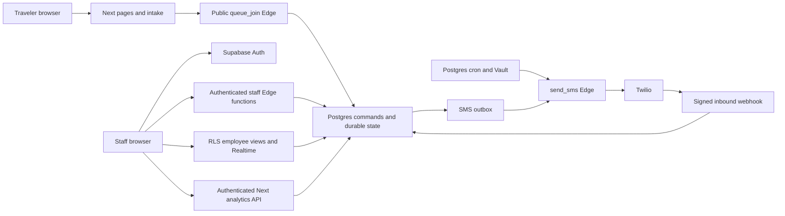

# Chiroport developer handoff audit

Audit date: **October 13, 2026, America/Chicago**. Intended transfer: **Wednesday evening, October 14, 2026**. Audited source: `d2fd20d95f6e99102dc61349fb8376a8d0b0a871` on `main`. Companion execution plan: [HANDOFF_PLAN.md](HANDOFF_PLAN.md).

This is an assessment, not an implementation or release. Only the two requested handoff documents were added to the checkout. No application, configuration, dependency, infrastructure, credential, migration, customer record, or live service was changed.

## Executive assessment

**The implementation is substantially prepared; independent operational ownership is not yet demonstrated.** This is a credible, tested production system with unusually useful transactional database boundaries, synthetic verification, race/failure regressions, and operational documentation. A rewrite or broad cleanup would reduce the time available for the actual handoff.

Three gates prevent an unconditional handoff today:

1. The successor's individual access, recovery permissions, secret custody and billing continuity have not been demonstrated.
2. The production backup API currently lists **zero backups and PITR disabled**. The documented logical recovery archive is retained privately on the original maintainer's laptop; independent custody and a production-equivalent restore remain unverified.
3. Reachable Git history contains a historically exposed **service-role credential for a different project**, with present ownership/revocation unresolved. This is not evidence that current Chiroport production is compromised, but it requires a security disposition before transferring unresolved credential responsibility or publishing additional material.

Important preparation beyond these gates is practical: prove an editable local development setup on the brother's computer, provide reliable incident detection, update the current-state documentation, verify a compatible recovery path, and assign tomorrow's announced framework security update.

**Current production metadata is aligned with current `main`.** The latest Vercel production deployment is READY at this source SHA, its aliases include both public domains, all eight Edge functions are ACTIVE, and the hosted ledger contains all **97** repository migration versions through `20261011000000`. The latest hosted CI passed the complete database/browser validation. The older release document's 96-migration baseline is historical, not an outstanding deployment mismatch.

The essential plan requires approximately **12–18 developer-hours**, plus **2 hours of contingency** and possible account/provider waiting. If historical-key rotation or complex restore repair is required, add a separately bounded **2–4+ hours**. The schedule spans today and tomorrow. “Excellent handoff” is conditional on demonstrated capabilities, not on finishing a document checklist.

## Evidence levels and inspection boundaries

- **Source verified:** implementation/configuration/history was inspected directly. A source consequence is distinguished from a reproduced runtime failure.
- **Executed locally:** safe commands ran in a sanitized temporary copy with no provider credentials or hosted database target.
- **Hosted verified:** read-only GitHub/Vercel/Supabase metadata was inspected on October 13. These checks did not create visits, send messages, invoke application mutation RPCs, or change account settings.
- **Historical record:** dated reports are useful evidence of earlier actions, not proof that ownership, backups or policy remained unchanged.
- **Unknown:** information requires account access, an owner decision, or a separate authorized experiment.

Coverage included the 329 tracked files by role/inventory, 74 `src` files, all eight Edge entrypoints and shared helpers, the 97 migration chain and current defining functions, operator/setup/recovery scripts, 36 test/fixture/helper files, CI/configuration, existing engineering/operations/audit documentation, relevant Git commits/branches/stashes, and configuration **names/existence only**. Binary assets were inventoried and their use inspected; no comprehensive asset-rights or publication-privacy certification is claimed. Large historical interview material was evaluated as secondary documentation, not treated as the current specification.

The user explicitly requested parallel investigation. Read-only investigators covered database/Edge/security, frontend/user journeys, and validation/history; the primary audit reconciled their findings with live metadata. No application changes were delegated. Historical reports were cross-checked rather than copied as current truth.

The initial working tree was clean. No root or nested repository `AGENTS.md` was found; the user's supplied surgical-edit rules govern this task. Existing local worktrees, branches and stashes were preserved. Secret-shaped text was processed privately; reports include only classifications and safe identifiers. The secret scan was a targeted shape/history check, not a complete forensic assurance.

## Verified mental model

### Purpose, users and feature map

Chiroport handles airport walk-in chiropractic/bodywork intake and queues. Travelers select an offering, provide required contact information and consent, and join a particular location. Staff authenticate, manage waiting/serving/history, correct visits, exchange SMS, and view queue state. Administrators additionally use operational analytics and privileged correction actions.

| Area | Start here | Authority / persistence |
| --- | --- | --- |
| Public airport/location navigation | `data/locationData.json`, `src/data/locationData.ts`, `src/features/locations/` | Build-time published location metadata |
| Intake wizard and validation | `src/features/location-details/LocationDetails.tsx:251`, `src/schemas/intake.ts`, `src/domain/services/catalog.ts` | Edge validation, canonical SQL offerings, customers/visits/consent |
| Staff workspace | `src/app/employee/[location]/page.tsx`, its `hooks/` and `components/` | Supabase Auth, employee profiles, three employee read views |
| Staff state changes | `hooks/useEntryActions.ts`, `supabase/functions/queue_entry_action/index.ts` | Transactional `staff_queue_entry_action` |
| Contact/service edits | `supabase/functions/update_queue_entry/index.ts` | `staff_edit_queue_entry` |
| Chat | `hooks/useChatData.ts`, `components/ChatPanel.tsx` | `sms_inbound`, `sms_outbox`, `staff_enqueue_message` |
| Delivery and inbound commands | `send_sms`, `twilio_webhook`, `supabase/functions/_shared/` | Durable claims/preferences/receipts; Twilio transport |
| Analytics | `src/app/api/analytics/route.ts`, `employee/analytics/dashboardModel.ts`, analytics page | Service-only SQL analytics; daily/monthly aggregates |
| Legal retention | `20260208000003_legal_visit_archive.sql` | Immutable visit/contact metadata independent of operational deletion |
| Operations/local verification | `docs/operations-runbook.md`, `scripts/local-verify.cjs` | Managed dashboards plus isolated synthetic checks |

### Runtime and trust boundaries

The web application is **Next.js 16.3.8 / React 19 / TypeScript**, using the App Router, Tailwind, Framer Motion, Zod and libphonenumber. Node is constrained to **22.x**; `.nvmrc` selects 22. The locked install is npm. Supabase provides Postgres, Auth, Realtime and separately deployed Deno Edge functions. Twilio is the SMS transport. Vercel serves the web deployment. No repository IaC or unified automatic web/Edge/database deployment workflow was found; GitHub Actions is a validation workflow.

The public join runs directly from the browser to Supabase Edge; it is not a Next API proxy. Public cancellation uses a bearer capability token via `cancel_visit_with_reason`; treat tokens as sensitive. Staff browser sessions persist and refresh through Supabase (`src/lib/supabase/client.ts:19`). Middleware supplies security headers, not authentication (`middleware.ts:3`). Actual authorization is in RLS, Edge identity/profile checks, and Next analytics access checks.

Gateway JWT verification is deliberately disabled for all eight functions (`supabase/config.toml:9`). Staff handlers validate identity and an open employee/admin profile before privileged commands (`_shared/employeeAuth.ts:12`); the worker authenticates its dedicated secret; Twilio requires a valid signature; public intake validates and rate-limits. Toggling gateway settings is not a substitute for preserving these boundaries. Staff access is currently **chain-wide**; a profile location is not tenant isolation. Hard delete is admin-only. Analytics verifies `getUser(token)` and an open admin role before service RPCs (`src/app/api/analytics/route.ts:359`).

Browser direct table mutations and unintended function execution are revoked in the hardened migration; the explicit privilege checker verifies effective grants and migration-owner default ACLs. Historical internal/public signatures coexist intentionally. Do not remove wrappers, overloads or endpoints on the strength of an unused-code search alone.

### End-to-end critical journeys

1. **Join:** static location -> service choice -> phone/email/consent validation -> `queue_join` -> `join_queue_with_offering`/locked internal join -> customer and active visit, joined event, legal/contact snapshot and confirmation outbox in the database transaction. Offering code determines classification and consent; clients do not own those derived rules. Active deduplication is per customer **per queue**, not global (`20260104000017_restore_unique_active_entry.sql:21`).
2. **Staff service/correction:** password login -> open employee profile -> database open locations/default queue -> waiting, serving and history views -> bearer Edge command -> locked transactional state/event/outbox mutation -> authoritative refresh/Realtime invalidation. Latest history transitions include history -> serving as well as return -> waiting (`20261011000000_staff_history_transitions.sql:59`). UI location remount/generation guards prevent old results acting on a new workspace. Three view reads are separate snapshots; recovery converges them.
3. **Cancellation:** public token or signed CANCEL receipt -> transactional customer cancel -> persisted departure reason/event and optional acknowledgement. Token retries retain the first result; new durable SMS receipt markers fence replay after staff return. Historical receipts and old callers have documented rollout limitations.
4. **Messaging:** queue transactions/manual enqueue commit durable rows -> immediate send optimization or minutely worker -> one-row claim/attempt fence/five-minute lease -> provider request with 20-second transport bound -> persisted acceptance or failure/retry. Confirmation-first dependency, opt-outs, queue/state eligibility and supersession guards apply. STOP/START receipts are durable and latest-recorded preference wins; callback receipt order is not guaranteed vendor-send order. `sent` means provider acceptance, not proved carrier delivery.
5. **Analytics/history:** browser bearer -> Next access checks -> primary analytics, dashboard scopes, workforce analytics, optional daily repeat share -> normalized payload -> pure `dashboardModel.ts` -> UI. Normal populated requests use **three RPCs filtered / four unfiltered**, independent of location count; early empty-date responses can return after one call. Hourly rollup catches prior local days, archives operational rows, deletes originals, and aggregates retained daily inputs into monthly history. A monthly rebuild is safe only with complete required retained daily inputs.

### Data lifecycle and configuration

Core entities include locations/queues, customers, employee profiles, canonical offerings/consent versions, active queue entries/events, operational visit archive, durable SMS outbox/inbound/opt-outs, daily/monthly analytics, anomaly records, rate buckets, and immutable legal visit rows linked to captured contact snapshots. Only the legal visit table has the mutation-blocking trigger; contact snapshots have no equivalent trigger and remain mutable by privileged operators, though browser writes are revoked. Generated database types live in `src/lib/supabase/database.types.ts`. Fresh migration replay and generated-type/effective-privilege checks are part of CI.

- Hourly rollup at minute 5 removes all visits whose **creation day** precedes the current location-local day, including waiting/serving visits. Cascading events/outbox disappear; inbound visit IDs become null. This is source-confirmed behavior, not a measured production incident.
- Operational archive defaults to 365 days; daily stats to 90 days. Monthly stats, immutable legal visit rows and captured contact history persist. No general purge of customers/inbound raw message payloads was found.
- Storage maintenance retains successful cron history seven days, failures 30 days, expired rate buckets with one-day grace, and ordinary daily vacuum. Existing maintenance already addressed a documented historical storage incident; do not repeat `VACUUM FULL` as routine maintenance.
- `env.template` describes public Next URL/anon configuration; server-only `SUPABASE_SECRET_KEY`; Edge `SUPABASE_URL`, anon/service-role keys; CORS; worker secret; Twilio account/signing/API/sender configuration; rate limits; optional health/Metabase settings.
- Supabase Vault **`project_url`** and **`send_sms_secret`** are independent operator dependencies; the latter must match Edge **`SEND_SMS_SECRET`** (`20260104000019_schedule_send_sms.sql:7`). Migrations warning about missing Vault values do not establish configuration health.
- Local `.env.local` and Supabase link state exist. Their values were withheld. Local names include legacy Waitwhile and unused feature flags with no current source consumers found. Their existence does not prove an active integration or production configuration.
- Metabase has a secured compatibility route/JWT builder and template settings, but no current frontend caller was found. Confirm external consumers before retiring it; do not make it a required local dependency by assumption.

## Current deployment and repository evidence

Read-only observations around **18:44 UTC / 13:44 CDT, October 13**:

| Resource | Verified observation | Limits |
| --- | --- | --- |
| GitHub | `zsikkink/chiroport` is public; remote `main` SHA matches checkout; authenticated connection has admin access | Brother's access was not checked |
| Release controls | `main` reports `protected:false`; repository ruleset list empty; push and PR CI triggers configured | No verified gate requiring CI completion before production publication |
| Issues/PRs | Repository search `repo:zsikkink/chiroport is:open` returned none | Does not capture private planning, closed items or local stashes |
| Web | Vercel project `chiroport`, team `zack-sikkinks-projects`; latest production `dpl_69tcsXidkEo9armRopYDg2ATdtm6` READY at `d2fd20d…` | Five latest production deployments inspected, not entire history |
| Aliases | Latest deployment includes `thechiroport.com`, `www.thechiroport.com` and project aliases | Registrar, renewal ownership and end-user journeys not tested |
| Database | Project `abxthfvmydedzajlcjlu`; ledger count 97, maximum `20261011000000`, staff-history migration present | Version inventory is not byte-level deployed SQL attestation |
| Worker | `send_sms_minutely` active; last successful cron completion `2026-10-13T18:44:00.305893Z` | A successful dispatch is not delivery or backlog health |
| Backups | Management API `backups` array empty; `pitr_enabled:false` | Provider-internal recovery promises and unlisted/manual archives not established |
| CI | [Current revision run 38203482217](https://github.com/zsikkink/chiroport/actions/runs/38203482217) successful | Hosted CI runs synthetic local services, not production workflows |

Live Edge metadata matched the October release versions: `queue_join` 28, `send_sms` 18, `twilio_webhook` 23, `advance_queue` 12, `set_serving` 15, `send_employee_message` 12, `update_queue_entry` 6, `queue_entry_action` 11. All ACTIVE with `verify_jwt:false`. Version identity alone does not attest source bytes; the release record provides historical execution evidence.

The October release used reviewed private execution wrappers, not byte-identical repository SQL, with temporary compatibility grants subsequently revoked (`docs/audits/chiroport-production-release-2026-10-11.md:44`). The private manifest and previous Edge artifacts must remain securely discoverable. Do not rewrite the migration ledger or edit canonical migrations to make the records appear identical.

Local `main` has no pre-existing uncommitted changes. Recent commits implement selector/dialog/history/error-preservation work with accompanying regressions. Older branches, six stashes, and three Cursor worktrees at `44518b3` remain historical work requiring disposition; clone does not transfer local stashes. No branch merge, stash application or cleanup was justified. No meaningful TODO/FIXME/HACK marker was found in runtime code; documented unresolved policies are the real unfinished work.

## Commands executed and actual outcomes

All validation writes were confined to disposable temporary outputs. Final checks used Node **22.22.0**, npm **10.9.4**, Deno **2.7.7**, and synthetic loopback configuration with no provider credentials. A first check inherited Node 23 through temporary-directory shell initialization; the final checks below superseded it under explicit Node 22.

Temporary evidence directory: `/var/folders/mm/q0qs8jc94078dcqfkyx6qjch0000gn/T/chiroport-handoff-check-30XS1e`. This is machine-specific audit evidence, not a future setup dependency.

| Command / procedure | Actual result | Interpretation |
| --- | --- | --- |
| `git status --short`, `git rev-parse HEAD`, branch/log/diff/worktree/stash inventory | Clean initial checkout; SHA above; 97 migration files | Existing work preserved |
| `rg --files`, targeted `rg -n`, `nl -ba`, `cat`, `sed`, line counts | Source/config/docs/history inspected | Read-only; initial inventory included harmless exit 2 for nonexistent queried directories |
| `npm ci --no-audit --no-fund` | Exit 0; 687 packages | Fresh locked dependency install; dev-chain deprecation warnings |
| `npm run check:env` in synthetic mode | Exit 0 | Valid provider-free local environment, not production readiness |
| `npm run type-check -- --incremental false` | Exit 0 | Current Next/application/test types pass |
| `npm run lint` | Exit 0 | Current lint passes |
| `npm test -- --runInBand` | Exit 0; 101 passed, **53 skipped**; 18 passed/10 skipped suites | Mock/pure/UI evidence; local database suites intentionally not executed |
| `npm run check:edge` with fresh Deno cache | Exit 0; eight entrypoints | Separate frozen-lock Edge types pass |
| `node --test scripts/clear-queues.test.cjs scripts/check-database-storage.test.cjs scripts/local-safety.test.cjs` | Exit 0; 47 passed, zero skipped | Operator safety/monitor evaluation fixtures pass |
| `npm run build` with synthetic loopback settings | Exit 0; Next 16.3.8 Turbopack, 21 static pages | Fresh compilation; not production provider/config validation |
| `npm audit --omit=dev --json` | Exit 0; zero reported vulnerabilities | Registry snapshot, not security assurance |
| `npm audit --json` | Exit 1; 42 findings: 35 high, seven moderate | Development dependency chains remain |
| `docker version --format '{{.Server.Version}}'` with 15-second bound | Timed out | Local Docker unavailable; no restart/cleanup attempted |
| `psql --version` | 18.2 | Client available; local database unavailable |
| `gh run list/view`, read-only branch/ruleset/job API queries | Current hosted CI successful, main unprotected, no rulesets | No pushes or workflow runs triggered |
| Current CI logs, captured internally and filtered to safe summaries | **154 Jest tests/28 suites, 47 operator checks, 15 browser tests passed**; generated types matched; privilege check 45 functions/one default ACL owner | Zero skipped hosted integration tests; October 12 ~04:25–04:26 UTC |
| Vercel team/project/deployment read tools | Current READY revision/aliases established | No deployments, environment-value reads or account changes |
| Supabase Management API read-only SQL endpoint | Ledger/cron metadata above | Aggregate metadata only; no customer reads or application mutation RPCs |
| Supabase GET backups/functions metadata | Backup/Edge observations above | Credentials stayed inside execution process and were not printed |
| Current tracked-tree secret-shape scan; 11 distinct historical `env.template` blobs | No current JWT/private-key/AWS/GitHub-token shape hits; one historical template blob contained two JWTs | Targeted scan; see HA-03; no secret values emitted |

**Not executed:** full local migration replay/upgrade, local database integration/type/grant/storage checks, local browser suite, synthetic restore drill. Docker prevented these. Current hosted CI establishes fresh replay/integration/build/browser confidence, but CI does not run the isolated runner's older-baseline upgrade and synthetic restore. The recorded September/October synthetic restore evidence remains historical.

Also not executed: production intake/staff mutation/SMS smoke, dependency credential validation, historical-token authentication attempts, production backup/export/restore, deployments/migrations, account invitations, monitoring activation, credential rotation, or data cleanup. These require later explicit authorization and suitable isolation.

## Prioritized findings register

Severity describes consequence; likelihood describes an unmitigated handoff risk, not a measured incident rate. Estimates include validation and are incremental; related documentation/walkthrough work is consolidated in the plan rather than added repeatedly.

| ID | Priority | Category | Title | Likelihood / severity | Plan |
| --- | --- | --- | --- | --- | --- |
| HA-01 | P0 | Operations/data | Recovery depends on original laptop; no listed backups/PITR | High / critical | A03 |
| HA-02 | P0 | Security/operations | Successor access and ownership unproved | High / critical | A01 |
| HA-03 | P0 verification gate | Security | Historical privileged credential disposition unresolved | Authority unknown / critical if live | A02 |
| HA-04 | P1 | Operations | Always-on workflow detection/routing unproved | High / high | A05 |
| HA-05 | P1 | Onboarding | Quick start is a disposable demo, not a complete daily dev recipe | High / moderate | A04 |
| HA-06 | P1 | Documentation | Current facts mixed with dated unresolved assessments | High / moderate | A06/A07 |
| HA-07 | P1 date-specific | Security/dependencies | October 14 framework security follow-up needs an owner | High / potentially high; impact pending | A08 |
| HA-08 | P1 process | Deployment | Direct-main publication lacks a verified prepublication CI gate | Medium / high | A07 |
| HA-09 | P1 warning | Security/onboarding | Employee sync resets passwords without target/confirmation guards | Medium / high | A06/B01 |
| HA-10 | P1 warning | Data/operations | Overnight rollup deletes unsettled operational work/evidence | High discovery risk / high | A06/B03/C03 |
| HA-11 | P1 preservation | Data/documentation | Original consent body depends on historical sources/backup | High / high | A03/A06/C04 |
| HA-12 | P1 interpretation | Testing | Green short checks can skip integration coverage | High / moderate | A04/A06 |
| HA-13 | P2 | Code quality | Analytics hides structured access/dependency errors | Medium / moderate | B02 |
| HA-14 | P2 | Code quality | Signed-in profile failures can appear as empty workspaces | Medium / moderate | C01 |
| HA-15 | P2 | Operations | Liveness endpoint can await database rate-limit I/O | Medium / moderate | A06/C02 |
| HA-16 | P2 | Data/product | Reporting/browser calendars differ near midnight | Medium / moderate | A06/C03 |
| HA-17 | P2 policy; P1 training | Operations | SMS acceptance, ambiguity and usefulness policy need explanation | High misunderstanding risk / high | A09/C05 |
| HA-18 | P2 | Data/product | Contact edits and queued destinations have different scope | Medium / high | A06/C04 |
| HA-19 | P2 | Dependencies | 42 tooling-chain advisories remain | Exposure dependent / moderate | C06 |
| HA-20 | P2 | Security/config | Generic env files are not ignored; obsolete config names persist | Medium / moderate | B01/C06 |
| HA-21 | P2 | History | Old branches/stashes/worktrees lack successor disposition | Medium / moderate | A06/C07 |
| HA-22 | P3 | Architecture | Large UI modules increase navigation effort | High / low | C08 |
| HA-23 | P2 | Testing | Synthetic restore command does not verify actor attribution | Certain coverage gap / moderate | A03/B05 |

### HA-01 — Recovery continuity

**Evidence:** current backup API above; release record `:67–71`; runbook `:119–123`. **Problem:** no demonstrated independently retrievable current backup, ongoing coverage or full-project restore path. The documented private pre-release archive includes public/Auth/migration data, not Vault, Storage objects or all external settings. **Impact:** data loss/outage can force contacting Zack or make recovery impossible. **Remediation:** transfer encrypted custody and private manifest, establish backup frequency/retention and RPO/RTO, verify restore permissions and perform a dispatcher-disabled isolated recovery. **Effort:** 3–5 hours for immediate custody/backup/rehearsal, more if restore incompatibilities emerge. **Acceptance:** brother retrieves and validates a recoverable archive/config inventory independently, demonstrates restoration/critical checks in isolation, and knows the recovered cutoff and replay hazards. An archive listing alone does not close recovery.

### HA-02 — Access and ownership

**Evidence:** runbook `:7–20`; current repo is personal/public and Vercel team belongs to Zack; brother identity/access unavailable. **Problem:** neither an accepted invitation nor MFA/recovery/billing/log access is established. **Impact:** code access does not supply deployment, incident or billing continuity. **Remediation:** individual accounts and appropriate roles across the matrix below; secure configuration custody and named backup operator. Avoid relying on shared personal logins. **Effort:** 1–2 hours plus invitation/provider delays. **Acceptance:** independent login/log/source/config/recovery access proven; primary and backup owner, recovery method and payer recorded without secrets. Resolve ownership before removing original access.

### HA-03 — Historical privileged key

**Evidence:** `docs/audits/chiroport-engineering-assessment.md:228`; historical `env.template` exposure introduced `c4477d7`, removed `88306d6`, reachable blob `316526dc246c980644539ee7a7f458f0651ff960`; safe history scan independently found two JWT literals. The earlier assessment classified service-role/anon keys for a project different from current production. **Problem:** removal does not prove revocation; no current provider authority was tested. **Impact:** if live, a privileged key can bypass that project's RLS; unknown ownership leaves a material security liability with the successor. **Remediation:** restricted ownership/revocation investigation; controlled rotation/consumer updates only if required and authorized. History rewriting neither revokes credentials nor belongs in this deadline by default. **Effort:** 0.5–1 hour verification; add 2–4+ hours if active rotation/consumer repair is needed. **Acceptance:** documented provider-backed revocation/replacement or a verified ownership/scope disposition with responsible operator; no secret copied into Git and no speculative authentication probe. Current Chiroport compromise is not asserted.

### HA-04 — Detection and routing

**Evidence:** monitor `scripts/check-database-storage.cjs:79–85,134–159`; runbook `:49`; storage execution report `:68–70`; latest release `:78,87`. **Problem:** workflow policy is opt-in; the documented watch needs Zack's Mac/app/Keychain. An always-on runner and actionable recipients are not established. **Impact:** cron/HTTP success can coexist with old/dead SMS or data anomalies and remain unnoticed. **Remediation:** reuse the read-only evaluator on an approved available runner, explicit thresholds, notifications and monitor-failure detection. **Effort:** 1.5–3 hours with existing runner; more for new infrastructure. **Acceptance:** healthy, aged-work, credential-failure and stopped-runner fixtures produce appropriate signals to brother and backup recipient while Zack's laptop is off. Production healthy-state checks alone do not prove alerting.

### HA-05 — Editable local development

**Evidence:** README `:50–69`; architecture `:184–199`; isolated runner `:149–154`. **Problem:** the demo runs `npm start` from a temporary copy and removes owned DB volumes on exit. Lower-level instructions omit the complete ordered persistent synthetic development recipe. **Impact:** a new maintainer can view the product yet cannot confidently start day-to-day edits/restarts. **Remediation:** test and document a uniquely owned local project, provider-free environment, disabled cron, staff seed, loopback Next dev and Edge services, ordinary restart and explicit reset. **Effort:** 1.5–2.5 hours including brother-machine test; download/install waiting separate. **Acceptance:** clean machine supports hot reload, synthetic intake/staff journey and preserved data across normal restart, then full isolated verification. macOS/Linux workflow is evidenced; native Windows behavior is unverified because the runner uses Unix sockets/process groups and `/dev/null`.

### HA-06 — Documentation accuracy and discovery

**Evidence:** runbook `:9–18,102`; architecture `:107,137,197,207`; engineering walkthrough `:9`. **Problem:** current hosting/CI still appears unverified in older present-tense sections; analytics call count omits workforce; command map/lifecycle omit latest history transitions; walkthrough names the removed “Latest settled day” control. More than 12,000 existing documentation/interview lines obscure the current entry point. **Impact:** brother may repeat completed hardening or follow wrong controls/definitions. **Remediation:** update README/architecture/runbook current facts and links, keeping dated audit claims intact; use these two handoff files for status/completion. **Effort:** 1–1.5 hours consolidated with warnings. **Acceptance:** one obvious reading path, truthful current metadata, correct flows/signatures and specific-day workaround; no seven-document duplication.

### HA-07 — Tomorrow's framework patch

**Evidence:** Next pinned 16.3.8; runbook `:129` assigns October 14 review to Zack. The [official October 8 announcement](https://nextjs.org/blog/upcoming-nextjs-security-update-october-2026), checked October 13, announces an October 14 update for upstream vulnerabilities; affected versions and upgrade instructions are pending. **Problem:** a time-sensitive task falls on the ownership-transfer day. **Impact:** a maintenance gap can leave an applicable security update unapplied. **Remediation:** assign owner/window; check official applicability when published; minimally update existing affected packages/lock and validate/release through the approved process. **Effort:** reserve 1–2 hours; applicability/complexity unknown. **Acceptance:** advisory applicability recorded and applicable patch verified/deployed or a specific owner-backed exception/escalation recorded. Zero advisories today does not discharge tomorrow's review; no version invented.

### HA-08 — Release and rollback control

**Evidence:** live branch/rulesets results; `.github/workflows/ci.yml:3`; latest Vercel production revisions; release record `:44–50,85`. **Problem:** push starts CI and can publish production; an enforced wait-for-green gate and demonstrated compatible rollback artifact are not verified. **Impact:** brother's first routine push could become an unreviewed release, and an old artifact may rely on revoked RPCs. **Remediation:** explicit selected-SHA manual release checklist first; verify integration settings, current DB/Edge/web compatibility, CI completion and recovery artifact. Do not mandate a workflow rewrite or PR policy to solve a one-day transfer. **Effort:** 0.5–1 hour inventory/dry run; actual release separately authorized. **Acceptance:** brother can explain publication trigger and demonstrate compatible preview/recovery procedure without undoing migrations/ACLs.

### HA-09 — Employee reset tool

**Evidence:** `scripts/sync-employees.cjs:34–37,83–89,115–140`. **Problem:** loads local credentials, reads plaintext passwords, resets existing Auth users and reopens profiles with no dry-run/target confirmation. **Impact:** a seemingly harmless seed command can affect real staff access. **Remediation:** immediate restricted-tool warning/use demo seed only; optional target/apply guards and no-write tests. **Effort:** 15 minutes within documentation; 1–2 hours guarded implementation. **Acceptance:** excluded from onboarding; future dry run never sends admin writes and remote apply requires explicit target/confirmation. No execution during this audit.

### HA-10 — Overnight cleanup

**Evidence:** `20260104000060_fix_rollup_runtime_errors.sql:548–555`; initial schema `:105–116`; inbound migration `20260827003000:3–5`; hourly schedule `20260104000030:374–386`. **Problem:** creation-day cleanup is not limited to terminal statuses; waiting/serving entries and associated pending SMS/events expire. **Impact:** apparent queue loss and disappearing incident evidence can surprise the successor. **Remediation:** explain and demonstrate current behavior; name policy owner before changing SQL. **Effort:** 15-minute warning; 0.5–1 hour synthetic fixture; 3–6 hours deferred behavior review. **Acceptance:** brother knows the local-midnight boundary and evidence-preservation procedure; a fixture verifies cascades and legal preservation. No hurried retention change recommended.

### HA-11 — Consent wording reconstruction

**Evidence:** legal archive migration `:20–30,64–78,116–143`; `20260428000001_simplify_queue_consent_text.sql:21–27`; release `:69`. **Problem:** immutable legal visit rows capture a contact-snapshot link/key/version/ID/time, not the exact consent/policy bodies; the current consent row was updated in place. Linked contact snapshots have no mutation-blocking trigger for privileged writes. **Impact:** current tables alone cannot reliably reproduce earlier displayed wording, and full contact immutability is not database-enforced. **Remediation:** preserve historical consent source/private pre-release archive; document limitations and prohibit further in-place historical wording/contact changes without preservation review. Defer schema design until owner requirements are known. **Effort:** 0.5 hour preservation/documentation shared with A03; 2–4 hours later design/tests. **Acceptance:** restricted custodian can retrieve earlier wording evidence; successor understands exactly which table is immutable. No legal sufficiency conclusion is made.

### HA-12 — Validation meaning

**Evidence:** `package.json:16–26`; `tests/helpers/supabase.ts:40–54`; today's 53 local skips. **Problem:** ordinary Jest and `verify` can pass without database tests; `verify` also omits grant/type/operator/storage/browser/upgrade/recovery checks. Existing runbook already warns correctly. **Impact:** successor might release under weaker evidence than intended. **Remediation:** a clear fast/full validation matrix and zero-skipped integration acceptance; reuse `verify:local` and CI. **Effort:** 15–30 minutes folded into A04/A06. **Acceptance:** brother explains each check's limits and supplies a complete runner result; no arbitrary blanket coverage target or new test framework.

### HA-13 — Analytics error envelope mismatch

**Evidence:** analytics page `:1955–1972`; API `:367–419,474–484`; reusable parser `src/lib/apiError.ts`. **Problem:** UI recognizes only string errors while API returns nested code/message envelopes. **Impact:** 401/403/503 become generic failures, slowing access/outage diagnosis. Source verified, not independently reproduced in this audit. **Remediation:** reuse existing parser and test nested/legacy errors. **Effort:** 0.5–1 hour. **Acceptance:** meaningful access/dependency messages survive; types/lint/targeted tests pass; public envelope unchanged.

### HA-14 — Profile lookup failure visibility

**Evidence:** presence hook `:30–35`; employee page `:580–638`; analytics page `:2038–2054,2368–2426`. **Problem:** valid session plus failed profile query clears profile/sets an error displayed only in the login branch. **Impact:** empty workspace can mask dependency/access failure. This is not a demonstrated RLS bypass. **Remediation:** explicit pending/retry/error state and stale-response handling at account change; synthetic failure tests. **Effort:** 1.5–3 hours. **Acceptance:** signed-in profile failure is visible and retryable; late results after logout/account switch do not resurrect workspace state.

### HA-15 — Health interpretation

**Evidence:** health route `:20–42`; server rate limiter `:34–65,92–97`. **Problem:** health awaits a rate-limit DB RPC before secret authorization when configured; RPC errors fail open, but latency can delay response and unauthorized calls can consume buckets. **Impact:** 200 is not dependency readiness, 429 is not process failure, and latency is not dependency-independent liveness. **Remediation:** immediate status/latency interpretation; later authenticate first and bound/decouple liveness I/O. **Effort:** 10-minute runbook correction; 0.75–1.5 hours later code/tests. **Acceptance:** monitor interprets 404/401/429/200 correctly and separate workflow monitoring supplies real dependency evidence.

### HA-16 — Calendar semantics

**Evidence:** analytics page `:56–96,2106–2109`; staff `utils.ts:127–135`; architecture `:117`; prior assessment `:232`. **Problem:** relative presets use browser calendar, database history location calendar; date memo does not tick merely because midnight passes. **Impact:** remote admin may omit a newer local day or see stale relative range. Earlier synthetic evidence reproduced the mismatch; production impact was not measured. **Remediation:** teach explicit location-local “Specific day” and refresh; decide location/chain reporting semantics before changing them. **Effort:** warning folded into docs; 2–4 hours policy/tests/fix. **Acceptance:** agreed frozen-time/multiple-zone behavior and tests; no silent redefinition of historical reports.

### HA-17 — SMS semantics and unresolved policies

**Evidence:** `_shared/outboxDelivery.ts:281–310`, `_shared/twilio.ts:75–96`, runbook `:66–72`. **Problem:** provider acceptance and DB persistence cannot be atomic; no delivery callback is supplied by the sender; maximum useful notification age remains undecided. **Impact:** blind replay can duplicate an accepted message; “sent” may be mistaken for received; a move during final provider I/O can send old context. **Remediation:** teach restricted provider reconciliation/no bulk requeue; name policy owner; defer callback/new semantics until requirements are settled. **Effort:** 20 minutes within walkthrough; 4–8 hours optional later callback work. **Acceptance:** successor handles accepted-but-not-persisted/lost-response cases without unsafe replay and distinguishes acceptance from delivery.

### HA-18 — Shared contact edits

**Evidence:** `20260827002000_atomic_queue_mutations.sql:83–87`; inbound association `20260827003000:61–65`; outbox captured recipient. **Problem:** an edit changes shared customer contact, while queued message destinations and originally captured contact snapshots remain unchanged by this command. **Impact:** another visit/current view or inbound matching can change while an old phone still receives queued work. Source and previous synthetic evidence establish semantics; current customer impact was not inspected. **Remediation:** operator caution plus explicit contact/retargeting policy; tests before changing it. **Effort:** 15-minute warning; 3–6 hours deferred decision/tests/fix. **Acceptance:** policy covers shared visits, queued/sending/sent rows, opt-out and legal history; schema/API changes require separate authorization.

### HA-19 — Tooling advisories

**Evidence:** current audit 35 high/seven moderate dev-chain entries, zero production-only entries; package dev dependencies. **Problem:** tooling exposure remains unresolved, but audit severities alone do not establish application exploitability. **Impact:** risky build/test operations or blind major upgrades can undermine maintainability. **Remediation:** classify reachability and controlled current-stack patch options; assign owner. **Effort:** 1–2 hours investigation, 2–6 hours scoped remediation later. **Acceptance:** advisory/version disposition and meaningful full validation, no `audit fix --force` or unsolicited framework replacement.

### HA-20 — Environment hygiene

**Evidence:** `.gitignore` ignores `.env*.local` but not generic `.env`; no current env file tracked; local names have unconsumed legacy settings; `scripts/check-env.cjs:40` checks more credentials than Next runtime `src/server/env.ts:49`. **Problem:** incomplete ignore protection and environment-role confusion invite copying hosted config into local setup or assuming obsolete flags are active. **Impact:** future accidental commit or incomplete operational configuration. **Remediation:** document scope/variable owners; optional generic env ignore protection; do not delete settings until external ownership known. **Effort:** 0.25–0.5 hour safeguards; 0.5–1 hour configuration inventory. **Acceptance:** local secrets cannot be casually staged, server/Edge/Vault/optional settings separated, production values kept in managed custody.

### HA-21 — Historical work disposition

**Evidence:** branch/worktree/stash inventory; clean `main`; historical audit branches and six stashes. **Problem:** relevant local-only intentions/artifacts cannot be established from branch names. **Impact:** successor may resurrect obsolete code or lose useful private evidence unavailable in clone. **Remediation:** owner marks relevant/abandoned/preserved items in current-work table; securely transfer needed private artifacts. **Effort:** 0.5–0.75 hour. **Acceptance:** `main` authority and every retained item disposition known; no deletion/reset/application needed before handoff.

### HA-22 — Large UI files

**Evidence:** analytics page 3,190 lines, staff page 1,218, intake component 582. **Problem:** navigation effort remains despite focused hooks and pure analytics model. **Impact:** moderate learning burden, with no demonstrated defect caused by file length. **Remediation:** feature/file map now; incremental extraction only when a later real change needs it. **Effort:** 0.25-hour navigation notes; extraction estimate only after bounded scope. **Acceptance:** brother locates feature authority rapidly; no deadline-driven broad refactor, rename or move.

### HA-23 — Restore actor-attribution coverage

**Evidence:** `scripts/test-local-recovery.cjs:61` passes `userId` as the third positional staff-command argument, which is target location, rather than fourth actor argument. **Problem:** serving/completion can pass with a null actor, and the drill asserts event counts without actor identity. **Impact:** synthetic recovery proves transitions, not restored staff audit attribution. It does not establish a production command defect. **Remediation:** A03 must use the correct named/four-argument contract and inspect actor fields; optional B05 corrects the existing drill and adds an attribution assertion. **Effort:** 0.25–0.5 hour. **Acceptance:** recovered commands use the restored user's actor ID, persisted events match it, and the isolated restore/conservation checks still pass; no schema or runtime API change.

## Handoff experience and documentation gaps

| New maintainer question | Current answer / gap | Minimum useful output |
| --- | --- | --- |
| What does it do / who uses it? | README accurately describes travelers/staff/admin | Preserve overview and synthetic captures |
| How does it work / where is each feature? | Architecture and feature map good; latest details stale | Correct invariant map, source trace above |
| How do I run it from a clean computer? | Isolated demo strong; daily development incomplete | Tested editable recipe on brother's machine |
| How do I obtain access/config? | Names exist, successor custody unknown | Individual logins and restricted inventory |
| How do I change/test safely? | Strong suite; skip/full distinctions easy to miss | Fast/full matrix and one harmless exercise |
| How do I deploy? | Runbook explains coordination; trigger gate unverified | Selected-SHA release/compatibility dry run |
| How do I know production is healthy? | Point-in-time CI/cron metadata, no proven routed workflow monitor | Always-on detection and notification proof |
| Where are logs / what when it breaks? | Useful incident tables | Brother independently locates web/Edge/Auth/cron/Twilio evidence |
| How do DB changes/backups work? | Append-only migrations/types/ACL checks; custody/recovery incomplete | Safe migration rehearsal and independently recoverable backup |
| What is weak/unfinished? | Distributed across older reports/policy notes | Stable findings/tasks and current disposition |
| Which accounts/payments keep it alive? | Service names known; payer/renewals unknown | Owner/recovery/billing matrix |
| Which architecture constraints matter? | SQL authority, chain-wide staff, durable SMS, permanent legal history | Walkthrough of tradeoffs/guardrails |
| How do I recover without Zack? | Not demonstrated | Restore/compatible artifact and successor-led incident exercise |

Recommend keeping a small documentation set: **README** as entry point; **system-architecture** for invariants, feature map and tested development recipe; **operations-runbook** for account/release/incident/recovery procedures; these **two handoff documents** for assessment, plan and completion evidence. The engineering walkthrough stays an optional practical reference. Dated audits/interview material remain historical and need an explicit precedence link, not deletion or wholesale rewriting. Seven new overlapping documents would add navigation cost.

## External access and operational dependencies

Each resource needs named primary/backup operator, individual login, least privilege appropriate to duties, MFA/recovery continuity, relevant logs, configuration custody and billing/renewal owner. Secret values, private backup paths/keys and customer details belong in restricted systems, not this public repository.

| Resource | Verified requirement | Requires owner/external verification |
| --- | --- | --- |
| GitHub / Actions | Public repository, private administrative rights, CI, direct-main integration | Brother write/admin/recovery rights; chosen release gate |
| Vercel | Project/team above, production aliases, build/runtime logs | Team invitation, role, environment scopes, deploy permissions, compatible recovery artifact, payer |
| Supabase | Production project, Postgres/Auth/Realtime/Edge, migration ledger/cron/Vault | Organization role, SQL/Auth/Edge logs, backup/restore rights, Auth configuration, billing and scoped monitor token |
| Twilio | Outgoing account + API key/secret + sender/Messaging Service; inbound signing auth token | Account/subaccount role, number ownership, webhook URL/retries, delivery logs, sender registration, billing/renewal |
| Domain/DNS/TLS | Two production aliases | Registrar/DNS provider, renewal/card/expiry notices and independent recovery |
| Monitoring | Existing read-only evaluator and local follow-up documented | Existing external coverage, always-on host, approved policy, recipients, failure notification |
| Secrets / backups / private manifest | Server, Edge, Vault and private release/archive evidence required | Shared encrypted custody independent of Zack's laptop, recovery/rotation operator |
| Public support channels | Policies reference company mailbox/phone | Mailbox/phone routing owner and support/escalation coverage |
| Metabase | Secured compatibility endpoint only | Whether externally used; if used, owner/dashboard/secret/billing |
| Historical credential's project | Different from recorded Chiroport project | Actual owner, current authority and revocation evidence |

## Existing strengths and remaining unknowns

Preserve strict TypeScript, generated contracts, committed npm/frozen Deno locks, canonical offerings, SQL transaction/locking authority, deny-by-default permissions, request/receipt idempotency, claim fencing, bounded provider transport, immutable legal metadata, location-generation/reconnect guards, pure analytics model and the current-stack tests. The isolated runner refuses occupied ports/remote Docker and owns its disposable volumes. Browser fixtures reject hosted URLs. Existing documentation candidly describes distributed delivery and recovery limitations. These are meaningful handoff assets.

Unknowns that source or this read-only audit cannot settle:

- Brother's account identities, supported OS and actual clean-machine success; invitation/billing/recovery ownership.
- Historical key's present authority/revocation; full secrets/publication assurance beyond the targeted scan.
- Fresh independently held backup, full-project restore cutoff/time, Storage usage/config coverage, RPO/RTO and emergency authorization.
- Existing always-on alerting and recipients, workflow thresholds, raw-log retention/redaction controls.
- Current Twilio sender/signature/webhook retry/carrier delivery configuration; no real message was sent.
- Compatible rollback artifact rehearsed against current 97-migration/ACL state; source-byte attestation beyond metadata/release evidence.
- October 14 advisory applicability, actual release version and migration-free patch complexity.
- Intended midnight handling, contact scope, maximum notification age, reporting calendar, long-term inbound/customer retention and legacy external consumers.
- Private release wrapper manifest, historical consent evidence and meaningful local stashes/worktrees successfully transferred.

No routine owner questionnaire was needed to complete the audit. The plan turns these remaining facts/decisions into specific access, recovery and competency gates. Until those gates pass, describe the handoff as **implementation-ready but operationally incomplete**.
