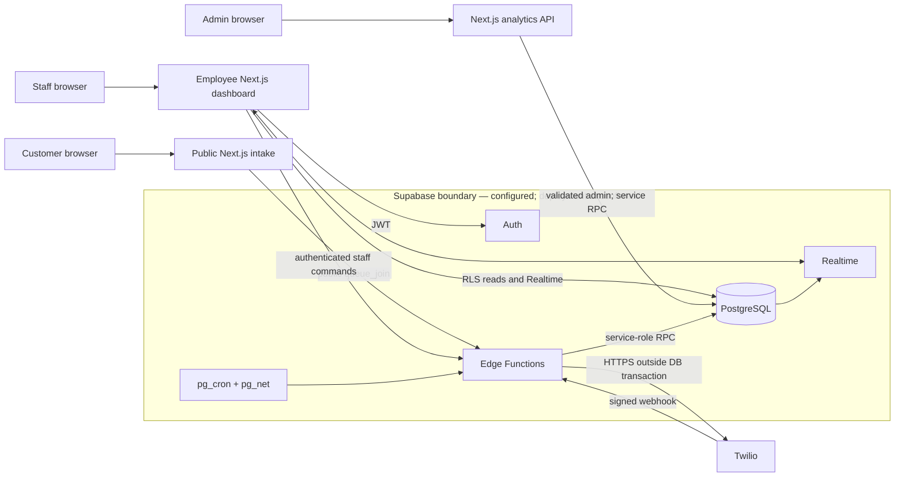
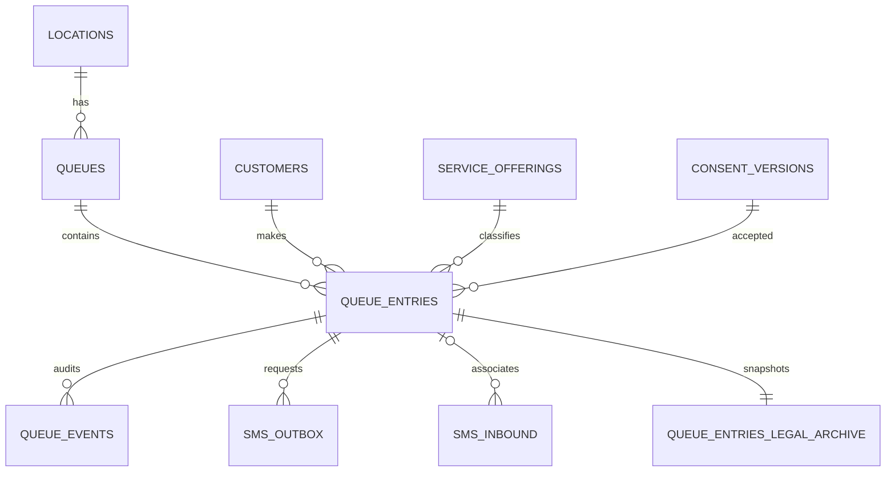
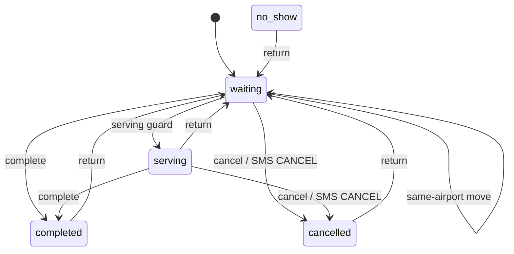

# How the current Chiroport system works

This is a defense of the inspected implementation, not a reconstruction of personal history. Unless labeled otherwise, citations describe the **uncommitted working tree** at commit baseline `e72465c…`; that distinction matters because several of the strongest security, analytics, SMS, and recovery changes are not in `HEAD`. Evidence IDs resolve in [evidence-and-gaps.md](evidence-and-gaps.md#claim-ledger).

## Business workflow and supported requirements

The supported workflow is: a traveler opens an airport/location route, chooses a service, enters name/phone/email, accepts consent, and joins. The service catalog maps a specific offering to either the paying or Priority Pass customer class ([`catalog.ts:1-27`](../../src/domain/services/catalog.ts)). Staff authenticate, choose a location, view waiting/serving/history lists, change state, move an entry within one airport, edit details, or send a message. Admins can view analytics and are the only role the active HTTP handler allows to delete a visit ([`queue_entry_action/index.ts:17-24,76-101`](../../supabase/functions/queue_entry_action/index.ts)).

This supports the repository-visible needs of self-service intake, a shared operational queue, customer notification, and timestamp-derived reporting. Why each requirement was originally prioritized, what the old SaaS contract guaranteed, and which current features were deployed during May 2025–March 2026 are **UNKNOWN**. The $550/month, 9-location/5-airport rollout, and 20,000+/113-per-day snapshot are **USER-PROVIDED**, not repository measurements.

Historically, the parent of commit `5864ce4…` routed check-ins to Waitwhile `/visits`, returned its queue position/estimated-wait fields, and offered a visit lookup. That baseline commit removed the Waitwhile routes/client while adding the Supabase/Twilio queue stack; no active Waitwhile reference remains in current executable source. This is evidence of a technical replacement, not of the subscription price, deployment date, notification parity, or net savings (`git show 5864ce4^:src/app/api/waitwhile/submit/route.ts:1-109`; `git show 5864ce4^:src/server/waitwhile-client.ts:39-152`).

## Architecture and boundaries



**Illustrates:** browser, application, database, managed-service, and provider boundaries. **Talk track:** the system is a modular monolith: Next.js UIs and one analytics route, Supabase Auth/Edge/Realtime/Postgres, and Twilio. Inspected browser paths use public/user credentials; server and Edge helpers hold the service role. **Evidence:** Edge configuration ([`config.toml:9-31`](../../supabase/config.toml)), staff authentication ([`employeeAuth.ts:12-40`](../../supabase/functions/_shared/employeeAuth.ts)), and Realtime publication migrations ([`enable_queue_entries_realtime.sql:3-20`](../../supabase/migrations/20260104000013_enable_queue_entries_realtime.sql), [`enable_sms_realtime.sql:3-29`](../../supabase/migrations/20260104000024_enable_sms_realtime.sql)). **Limitation:** the web host and actual deployed topology are not evidenced. “Supabase boundary” describes configured dependencies, not proof of deployment. [Raw Mermaid](01-system-context.mmd).

The browser uses public or user-scoped credentials. Public joining crosses an Edge boundary that validates and rate-limits, then uses a service-role database client. Staff mutations follow the same shape after verifying an Auth user and open employee profile. The admin analytics route validates a bearer token and an open `admin` profile before using its server-side client ([`analytics/route.ts:342-403`](../../src/app/api/analytics/route.ts)).

## One check-in end to end

```mermaid
sequenceDiagram
  actor C as Customer
  participant UI as Intake UI
  participant E as queue_join
  participant DB as PostgreSQL
  participant T as Twilio
  C->>UI: Service + contact + consent
  UI->>UI: Validate
  UI->>E: POST location and offering
  E->>E: Validate, normalize, rate-limit
  rect rgb(232,244,255)
    Note over E,DB: One RPC transaction
    E->>DB: join_queue_with_offering(...)
    DB->>DB: Resolve offering/consent/open queue
    DB->>DB: Lock queue + class allocation; upsert/reuse/insert
    DB->>DB: Insert event + confirmation outbox
    DB-->>E: Entry, token, initial position
  end
  Note over E,DB: Durable commit has occurred
  E->>T: Best-effort immediate send
  E-->>UI: Success response
  UI-->>C: Joined + initial position
```

**Illustrates:** validation, the durable transaction, and the external-effect boundary. **Talk track:** a failed Twilio call does not roll back a valid join because the outbox is already committed. **Evidence:** browser invocation ([`LocationDetails.tsx:231-329`](../../src/features/location-details/LocationDetails.tsx)); Edge validation/RPC/send ([`queue_join/index.ts:65-137,178-275`](../../supabase/functions/queue_join/index.ts)); transactional inserts ([`canonical_service_offerings.sql:174-303`](../../supabase/migrations/20260827001000_canonical_service_offerings.sql)). **Limitation:** the UI stores the returned capability token but no current public screen calls `get_visit` or `cancel_visit`; continuing public queue visibility is not evidenced. [Raw Mermaid](02-check-in-sequence.mmd).

In detail, client validation improves feedback, but the Edge Function repeats required validation, normalizes the phone to E.164, and applies fail-closed IP/phone rate limits. It resolves a canonical `offeringCode` and calls `join_queue_with_offering`. That function resolves an active offering and consent version, calls the lower join command, records a single `joined` event, creates one confirmation outbox row under a unique key, and returns the initial queue position. The success screen shows that position and promises an SMS ([`steps.tsx:6-40`](../../src/features/location-details/components/steps.tsx)).

**Decision—database-owned join.** Problem: separate browser writes could create duplicates or partially persist consent, entry, history, and notification intent. Mechanism: one privileged SQL command plus constraints/triggers. Guarantee: ordinary command failure rolls back its database work together; the partial unique index prevents two active entries for one customer in one queue ([`create_queue_schema.sql:151-153`](../../supabase/migrations/20260104000000_create_queue_schema.sql)). Non-guarantee: privileged maintenance/owner code can bypass the command, and a database commit is not a provider delivery. A plausible alternative is several server-side table writes; it is simpler SQL but exposes partial-commit and race handling to application code.

## Data model and invariants



**Illustrates:** core durable relationships; see the [full raw diagram](03-core-entities.mmd) for key fields. **Talk track:** `queue_entries` is authoritative visit state; views, positions, Realtime payloads, and analytics are derived. `queue_events` is an audit trail, while `sms_outbox` is durable external-work intent. **Evidence:** base schema ([`create_queue_schema.sql:33-163`](../../supabase/migrations/20260104000000_create_queue_schema.sql)) and canonical offering/history model ([`canonical_service_offerings.sql:3-141`](../../supabase/migrations/20260827001000_canonical_service_offerings.sql)). **Limitation:** the diagram omits rate-limit, rollup, retention, and chat-detail tables. It is not a full schema.

Authoritative state is the queue entry’s enum status, timestamps, class, offering, queue, and `sort_key`. Important database invariants include unique location/queue codes; unique normalized customer phone; unique public token; only one active entry per customer/queue; required `served_at` for serving/completed; required `completed_at` for completed; and consent time aligned to join creation ([`create_queue_schema.sql:33-103,151-153`](../../supabase/migrations/20260104000000_create_queue_schema.sql), [`security_and_rpc.sql:61-89`](../../supabase/migrations/20260104000002_security_and_rpc.sql)). An insert trigger snapshots contact and consent into an immutable legal archive ([`legal_visit_archive.sql:64-152`](../../supabase/migrations/20260208000003_legal_visit_archive.sql)).

One subtle model tradeoff is that `customers.phone_e164` is globally unique and a later join upserts the canonical name/email. That makes phone-based repeat classification and contact lookup simple, but a shared/reassigned phone is not identity and current contact fields are not a faithful historical snapshot. The legal archive addresses the audit half by capturing contact and consent at each join; it does not make the repeat metric person-level truth. This is also why an interview answer should say “visits” rather than “customers.”

Positions are derived, not stored counters. Paying has rank 0 and Priority Pass rank 1; then `sort_key`, creation time, and ID break ties ([`enforce_security_and_queue_ownership.sql:38-109`](../../supabase/migrations/20260827006000_enforce_security_and_queue_ownership.sql)). This supports deterministic staff views, but it does **not** prove the business policy’s original rationale or fairness under every desired rule.



**Illustrates:** common states and guards; [raw diagram](04-visit-state-machine.mmd) also shows moves/deletes and the dormant `no_show` command gap. **Talk track:** transition timestamps and events are written with state, not inferred later from UI actions. **Evidence:** [`staff_queue_entry_action:34-206`](../../supabase/migrations/20260104000044_staff_queue_entry_move_dedupe.sql). **Limitation:** `no_show` exists in the enum/read models, but no active Edge action exposes it; the diagram must not imply staff can currently set it.

A move is more than changing a foreign key. The command permits only an open target queue in the same airport, cancels another active entry for the same customer in that target, allocates a fresh class-specific `sort_key`, resets terminal/service timestamps, and records both cancellation and move events where applicable (`staff_queue_entry_action:111-192`). The useful guarantee is one active target-queue visit through the canonical path. It does not prevent a database owner from constructing inconsistent history, and reopening completed/cancelled entries deliberately changes later analytics interpretation.

## Queue ordering and concurrent staff actions

There are two allocation locks before the per-entry action lock discussed below. A join first selects its open queue row `FOR UPDATE`, so joins to the same queue serialize even across customer classes and a concurrent queue-closing write must wait. It then takes `pg_advisory_xact_lock(hashtext(queue_id || ':' || customer_type))` and locks the current maximum waiting row while computing max `sort_key` + 1 ([`enforce_security_and_queue_ownership.sql:192-219`](../../supabase/migrations/20260827006000_enforce_security_and_queue_ownership.sql)). The same advisory convention is used by `next_sort_key` for move/edit allocation, coordinating paths that do not hold that queue-row lock ([`next_sort_key_rpc.sql:3-32`](../../supabase/migrations/20260104000038_next_sort_key_rpc.sql)). Both lock types wait and release at transaction end. The advisory key is queue/class-scoped, but the **effective join scope is the whole queue** because that lock comes first. A hash collision can over-serialize unrelated keys, and privileged paths that ignore the convention remain bypasses.

For a staff action, `staff_queue_entry_action` locks the exact entry with `SELECT … FOR UPDATE`, rechecks its status, updates status/timestamps, inserts the audit event, and lets database triggers enqueue SMS/advance “next,” all before commit. Without the row lock/recheck, two requests could both observe `waiting` and both report success or create duplicate logical effects.

A conditional `UPDATE … WHERE status = 'waiting' RETURNING …` is a plausible simpler alternative for a single transition, while serializable transactions could reject broader anomalies. The former becomes awkward once a move, event, and outbox must agree; the latter requires deliberate retry handling. The implemented row lock makes the multi-step rule explicit, at the cost of wait time and possible contention on a hot entry.

```mermaid
sequenceDiagram
  participant A as Request A
  participant B as Request B
  participant DB as PostgreSQL
  A->>DB: action(entry, serving)
  DB->>DB: FOR UPDATE; status=waiting
  B->>DB: action(entry, serving)
  Note over B,DB: waits on the same row
  DB->>DB: A updates + event + outbox
  DB-->>A: commit
  DB->>DB: B resumes; status=serving
  DB-->>B: invalid transition; rollback
```

**Illustrates:** transaction boundaries and the losing request. **Talk track:** correctness comes from lock plus condition plus atomic writes—not the word “lock.” **Evidence:** [`staff_queue_entry_action.sql:34-110`](../../supabase/migrations/20260104000044_staff_queue_entry_move_dedupe.sql), trigger ([`messaging_pipeline.sql:68-115`](../../supabase/migrations/20260104000008_messaging_pipeline.sql)). PostgreSQL 17 documents that `FOR UPDATE` blocks competing writers/lockers and transaction advisory locks auto-release ([primary documentation](https://www.postgresql.org/docs/17/explicit-locking.html)). **Limitation:** a realistic local concurrency test exists ([`queue_concurrency.test.ts:7-56`](../../tests/queue_concurrency.test.ts)) but was **not run** during this inspection; service-role/owner maintenance remains a bypass. [Raw Mermaid](05-concurrent-actions.mmd).

The browser applies optimistic changes for responsiveness, but a failed command triggers an authoritative refetch ([`useEntryActions.ts:103-121`](../../src/app/employee/%5Blocation%5D/hooks/useEntryActions.ts)). That keeps correctness server-owned while accepting brief speculative UI state.

## Live updates and SMS

Staff live updates use Supabase Realtime over Postgres publications, filtered by `queue_id` for queue entries. Events update or fetch the appropriate view row. The SMS subscriptions are unfiltered, then reconcile only known entry IDs. On `CHANNEL_ERROR`, `TIMED_OUT`, or `CLOSED` after an initial subscription, the client marks recovery needed; the next `SUBSCRIBED` refreshes all three queue views and active chat ([`realtimeRecovery.ts:1-33`](../../src/app/employee/%5Blocation%5D/hooks/realtimeRecovery.ts), [`useRealtimeSubscriptions.ts:78-247`](../../src/app/employee/%5Blocation%5D/hooks/useRealtimeSubscriptions.ts)).

**Decision—push as invalidation, database as truth.** The mechanism gives low-latency UI while refetching on recognized reconnection and rejected optimistic actions. It does not guarantee a never-stale screen: no periodic polling was found, refresh can fail, and recovery depends on channel status transitions. An alternative is short polling, which is simpler to reason about but adds repeated reads and slower average updates. Public customers do not get this live mechanism in the current UI.

```mermaid
sequenceDiagram
  participant TX as Visit transaction
  participant O as sms_outbox
  participant W as Worker
  participant T as Twilio
  TX->>O: unique queued message
  TX-->>TX: commit state/event/outbox
  W->>O: claim due row SKIP LOCKED
  O-->>W: sending + attempt + lease
  W->>T: POST outside transaction
  alt rejected or throws
    W->>O: failed/retry; dead at attempt 8
  else accepted and persisted
    W->>O: sent + provider ID
  else accepted but response/write lost
    Note over W,T: ambiguous; later retry can duplicate
  end
```

**Illustrates:** the durable handoff and unavoidable provider boundary. **Talk track:** confirmation, next, serving, cancel acknowledgement, and staff messages become rows before sending. A minutely configured job and immediate paths claim work; `FOR UPDATE SKIP LOCKED`, a five-minute lease, and attempt fencing reduce two workers sending one claim ([`confirm_first_outbox_guard.sql:4-55`](../../supabase/migrations/20260104000045_confirm_first_outbox_guard.sql), [`outbox.ts:36-60`](../../supabase/functions/_shared/outbox.ts)). **Evidence:** retry state machine ([`outboxDelivery.ts:45-115,135-298`](../../supabase/functions/_shared/outboxDelivery.ts)); schedule ([`schedule_send_sms.sql:3-32`](../../supabase/migrations/20260104000019_schedule_send_sms.sql)). **Limitation:** schedule existence/configured secrets and real Twilio delivery were not verified. “Sent” means provider HTTP acceptance persisted, not carrier/handset delivery; no status callback was found. [Raw Mermaid](06-sms-effects.mmd).

The useful guarantee is durability through ordinary database-to-worker failures: if the app dies after commit, the row remains due; provider rejection/network errors back off from one minute up to one hour and become `dead` at attempt eight. Confirmation-first claiming prevents automated follow-ups until confirmation is locally `sent`. Current templates report people ahead, “next,” and serving readiness; no computed numeric wait estimate was found. The non-guarantee is exactly-once delivery. If Twilio accepts but the response times out, or accepts and the local `sent` write fails, the lease can expire and retry, producing a duplicate. The code logs the latter provider ID but has no evidenced durable ambiguity/reconciliation record. An alternative is provider-side idempotency or a reconciliation callback if supported; neither is implemented here.

Inbound webhooks verify Twilio signatures, persist the provider message ID uniquely, apply STOP/START preferences, and map CANCEL only when the phone has exactly one active visit ([`twilio_webhook/index.ts:127-224`](../../supabase/functions/twilio_webhook/index.ts), [`inbound_sms_visit_identity.sql:31-98`](../../supabase/migrations/20260827003000_inbound_sms_visit_identity.sql)). That deliberately refuses to guess when several active visits share a phone.

<a id="security-operations-analytics-and-limitations"></a>
## Security and privacy boundaries

The current hardening migration revokes browser writes and allowlists only public token capabilities plus service-role commands ([`enforce_security_and_queue_ownership.sql:3-36,485-559`](../../supabase/migrations/20260827006000_enforce_security_and_queue_ownership.sql)). RLS keeps public reads to open non-PII configuration; employee reads require an open profile. The random unique `public_token` is a bearer capability for visit status and waiting-only cancellation; no expiry or rotation was found ([`enforce_security_and_queue_ownership.sql:310-376`](../../supabase/migrations/20260827006000_enforce_security_and_queue_ownership.sql), [`atomic_queue_mutations.sql:270-310`](../../supabase/migrations/20260827002000_atomic_queue_mutations.sql)). Anyone who obtains it has that narrow capability, although the current public UI does not use it after join. However, policy comments and predicates explicitly provide **global employee access**, and `requireEmployee` does not enforce `employee_profiles.location_id`. This is chain-wide authorization, not multi-tenant or per-location isolation ([`security_and_rpc.sql:190-281`](../../supabase/migrations/20260104000002_security_and_rpc.sql)). Unfiltered staff SMS Realtime channels are therefore a data-minimization risk inside that trusted staff boundary, not evidence of public exposure.

## Testing, deployment, operations, and analytics evidence

Analytics uses terminal visit rows—completed, cancelled, or no-show—from current/archive history. “Arrivals” is that terminal set, completion/dropoff share the same denominator, wait is `served_at-created_at`, and hourly grouping converts timestamps to the location time zone ([`close_dfw_location.sql:76-215,248-284`](../../supabase/migrations/20260827000000_close_dfw_location.sql)). Repeat is a visit whose phone proxy has an earlier visit; it is not a verified person identity. Operational queue length and utilization integrate visit intervals against configured location hours ([`bounded_dashboard_analytics.sql:245-400`](../../supabase/migrations/20260827008000_bounded_dashboard_analytics.sql)). To avoid route-level fan-out, the dashboard uses two or three RPC calls rather than one query per location ([`analytics/route.ts:238-340`](../../src/app/api/analytics/route.ts)). That bounds round trips, not SQL cost or latency; per-location queries would be simpler but scale calls with the fleet. `queue_events` supports auditability, but these analytics derive primarily from visit state/timestamps; qualify the résumé’s “timestamped events” wording if it specifically meant the event table.

To reproduce the résumé snapshot safely, I would first freeze its date range, included locations/statuses, and definition of a day. On a sanitized historical export, I would count the chosen visit rows for the total, group by each visit’s location-local date, decide explicitly whether zero-visit open days belong in the series, and compute `percentile_disc(0.5)` over those daily counts. I would save the query, source version, and result together. Changing terminal-only versus all joins, active days versus calendar/open days, or local versus UTC dates can materially change both 20,000+ and the 113 median; no such reproducible artifact was found here.

Testing evidence is mixed. Current CI is configured to replay local migrations, disable cron, run type/lint/privilege/Jest/storage/build/Edge/E2E checks ([`.github/workflows/ci.yml:1-73`](../../.github/workflows/ci.yml)), but that file is uncommitted and no CI run was inspected. This task ran only 47 pure Node safety tests; no application/database/provider test. The liveness route explicitly does not check dependencies ([`health/route.ts:13-17,52-72`](../../src/app/api/health/route.ts)). No deployment job, infrastructure-as-code, rollback record, or monitoring-service configuration was found; absence here is not proof those practices never existed.

## Tradeoffs and remaining limitations

The strongest tradeoffs are: database-centric correctness with more SQL/migration complexity; fast optimistic/Realtime UI with bounded stale-state risk; durable retry without exactly-once SMS; and simple chain-wide staff operations with a wider privacy boundary. The highest-priority remaining limitations are unverified deployment of current hardening, no ongoing public queue view despite the returned token, ambiguous provider acceptance, and unused location-level staff scoping. These are technically modest, honest boundaries—not reasons to claim the system failed its intended small-operations scope.
